# Roadmap

Generated by `tools/orchestrate.py` from `docs/queue.json` – do not edit. Updated 2026-11-04 23:00. Policy: `docs/AUTONOMY.md`.

**Now:** nothing running · **Up next:** 1 packages · **Done:** 26 packages (67 items) · **Failed:** 0 · **Waiting for you:** 0 (`docs/OWNER-INBOX.md`) · **Deferred:** 23

## Board size

| Board | Parts | DNP | Unique fitted parts | Since the agents started |
|---|---|---|---|---|
| pdm-4ch | 210 | 15 | 61 | +43 parts, +15 DNP, +3 unique |
| pdm-hc2 | 225 | 11 | 68 | +56 parts, +11 DNP, +2 unique |

Every unique extended part costs a loading fee per order; DNP parts cost nothing but board space.

## Plan

```mermaid
flowchart LR
  T0064["T-0064 · shared<br/>Battery input bulk/HF caps and output s…"]:::done
  T0065["T-0065 · shared<br/>Shared supply, USB and fuse parts (buck…"]:::done
  T0066["T-0066 · shared<br/>Custom footprints in lib/ (TDSO-14 past…"]:::done
  T0067["T-0067 · shared<br/>CAN sheet: barrier Y-cap/CMC footprints…"]:::done
  T0068["T-0068 · shared<br/>Panel interface (analog_sw): debounce, …"]:::done
  T0069["T-0069 · pdm-4ch<br/>Channel sense resistor, DEN rule, popul…"]:::done
  T0070["T-0070 · pdm-hc2<br/>HC2 gate slew control (inrush, EMC edge…"]:::done
  T0071["T-0071 · pdm-hc2<br/>HC2 controller pin filtering (VS RC, CS…"]:::done
  T0072["T-0072 · shared<br/>HC2 breaker level, float-run OUT divide…"]:::done
  T0073["T-0073 · shared<br/>BOM LCSC codes and controller notes (VB…"]:::done
  T0078["T-0078 · shared<br/>U5 CA-IS3050G: TXD/RXD pin numbers 2/3 …"]:::done
  T0082["T-0082 · sync<br/>HC2 heat-budget RDS(on) at 150 C per BS…"]:::done
  T0084["T-0084 · sync<br/>HC2 heat-budget RDS(on) at 150 C - veri…"]:::done
  T0085["T-0085 · sync<br/>Sync the  For /system  lists"]:::done
  T0104["T-0104 · shared<br/>PTC interrupt rating: F1/F3/F4 100 A PT…"]:::done
  T0105["T-0105 · shared<br/>Panel switch loads R3/R4/R7/R8 -  2 k +…"]:::done
  T0106["T-0106 · pdm-hc2<br/>Short EMC gate slew, maximum load capac…"]:::done
  T0107["T-0107 · shared<br/>Extended-part fee levers: C18 -  C9196,…"]:::done
  T0108["T-0108 · shared<br/>README installation guidance (text only)"]:::done
  T0118["T-0118 · shared<br/>PTC interrupt rating: C70113 on F1-F4 p…"]:::done
  T0119["T-0119 · shared<br/>USB shield capacitor C18 to 1 nF/2 kV C…"]:::done
  T0120["T-0120 · pdm-4ch<br/>pdm-4ch VS-tab capacitors C104-C404 to …"]:::done
  T0121["T-0121 · pdm-4ch<br/>pdm-4ch reverse-battery blocking on VS …"]:::done
  T0132["T-0132 · pdm-4ch<br/>Q30 AGM601LL swap check (swap only if i…"]:::done
  T0137["T-0137 · pdm-4ch<br/>TVS across Q30 for negative transients …"]:::done
  T0141["T-0141 · sync<br/>Sync the  For /system  lists"]:::done
  T0143["T-0143 · pdm-4ch<br/>Fit SMDJ40CA across Q30, record the res…"]:::ready
  T0074["T-0074 · pdm-4ch<br/>re-check after its packages"]:::done
  T0075["T-0075 · pdm-hc2<br/>re-check after its packages"]:::done
  T0079["T-0079 · pdm-4ch<br/>re-check after its packages"]:::done
  T0080["T-0080 · pdm-hc2<br/>re-check after its packages"]:::done
  T0109["T-0109 · pdm-4ch<br/>re-check after its packages"]:::done
  T0110["T-0110 · pdm-hc2<br/>re-check after its packages"]:::done
  T0111["T-0111 · system<br/>re-check after its packages"]:::done
  T0112["T-0112 · system<br/>re-check after its packages"]:::done
  T0122["T-0122 · pdm-4ch<br/>re-check after its packages"]:::done
  T0123["T-0123 · pdm-hc2<br/>re-check after its packages"]:::done
  T0124["T-0124 · system<br/>re-check after its packages"]:::done
  T0125["T-0125 · system<br/>re-check after its packages"]:::done
  T0133["T-0133 · pdm-4ch<br/>re-check after its packages"]:::done
  T0134["T-0134 · system<br/>re-check after its packages"]:::done
  T0135["T-0135 · system<br/>re-check after its packages"]:::done
  T0138["T-0138 · pdm-4ch<br/>re-check after its packages"]:::done
  T0139["T-0139 · system<br/>re-check after its packages"]:::done
  T0140["T-0140 · system<br/>re-check after its packages"]:::done
  T0144["T-0144 · pdm-4ch<br/>re-check after its packages"]:::ready
  T0145["T-0145 · system<br/>re-check after its packages"]:::ready
  T0146["T-0146 · system<br/>re-check after its packages"]:::ready
  T0065 --> T0066
  T0065 --> T0067
  T0065 --> T0068
  T0064 --> T0069
  T0064 --> T0070
  T0070 --> T0071
  T0068 --> T0072
  T0071 --> T0072
  T0064 --> T0073
  T0065 --> T0073
  T0066 --> T0073
  T0067 --> T0073
  T0068 --> T0073
  T0104 --> T0105
  T0105 --> T0107
  T0106 --> T0107
  T0106 --> T0108
  T0118 --> T0119
  classDef done fill:#d8f0dc,stroke:#2e7d32
  classDef running fill:#d6e6ff,stroke:#1f5fbf
  classDef ready fill:#f2f2f2,stroke:#888
  classDef failed fill:#f9d9d9,stroke:#b3261e
```

Green done · blue running · grey waiting · red failed. Arrows: must finish first.

## Up next – what will change

### T-0143 · pdm-4ch · Fit SMDJ40CA across Q30, record the residual risk and the prototype check

Waiting.

- MINOR · A negative transient clamped by D30 at about -48.4 V while VS is charged puts about 77 V across Q30 (60 V rat… → your ruling: A: fit SMDJ40CA C42371557 (preferred, 0.22 USD) across Q30 (drain VS to source VBAT_FL). Accept VDS 59.4 V worst case and VS down to about -4 V only for the 31…

Planner's brief

Owner's ruling Q-0067, verbatim: "A: fit SMDJ40CA C42371557 (preferred, 0.22 USD) across Q30 (drain VS to source VBAT_FL). Accept VDS 59.4 V worst case and VS down to about -4 V only for the 31 A bounding spike; record this as a residual risk in design-notes 8.6 (C31 briefly reverse-biased) and add a prototype check of Q30 VDS and VS during a negative pulse."

The owner has chosen the part: do not search again or compare candidates. Background and all figures: docs/reviews/2026-11-04-fix-pdm-4ch-T-0137.md (points 2 and 3), docs/reviews/2026-11-04-plan-system-T-0142.md, docs/part-facts/C42371557.md. This supersedes stop (iii) of the T-0136 brief, which the ruling has answered.

In order:

1. Part check. Run python3 tools/part_facts.py C42371557 (cached) and confirm: bidirectional, VRWM 40 V, VBR 44.4-49.1 V, VC 64.5 V at 46.5 A, IR 2 uA, SMC/DO-214AB. Confirm the current JLCPCB status and stock (preferred, 10271 on 2026-11-04). Re-derive the figures once, 25 C worst tolerances: VDS = 49.1 V + 0.331 ohm x I gives 59.4 V at 31 A and 59.7 V at the 32 A of decision 92; VS floor = 44.4 V - (36.8 V + 0.374 ohm x I) gives -4.0 V at 31 A and 0 V at about 20.3 A.

2. Schematic: add one TVS with tools/ksch.py on the pdm-4ch root sheet: D31 (free; check again), value SMDJ40CA, LCSC C42371557, footprint Diode_SMD:D_SMC as D30, bidirectional symbol as D30, between net VS (Q30 pin 3, drain) and net /VBAT_FL (Q30 pin 2, source). No other connection changes. Run ERC and compare the netlist before and after with tools/sch_query.py pdm-4ch ref D31. Declared refs: D31 only. No shared sheet changes: this part of the root sheet exists only on pdm-4ch, and the controller part stays identical.

3. Heat: the TVS dissipates nothing in steady state, so the budget should not change. Confirm at 40 C with tools/heat_budget.py using the existing --r-path 0.00505 and the --mix case, as CLAUDE.md requires. Do not change its inputs.

4. design-notes 8.6, in this order:
(a) Part table: add D31 SMDJ40CA with its facts. Cost: +0.22 USD per board, one more unique preferred part, no loading fee.
(b) Correct 8.6 (b): 'VDS <= 48.4 V' holds only for a steady reversal with VS discharged. For a negative transient with VS charged, D31 clamps VDS.
(c) Correct 8.6 (c): the TVS is across Q30, not from VS to GND. The OUT->VS->Q30->D30 surge path stays and invariant 4 is unchanged.
(d) Add a residual-risk paragraph (safety, the owner's explicit acceptance, ruling Q-0067). State all of the following, because the ruling's short figures depend on them: C31 is briefly reverse-biased during such a spike and its datasheet gives no reverse rating (docs/part-facts/C487384.md), behaviour under -4 V is unverified. VS stays >= 0 V up to about 20.3 A and reaches about -4.0 V at 31 A (-2.4 V with the 0.75 ohm load); at 31 A VS crosses 0 V after about 170 us and stays negative until the spike ends (about 830 us of a 1 ms pulse). The 59.4 V figure is at 25 C and at a source short-circuit current of at most 31 A: with the TVS at 47 C VDS is about 60.4 V, slightly above Q30's 60 V 25 C minimum (Q30's own rating rises, about 63 V at 125 C), so Q30 may then take a small share in avalanche; a source tuned to 31 A at the D30 clamp stays under 60 V with SMDJ40CA only for Us >= about 334 V. Pulse rating margin about x5.3 at 25 C for a 31 A, 1 ms pulse, multiply by 0.6 for a TVS at 75 C. Textbook ISO 7637-2 pulse 1 (12-15 A, secondary sources): VDS 53.1-54.1 V, VS +2 V or above. Whether such spikes occur on a real bus is unverified (T-0130). All figures use the straight chord from VBR max to VC at Ipp, because the maker gives no VC at lower currents. Do not write that VS goes negative only at 31 A.
(e) List the other VS branches at -4 V: D2 blocks U3 and C1, D55 blocks the panel supply, D1 does not conduct, C103-C403 and C104-C404 are non-polar; U11-U14 and R60 as in T-0137. Check these against the netlist while writing.
(f) 'Reverse battery now': steady reversal <= 28 V: D31 does not conduct; leakage gives VS at most about -0.48 V into the R60 divider (upper bound, IR is specified at 40 V and 25 C only). Keep 'no time limit' only if this still holds. With VS charged at the moment of reversal, D31 conducts once until VS is at about VBR - 28 V (+16 to +21 V); VDS at most about 57 V. Above D30 VBR (about 33 V) D30 conducts and the battery fuse clears, as before.
(g) Failure modes: D31 short bypasses Q30 (no reverse protection, not visible in use, same as 'Q30 fails short'); D31 open returns to Q30 avalanche (T-0132 figures). The TVS's own failure mode is not in its datasheet: say so. Keep the competent-person review reminder: F4 feeds navigation lights and bilge forced run.
(h) PCB rule: D31 directly across the Q30 drain tab and source pins, short and wide.

5. README: T-0137 found its reverse-battery text still true (it describes a reversed battery, not spikes). Change it only if your wording in 4(f) makes it untrue.

6. hardware/pdm-4ch/STATUS.md: add the result at the top. Remove the 'Waiting for a run' line and mark the T-0137 entry as superseded. Add to the Prototype test list: 'T-0129 / Q-0067 - negative pulse on J10 with VS charged and the source short-circuit current within 31 A: scope Q30 VDS and VS (also VBAT_IN); expect VDS about 60 V or less and VS no lower than about -4 V; inspect C31 afterwards.' Add to the Pre-order checklist: check KiCad D_SMC against the JLCPCB footprint of C42371557 (hongjiacheng suggested land: pads 3.03 x 3.82 mm, gap at most 3.84 mm) and recheck its stock. Add the PCB rule to the layout list. Add to 'For /system': the ARCHITECTURE root row should name the TVS across Q30 (do not edit docs/ARCHITECTURE.md, it is out of this scope).

Checks: python3 tools/fix_check.py --scope pdm-4ch --refs D31; ERC no worse than before (pdm-4ch 0 errors, 5 warnings); parts +1, unique +1 on pdm-4ch, +0 on pdm-hc2.

Do not add the owner's ruling as a decision row: the planner has drafted it. The part is the owner's choice, so no auto decision is needed for it. Add nothing else: no second TVS, no series element, no change to C31, Q30 or D30, no extra footprint.

Not a stop: the 60.4 V warm figure and the 31 A source assumption. Both are already known, reported to the owner in this plan, and only need recording under 4(d).

Stop and ask (one-way door), with your numbers: (i) the part facts or your re-derivation differ from the ruling, so that VDS at 31 A and 25 C is at or above 60 V or VS falls clearly below about -4 V. (ii) C42371557 is no longer available, no longer preferred, or does not fit D_SMC without a new footprint decision: do not swap to another part. (iii) A part other than C31 turns out to be harmed by VS at about -4 V, because the ruling accepts the risk for C31 only. (iv) D31 conducts in normal operation or for a steady reversed battery <= 28 V. (v) The fix would need a change to an invariant or to the OUT->VS->Q30->D30 surge path.

## Done

| Package | Scope | What | Items | Board growth | Model | Cost | Merged |
|---|---|---|---|---|---|---|---|
| T-0064 | shared | Battery input bulk/HF caps and output surge protection (inv… | 4 | – | opus | 4.12 USD | `dbc672cd` |
| T-0065 | shared | Shared supply, USB and fuse parts (buck caps, USB shield/ES… | 6 | – | opus | 12.15 USD | `e5fedd96` |
| T-0066 | shared | Custom footprints in lib/ (TDSO-14 paste, LMR51610 -> SOT-2… | 2 | – | opus | 1.58 USD | `14b42e65` |
| T-0067 | shared | CAN sheet: barrier Y-cap/CMC footprints, TXD pull-up, CA-IS… | 5 | – | opus | 6.74 USD | `5ffcfb6f` |
| T-0068 | shared | Panel interface (analog_sw): debounce, switch-load resistor… | 6 | pdm-4ch +1 parts (+0 DNP), +1 unique, pdm-hc2 +1 parts (+0 DNP), +1 unique | opus | 2.66 USD | `86fbfe03` |
| T-0069 | pdm-4ch | Channel sense resistor, DEN rule, population rule | 4 | pdm-4ch +4 parts (+4 DNP), +0 unique | sonnet | 0.62 USD | `b9fcef31` |
| T-0070 | pdm-hc2 | HC2 gate slew control (inrush, EMC edges) | 4 | no part changes | opus | 1.65 USD | `c036d2a6` |
| T-0071 | pdm-hc2 | HC2 controller pin filtering (VS RC, CS/EN/OV/IWRN filters,… | 3 | pdm-hc2 +16 parts (+4 DNP), +0 unique | opus | 5.14 USD | `80bb3bd1` |
| T-0072 | shared | HC2 breaker level, float-run OUT divider, reverse-battery d… | 4 | – | opus | 3.99 USD | `c036d2a6` |
| T-0073 | shared | BOM LCSC codes and controller notes (VBAT full scale, IO3 s… | 6 | pdm-4ch +0 parts (+0 DNP), -4 unique, pdm-hc2 +0 parts (+0 DNP), -5 unique | opus | 1.13 USD | `1939dfbc` |
| T-0078 | shared | U5 CA-IS3050G: TXD/RXD pin numbers 2/3 swapped (both boards) | 1 | no part changes | opus | 0.51 USD | `d42065e2` |
| T-0082 | sync | HC2 heat-budget RDS(on) at 150 C per BSC030N08NS5 Diagram 9 | 1 | no part changes | opus | 0.24 USD | `24bf9f3b` |
| T-0084 | sync | HC2 heat-budget RDS(on) at 150 C - verify T-0082 sync and c… | 1 | no part changes | opus | 0.15 USD | `24bf9f3b` |
| T-0085 | sync | Sync the "For /system" lists | 0 | no part changes | opus | 0.71 USD |  |
| T-0104 | shared | PTC interrupt rating: F1/F3/F4 100 A PTC + series resistor,… | 1 | no part changes | opus | 3.21 USD | `3b24acd6` |
| T-0105 | shared | Panel switch loads R3/R4/R7/R8 -> 2 k + 2 k basic | 1 | pdm-4ch +4 parts (+0 DNP), +0 unique, pdm-hc2 +4 parts (+0 DNP), +0 unique | opus | 1.49 USD | `849fc1d6` |
| T-0106 | pdm-hc2 | Short EMC gate slew, maximum load capacitance, HC2 load gui… | 4 | pdm-hc2 +6 parts (+0 DNP), +0 unique | opus | 3.28 USD | `c036d2a6` |
| T-0107 | shared | Extended-part fee levers: C18 -> C9196, RIS -> 2 x C4410, 1… | 4 | pdm-4ch +4 parts (+0 DNP), +0 unique, pdm-hc2 +0 parts (+0 DNP), -1 unique | opus | 3.21 USD | `196bdd9c` |
| T-0108 | shared | README installation guidance (text only) | 1 | no part changes | opus | 0.25 USD | `c9bce1a7` |
| T-0118 | shared | PTC interrupt rating: C70113 on F1-F4 plus 0.2 ohm series r… | 1 | pdm-4ch +3 parts (+0 DNP), +0 unique, pdm-hc2 +3 parts (+0 DNP), +0 unique | opus | 1.81 USD | `3b24acd6` |
| T-0119 | shared | USB shield capacitor C18 to 1 nF/2 kV C9196 | 2 | pdm-4ch +0 parts (+0 DNP), -1 unique, pdm-hc2 +0 parts (+0 DNP), -1 unique | opus | 0.47 USD | `196bdd9c` |
| T-0120 | pdm-4ch | pdm-4ch VS-tab capacitors C104-C404 to 2.2 uF/100 V C170101 | 2 | pdm-4ch +0 parts (+0 DNP), -1 unique | opus | 0.41 USD | `70cdd9cf` |
| T-0121 | pdm-4ch | pdm-4ch reverse-battery blocking on VS in front of the bulk… | 1 | pdm-4ch +3 parts (+0 DNP), +2 unique | opus | 4.44 USD | `f1f3f88b` |
| T-0132 | pdm-4ch | Q30 AGM601LL swap check (swap only if it passes) and design… | 2 | no part changes | opus | 7.06 USD | `605f3305` |
| T-0137 | pdm-4ch | TVS across Q30 for negative transients with VS charged | 1 | no part changes | opus | 4.12 USD | `` |
| T-0141 | sync | Sync the "For /system" lists | 0 | no part changes | opus | 0.80 USD |  |

Undo a package: `python3 tools/orchestrate.py undo <item>` (any of its items).

## Deferred

**Until order** (12)

- Order 30 instead of 10 per run: -6.05 $/board (4-ch), -7.00 $/board (HC2); 10 instead of 5 saves -9.0/-9.8 $
- USB-C as DNP or pogo pads removes 3 extended fees and ~0.27 $ parts: -1.30 $/board at 10 (overlaps L3)
- How many pdm-4ch and pdm-hc2 boards per order (5, 10, 30)? This is the largest cost lever
- Is a fitted USB-C service connector required, or are pads/DNP plus OTA enough (L4)?
- TPS48110A stock is 989 and L1 1231, both single-source or thin; nothing is below 500
- 30 instead of 10 boards per order saves 6.38 USD (4-ch) / 7.12 USD (HC2) per board; 10 instead of 5 saves 9.4…
- Hand-soldering the four through-hole connectors removes 4 extended fees and the THT labour: 16.2 USD per orde…
- USB-C as service pads on later runs saves 3 extended fees and parts: 1.20 USD per board at 10
- A monthly JLCPCB assembly coupon may waive the 8.18 USD setup per order (conditions for 2 oz and Economic PCB…
- Should the first order use the free-assembly coupon (L6) or hand-soldered connectors (L3)?
- C13832 removal costs 0.162 USD per board against a 3.07 USD fee per order, so it pays only up to about 19 boa…
- C170101 instead of C13832 saves the loading fee only below about 14 boards per order; above that C13832 is ch…

**Until owner** (3)

- 52/59 unique parts cost 1.53 $ each only under Standard PCBA; merging package variants would save ~9 $ per or…
- Does JLCPCB accept 2 oz copper with Economic PCBA? If not, Standard PCBA adds +5.1 $ (4-ch) / +5.6 $ (HC2) pe…
- C30 swap to 2.2 uF C170101 adds about 0.054 USD per board on pdm-4ch with no fee saved, because C13832 stays …

**Until pcb** (3)

- One panel holding pdm-4ch + pdm-hc2 saves one setup, stencil, THT fee and 15 shared extended fees: -59.79 $/o…
- Is a combined 1:1 panel of pdm-4ch + pdm-hc2 acceptable (L2)?
- One panel for both designs saves 62.9 USD per order (3.15 USD per board at 10 + 10)

**Until prototype** (2)

- LMR51610YF (FPWM, same 1.1 MHz) would avoid PFM noise below 350 kHz; E7 asks for a scan first.
- LMR51610XDBVR (400 kHz, C20539658, 0.52 $) instead of the Y variant (1.35 $): -0.83 $/board; needs a re-desig…

**Until system-mechanical** (3)

- Board ground reaches the battery negative through one terminal pole that carries TVS surge current and, on HC…
- Fixed screw terminals instead of pluggable header + plug: about -1.0 $/board (the plug halves alone cost 1.20…
- Pluggable or fixed screw terminals (L5)?

