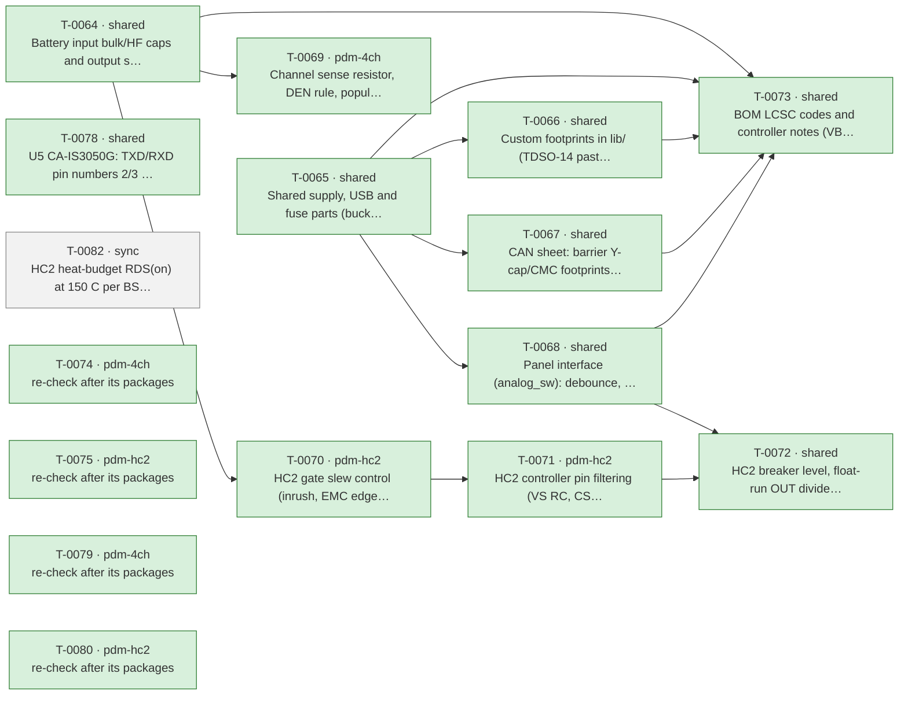

# Roadmap

Generated by `tools/orchestrate.py` from `docs/queue.json` – do not edit. Updated 2026-11-03 10:00. Policy: `docs/AUTONOMY.md`.

**Now:** nothing running · **Up next:** 1 packages · **Done:** 11 packages (45 items) · **Failed:** 0 · **Waiting for you:** 0 (`docs/OWNER-INBOX.md`) · **Deferred:** 13

## Board size

| Board | Parts | DNP | Unique fitted parts | Since the agents started |
|---|---|---|---|---|
| pdm-4ch | 196 | 15 | 61 | +29 parts, +15 DNP, +3 unique |
| pdm-hc2 | 212 | 11 | 70 | +43 parts, +11 DNP, +4 unique |

Every unique extended part costs a loading fee per order; DNP parts cost nothing but board space.

## Plan

Green done · blue running · grey waiting · red failed. Arrows: must finish first.

## Up next – what will change

### T-0082 · sync · HC2 heat-budget RDS(on) at 150 C per BSC030N08NS5 Diagram 9

Waiting.

- MINOR · RDS(on) at 150 C is 11.2 mOhm in the tool; BSC030N08NS5 Diagram 9 max (5.35 mOhm) gives 2 x 5.35 + 1 = 11.7 m… → agent decision: Set (0.0070, 0.0117) with the datasheet reference in a comment.

Planner's brief

Sync package (decision 71): no design change, no schematic or netlist change. 1) In tools/heat_budget.py set PARTS['HC-2xBSC030'] = (0.0070, 0.0117), with a comment citing the source: 'BSC030N08NS5 Rev 2.3 Diagram 9 (p. 8): max 3.0 mOhm at 25 C, ~5.35 mOhm at 150 C; path = 2 x FET + 1 mOhm shunt'. Change no other PARTS entry or default. 2) Run python3 tools/heat_budget.py --channels 2 --part HC-2xBSC030 --rth-ja 20 --r-box 0.9 --r-path 0.002 --currents 12.5,15,17.5,18,19.7,20 at 40 C. Expected values (validator H5 and T-0072 scratch copy): 15 A ~88 C, 17.5 A ~111 C, 18 A ~117 C, 19.7 A ~139 C, 20 A ~143 C. 3) In docs/design-notes.md section 4a, update the heat line under the parts table ('2 x 12.5 A -> Tj ~71 C; 2 x 15 A -> 87 C; 2 x 20 A -> 137 C') to the tool's new output, and add --r-path 0.002 to the quoted command if the numbers come from that run. In section 4a.2 you may replace 'scratch copy of tools/heat_budget.py with RDS(on)-path 11.7 mOhm' with the tool itself, with the same numbers. Keep the text 'Continuous rating ~15 A per channel'. 4) Gates: only tools/heat_budget.py and docs/design-notes.md change; netlists of both boards unchanged; ARCHITECTURE invariants untouched; the tool runs. Stop and ask (one-way door) if the rerun puts 15 A at or above ~100 C, or 19.7 A (upper IOC) at or above 150 C (Tj max, Table 2). Either would change the HC2 rating or the breaker setting (decisions 39 / T-0072).

## Done

| Package | Scope | What | Items | Board growth | Model | Cost | Merged |
|---|---|---|---|---|---|---|---|
| T-0064 | shared | Battery input bulk/HF caps and output surge protection (inv… | 4 | – | opus | 4.12 USD | `dbc672cd` |
| T-0065 | shared | Shared supply, USB and fuse parts (buck caps, USB shield/ES… | 6 | – | opus | 12.15 USD | `e5fedd96` |
| T-0066 | shared | Custom footprints in lib/ (TDSO-14 paste, LMR51610 -> SOT-2… | 2 | – | opus | 1.58 USD | `14b42e65` |
| T-0067 | shared | CAN sheet: barrier Y-cap/CMC footprints, TXD pull-up, CA-IS… | 5 | – | opus | 6.74 USD | `5ffcfb6f` |
| T-0068 | shared | Panel interface (analog_sw): debounce, switch-load resistor… | 6 | pdm-4ch +1 parts (+0 DNP), +1 unique, pdm-hc2 +1 parts (+0 DNP), +1 unique | opus | 2.66 USD | `86fbfe03` |
| T-0069 | pdm-4ch | Channel sense resistor, DEN rule, population rule | 4 | pdm-4ch +4 parts (+4 DNP), +0 unique | sonnet | 0.62 USD | `b9fcef31` |
| T-0070 | pdm-hc2 | HC2 gate slew control (inrush, EMC edges) | 4 | no part changes | opus | 1.65 USD | `` |
| T-0071 | pdm-hc2 | HC2 controller pin filtering (VS RC, CS/EN/OV/IWRN filters,… | 3 | pdm-hc2 +16 parts (+4 DNP), +0 unique | opus | 5.14 USD | `80bb3bd1` |
| T-0072 | shared | HC2 breaker level, float-run OUT divider, reverse-battery d… | 4 | – | opus | 3.99 USD | `901c6f45` |
| T-0073 | shared | BOM LCSC codes and controller notes (VBAT full scale, IO3 s… | 6 | pdm-4ch +0 parts (+0 DNP), -4 unique, pdm-hc2 +0 parts (+0 DNP), -5 unique | opus | 1.13 USD | `1939dfbc` |
| T-0078 | shared | U5 CA-IS3050G: TXD/RXD pin numbers 2/3 swapped (both boards) | 1 | no part changes | opus | 0.51 USD | `d42065e2` |

Undo a package: `python3 tools/orchestrate.py undo <item>` (any of its items).

## Deferred

**Until order** (4)

- Order 30 instead of 10 per run: -6.05 $/board (4-ch), -7.00 $/board (HC2); 10 instead of 5 saves -9.0/-9.8 $
- USB-C as DNP or pogo pads removes 3 extended fees and ~0.27 $ parts: -1.30 $/board at 10 (overlaps L3)
- How many pdm-4ch and pdm-hc2 boards per order (5, 10, 30)? This is the largest cost lever
- Is a fitted USB-C service connector required, or are pads/DNP plus OTA enough (L4)?

**Until owner** (2)

- 52/59 unique parts cost 1.53 $ each only under Standard PCBA; merging package variants would save ~9 $ per or…
- Does JLCPCB accept 2 oz copper with Economic PCBA? If not, Standard PCBA adds +5.1 $ (4-ch) / +5.6 $ (HC2) pe…

**Until pcb** (2)

- One panel holding pdm-4ch + pdm-hc2 saves one setup, stencil, THT fee and 15 shared extended fees: -59.79 $/o…
- Is a combined 1:1 panel of pdm-4ch + pdm-hc2 acceptable (L2)?

**Until prototype** (2)

- LMR51610YF (FPWM, same 1.1 MHz) would avoid PFM noise below 350 kHz; E7 asks for a scan first.
- LMR51610XDBVR (400 kHz, C20539658, 0.52 $) instead of the Y variant (1.35 $): -0.83 $/board; needs a re-desig…

**Until system-mechanical** (3)

- Board ground reaches the battery negative through one terminal pole that carries TVS surge current and, on HC…
- Fixed screw terminals instead of pluggable header + plug: about -1.0 $/board (the plug halves alone cost 1.20…
- Pluggable or fixed screw terminals (L5)?

