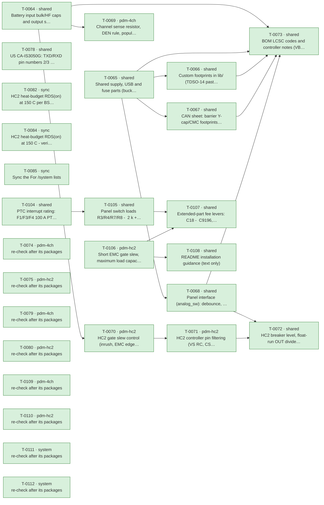

# Roadmap

Generated by `tools/orchestrate.py` from `docs/queue.json` – do not edit. Updated 2026-11-03 22:26. Policy: `docs/AUTONOMY.md`.

**Now:** nothing running · **Up next:** 0 packages · **Done:** 19 packages (58 items) · **Failed:** 0 · **Waiting for you:** 0 (`docs/OWNER-INBOX.md`) · **Deferred:** 16

## Board size

| Board | Parts | DNP | Unique fitted parts | Since the agents started |
|---|---|---|---|---|
| pdm-4ch | 204 | 15 | 61 | +37 parts, +15 DNP, +3 unique |
| pdm-hc2 | 222 | 11 | 69 | +53 parts, +11 DNP, +3 unique |

Every unique extended part costs a loading fee per order; DNP parts cost nothing but board space.

## Plan

Green done · blue running · grey waiting · red failed. Arrows: must finish first.

## Done

| Package | Scope | What | Items | Board growth | Model | Cost | Merged |
|---|---|---|---|---|---|---|---|
| T-0064 | shared | Battery input bulk/HF caps and output surge protection (inv… | 4 | – | opus | 4.12 USD | `dbc672cd` |
| T-0065 | shared | Shared supply, USB and fuse parts (buck caps, USB shield/ES… | 6 | – | opus | 12.15 USD | `e5fedd96` |
| T-0066 | shared | Custom footprints in lib/ (TDSO-14 paste, LMR51610 -> SOT-2… | 2 | – | opus | 1.58 USD | `14b42e65` |
| T-0067 | shared | CAN sheet: barrier Y-cap/CMC footprints, TXD pull-up, CA-IS… | 5 | – | opus | 6.74 USD | `5ffcfb6f` |
| T-0068 | shared | Panel interface (analog_sw): debounce, switch-load resistor… | 6 | pdm-4ch +1 parts (+0 DNP), +1 unique, pdm-hc2 +1 parts (+0 DNP), +1 unique | opus | 2.66 USD | `86fbfe03` |
| T-0069 | pdm-4ch | Channel sense resistor, DEN rule, population rule | 4 | pdm-4ch +4 parts (+4 DNP), +0 unique | sonnet | 0.62 USD | `b9fcef31` |
| T-0070 | pdm-hc2 | HC2 gate slew control (inrush, EMC edges) | 4 | no part changes | opus | 1.65 USD | `c036d2a6` |
| T-0071 | pdm-hc2 | HC2 controller pin filtering (VS RC, CS/EN/OV/IWRN filters,… | 3 | pdm-hc2 +16 parts (+4 DNP), +0 unique | opus | 5.14 USD | `80bb3bd1` |
| T-0072 | shared | HC2 breaker level, float-run OUT divider, reverse-battery d… | 4 | – | opus | 3.99 USD | `c036d2a6` |
| T-0073 | shared | BOM LCSC codes and controller notes (VBAT full scale, IO3 s… | 6 | pdm-4ch +0 parts (+0 DNP), -4 unique, pdm-hc2 +0 parts (+0 DNP), -5 unique | opus | 1.13 USD | `1939dfbc` |
| T-0078 | shared | U5 CA-IS3050G: TXD/RXD pin numbers 2/3 swapped (both boards) | 1 | no part changes | opus | 0.51 USD | `d42065e2` |
| T-0082 | sync | HC2 heat-budget RDS(on) at 150 C per BSC030N08NS5 Diagram 9 | 1 | no part changes | opus | 0.24 USD | `24bf9f3b` |
| T-0084 | sync | HC2 heat-budget RDS(on) at 150 C - verify T-0082 sync and c… | 1 | no part changes | opus | 0.15 USD | `24bf9f3b` |
| T-0085 | sync | Sync the "For /system" lists | 0 | no part changes | opus | 0.71 USD |  |
| T-0104 | shared | PTC interrupt rating: F1/F3/F4 100 A PTC + series resistor,… | 1 | no part changes | opus | 3.21 USD | `` |
| T-0105 | shared | Panel switch loads R3/R4/R7/R8 -> 2 k + 2 k basic | 1 | pdm-4ch +4 parts (+0 DNP), +0 unique, pdm-hc2 +4 parts (+0 DNP), +0 unique | opus | 1.49 USD | `849fc1d6` |
| T-0106 | pdm-hc2 | Short EMC gate slew, maximum load capacitance, HC2 load gui… | 4 | pdm-hc2 +6 parts (+0 DNP), +0 unique | opus | 3.28 USD | `c036d2a6` |
| T-0107 | shared | Extended-part fee levers: C18 -> C9196, RIS -> 2 x C4410, 1… | 4 | pdm-4ch +4 parts (+0 DNP), +0 unique, pdm-hc2 +0 parts (+0 DNP), -1 unique | opus | 3.21 USD | `` |
| T-0108 | shared | README installation guidance (text only) | 1 | no part changes | opus | 0.25 USD | `c9bce1a7` |

Undo a package: `python3 tools/orchestrate.py undo <item>` (any of its items).

## Deferred

**Until order** (6)

- Order 30 instead of 10 per run: -6.05 $/board (4-ch), -7.00 $/board (HC2); 10 instead of 5 saves -9.0/-9.8 $
- USB-C as DNP or pogo pads removes 3 extended fees and ~0.27 $ parts: -1.30 $/board at 10 (overlaps L3)
- How many pdm-4ch and pdm-hc2 boards per order (5, 10, 30)? This is the largest cost lever
- Is a fitted USB-C service connector required, or are pads/DNP plus OTA enough (L4)?
- TPS48110A stock is 989 and L1 1231, both single-source or thin; nothing is below 500
- C13832 removal costs 0.162 USD per board against a 3.07 USD fee per order, so it pays only up to about 19 boa…

**Until owner** (3)

- 52/59 unique parts cost 1.53 $ each only under Standard PCBA; merging package variants would save ~9 $ per or…
- Does JLCPCB accept 2 oz copper with Economic PCBA? If not, Standard PCBA adds +5.1 $ (4-ch) / +5.6 $ (HC2) pe…
- C30 swap to 2.2 uF C170101 adds about 0.054 USD per board on pdm-4ch with no fee saved, because C13832 stays …

**Until pcb** (2)

- One panel holding pdm-4ch + pdm-hc2 saves one setup, stencil, THT fee and 15 shared extended fees: -59.79 $/o…
- Is a combined 1:1 panel of pdm-4ch + pdm-hc2 acceptable (L2)?

**Until prototype** (2)

- LMR51610YF (FPWM, same 1.1 MHz) would avoid PFM noise below 350 kHz; E7 asks for a scan first.
- LMR51610XDBVR (400 kHz, C20539658, 0.52 $) instead of the Y variant (1.35 $): -0.83 $/board; needs a re-desig…

**Until system-mechanical** (3)

- Board ground reaches the battery negative through one terminal pole that carries TVS surge current and, on HC…
- Fixed screw terminals instead of pluggable header + plug: about -1.0 $/board (the plug halves alone cost 1.20…
- Pluggable or fixed screw terminals (L5)?

