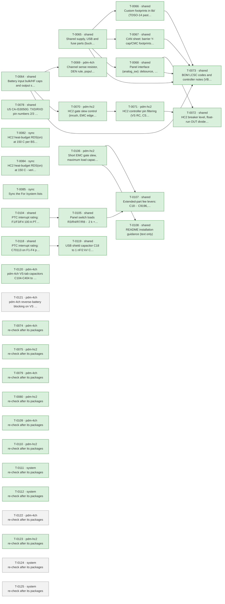

# Roadmap

Generated by `tools/orchestrate.py` from `docs/queue.json` – do not edit. Updated 2026-11-03 22:43. Policy: `docs/AUTONOMY.md`.

**Now:** nothing running · **Up next:** 1 packages · **Done:** 22 packages (63 items) · **Failed:** 0 · **Waiting for you:** 0 (`docs/OWNER-INBOX.md`) · **Deferred:** 22

## Board size

| Board | Parts | DNP | Unique fitted parts | Since the agents started |
|---|---|---|---|---|
| pdm-4ch | 207 | 15 | 59 | +40 parts, +15 DNP, +1 unique |
| pdm-hc2 | 225 | 11 | 68 | +56 parts, +11 DNP, +2 unique |

Every unique extended part costs a loading fee per order; DNP parts cost nothing but board space.

## Plan

Green done · blue running · grey waiting · red failed. Arrows: must finish first.

## Up next – what will change

### T-0121 · pdm-4ch · pdm-4ch reverse-battery blocking on VS in front of the bulk capacitor

Waiting.

- MAJOR · The VS bulk capacitors are polarised aluminium electrolytics with no reverse rating in their datasheet and no… → your ruling: Add reverse blocking now, this revision: a reverse-blocking element (P-FET or ideal-diode controller) on VS in front of the bulk capacitors on pdm-4ch, sized f…

Planner's brief

Owner ruling Q-0054 (verbatim): "Add reverse blocking now, this revision: a reverse-blocking element (P-FET or ideal-diode controller) on VS in front of the bulk capacitors on pdm-4ch, sized for the 40-50 A path and checked with the heat budget at 40 C. Until it is in, limit the README/design-notes claim to the BTT6050 and warn that C31 is not reverse-rated. Still key J10 (decision 34)." Finding: EMC E16 in docs/reviews/2026-11-03-emc-system.md. pdm-4ch only: HC2 keeps decision 40, and C106/C206 are not in scope. Steps in order. (1) Interim text first, so it stands even if a later step stops: README line 47 and design-notes section 8 (T-0050 paragraph). The reversal survival applies to the BTT6050 switches only; C31 (C487384, polarised electrolytic) is not reverse-rated and can overheat and vent. (2) Topology. Put the element between the VBAT_IN/JP30-FL30 side and VS, as a new intermediate net. D30 and C30 stay on VBAT_IN at J10. Everything on VS (C31, C104-C404, U11-U14, F1, F4, R60) sits behind it. Requirements: (a) It works without the ESP32 and without 3.3 V (invariant 1; the panel switch supply F4 hangs on VS). (b) Invariant 3: Vds >= 60 V for the 48.4 V D30 clamp, and Vgs protected (zener) where the gate sees the battery. (c) Invariant 4: positive PROFET output surges must still reach D30 (OUT -> body diode -> VS -> D30). A P-FET fully on with its gate to GND conducts both ways and keeps this path. An ideal-diode controller that blocks VS -> VBAT_IN breaks it. (d) Keep the turn-on into C31 + C104-C404 inside the FET's SOA. (3) Part. Prefer JLCPCB basic/preferred, then a part already on a BOM, else one extended part; the ruling requires the function. Check every limit with tools/part_facts.py: Vds, Vgs max, Rds(on) at the hot Tj, Id, SOA, RthJA/case and the package drawing for the footprint. Check stock. (4) Heat at 40 C. tools/heat_budget.py with the blocker's hot Rds(on) added to --r-path (or its I^2R loss added to --p-other). Cases: the standard 4 x BTT6050 at 4 A, the --mix BTT6010 case, and the blocker's own Tj at the 40 A input-terminal current. The 4 A (BTT6050) and about 8 A (BTT6010) channel ratings must stand. (5) ERC and netlist. tools/fix_check.py --scope pdm-4ch --refs with every new or changed ref (the parts on the old VS-JP30 node move to the new net). (6) Documents. README and design-notes section 8: the new reverse-battery behaviour (up to the voltage the part allows), and still check the polarity. Failure-mode note: a short-failed blocker means no reverse protection, as today; an open-failed blocker means a dead board, panel switches included (nav lights, bilge forced run; the float circuit stays independent, invariant 8). Remind the owner that a competent person reviews it before installation. pdm-4ch STATUS 'For /system': the ARCHITECTURE root row must mention the pdm-4ch blocker (sync sweep); J10 keyed/polarised on pdm-4ch too (decision 34, /system mechanical); the supply-path budget figure if it changes. PCB rules: copper width for 40 A and heat sinking. STOP and ask (one-way) if: (i) no available part meets 40 A at 40 C inside the heat budget, or the BTT6050 4 A / BTT6010 about 8 A rating would fall; (ii) the chosen topology needs a TVS on VS or other new wording of invariant 4 (no invariant edits); (iii) the path breaks the ARCHITECTURE budget 'shared supply path <= 2 mOhm' and the heat budget does not show that it is harmless; (iv) a part's facts cannot be verified. In each stop case keep step (1) and report the candidate parts.

## Done

| Package | Scope | What | Items | Board growth | Model | Cost | Merged |
|---|---|---|---|---|---|---|---|
| T-0064 | shared | Battery input bulk/HF caps and output surge protection (inv… | 4 | – | opus | 4.12 USD | `dbc672cd` |
| T-0065 | shared | Shared supply, USB and fuse parts (buck caps, USB shield/ES… | 6 | – | opus | 12.15 USD | `e5fedd96` |
| T-0066 | shared | Custom footprints in lib/ (TDSO-14 paste, LMR51610 -> SOT-2… | 2 | – | opus | 1.58 USD | `14b42e65` |
| T-0067 | shared | CAN sheet: barrier Y-cap/CMC footprints, TXD pull-up, CA-IS… | 5 | – | opus | 6.74 USD | `5ffcfb6f` |
| T-0068 | shared | Panel interface (analog_sw): debounce, switch-load resistor… | 6 | pdm-4ch +1 parts (+0 DNP), +1 unique, pdm-hc2 +1 parts (+0 DNP), +1 unique | opus | 2.66 USD | `86fbfe03` |
| T-0069 | pdm-4ch | Channel sense resistor, DEN rule, population rule | 4 | pdm-4ch +4 parts (+4 DNP), +0 unique | sonnet | 0.62 USD | `b9fcef31` |
| T-0070 | pdm-hc2 | HC2 gate slew control (inrush, EMC edges) | 4 | no part changes | opus | 1.65 USD | `c036d2a6` |
| T-0071 | pdm-hc2 | HC2 controller pin filtering (VS RC, CS/EN/OV/IWRN filters,… | 3 | pdm-hc2 +16 parts (+4 DNP), +0 unique | opus | 5.14 USD | `80bb3bd1` |
| T-0072 | shared | HC2 breaker level, float-run OUT divider, reverse-battery d… | 4 | – | opus | 3.99 USD | `c036d2a6` |
| T-0073 | shared | BOM LCSC codes and controller notes (VBAT full scale, IO3 s… | 6 | pdm-4ch +0 parts (+0 DNP), -4 unique, pdm-hc2 +0 parts (+0 DNP), -5 unique | opus | 1.13 USD | `1939dfbc` |
| T-0078 | shared | U5 CA-IS3050G: TXD/RXD pin numbers 2/3 swapped (both boards) | 1 | no part changes | opus | 0.51 USD | `d42065e2` |
| T-0082 | sync | HC2 heat-budget RDS(on) at 150 C per BSC030N08NS5 Diagram 9 | 1 | no part changes | opus | 0.24 USD | `24bf9f3b` |
| T-0084 | sync | HC2 heat-budget RDS(on) at 150 C - verify T-0082 sync and c… | 1 | no part changes | opus | 0.15 USD | `24bf9f3b` |
| T-0085 | sync | Sync the "For /system" lists | 0 | no part changes | opus | 0.71 USD |  |
| T-0104 | shared | PTC interrupt rating: F1/F3/F4 100 A PTC + series resistor,… | 1 | no part changes | opus | 3.21 USD | `3b24acd6` |
| T-0105 | shared | Panel switch loads R3/R4/R7/R8 -> 2 k + 2 k basic | 1 | pdm-4ch +4 parts (+0 DNP), +0 unique, pdm-hc2 +4 parts (+0 DNP), +0 unique | opus | 1.49 USD | `849fc1d6` |
| T-0106 | pdm-hc2 | Short EMC gate slew, maximum load capacitance, HC2 load gui… | 4 | pdm-hc2 +6 parts (+0 DNP), +0 unique | opus | 3.28 USD | `c036d2a6` |
| T-0107 | shared | Extended-part fee levers: C18 -> C9196, RIS -> 2 x C4410, 1… | 4 | pdm-4ch +4 parts (+0 DNP), +0 unique, pdm-hc2 +0 parts (+0 DNP), -1 unique | opus | 3.21 USD | `196bdd9c` |
| T-0108 | shared | README installation guidance (text only) | 1 | no part changes | opus | 0.25 USD | `c9bce1a7` |
| T-0118 | shared | PTC interrupt rating: C70113 on F1-F4 plus 0.2 ohm series r… | 1 | pdm-4ch +3 parts (+0 DNP), +0 unique, pdm-hc2 +3 parts (+0 DNP), +0 unique | opus | 1.81 USD | `3b24acd6` |
| T-0119 | shared | USB shield capacitor C18 to 1 nF/2 kV C9196 | 2 | pdm-4ch +0 parts (+0 DNP), -1 unique, pdm-hc2 +0 parts (+0 DNP), -1 unique | opus | 0.47 USD | `196bdd9c` |
| T-0120 | pdm-4ch | pdm-4ch VS-tab capacitors C104-C404 to 2.2 uF/100 V C170101 | 2 | pdm-4ch +0 parts (+0 DNP), -1 unique | opus | 0.41 USD | `70cdd9cf` |

Undo a package: `python3 tools/orchestrate.py undo <item>` (any of its items).

## Deferred

**Until order** (11)

- Order 30 instead of 10 per run: -6.05 $/board (4-ch), -7.00 $/board (HC2); 10 instead of 5 saves -9.0/-9.8 $
- USB-C as DNP or pogo pads removes 3 extended fees and ~0.27 $ parts: -1.30 $/board at 10 (overlaps L3)
- How many pdm-4ch and pdm-hc2 boards per order (5, 10, 30)? This is the largest cost lever
- Is a fitted USB-C service connector required, or are pads/DNP plus OTA enough (L4)?
- TPS48110A stock is 989 and L1 1231, both single-source or thin; nothing is below 500
- 30 instead of 10 boards per order saves 6.38 USD (4-ch) / 7.12 USD (HC2) per board; 10 instead of 5 saves 9.4…
- Hand-soldering the four through-hole connectors removes 4 extended fees and the THT labour: 16.2 USD per orde…
- USB-C as service pads on later runs saves 3 extended fees and parts: 1.20 USD per board at 10
- A monthly JLCPCB assembly coupon may waive the 8.18 USD setup per order (conditions for 2 oz and Economic PCB…
- Should the first order use the free-assembly coupon (L6) or hand-soldered connectors (L3)?
- C13832 removal costs 0.162 USD per board against a 3.07 USD fee per order, so it pays only up to about 19 boa…

**Until owner** (3)

- 52/59 unique parts cost 1.53 $ each only under Standard PCBA; merging package variants would save ~9 $ per or…
- Does JLCPCB accept 2 oz copper with Economic PCBA? If not, Standard PCBA adds +5.1 $ (4-ch) / +5.6 $ (HC2) pe…
- C30 swap to 2.2 uF C170101 adds about 0.054 USD per board on pdm-4ch with no fee saved, because C13832 stays …

**Until pcb** (3)

- One panel holding pdm-4ch + pdm-hc2 saves one setup, stencil, THT fee and 15 shared extended fees: -59.79 $/o…
- Is a combined 1:1 panel of pdm-4ch + pdm-hc2 acceptable (L2)?
- One panel for both designs saves 62.9 USD per order (3.15 USD per board at 10 + 10)

**Until prototype** (2)

- LMR51610YF (FPWM, same 1.1 MHz) would avoid PFM noise below 350 kHz; E7 asks for a scan first.
- LMR51610XDBVR (400 kHz, C20539658, 0.52 $) instead of the Y variant (1.35 $): -0.83 $/board; needs a re-desig…

**Until system-mechanical** (3)

- Board ground reaches the battery negative through one terminal pole that carries TVS surge current and, on HC…
- Fixed screw terminals instead of pluggable header + plug: about -1.0 $/board (the plug halves alone cost 1.20…
- Pluggable or fixed screw terminals (L5)?

