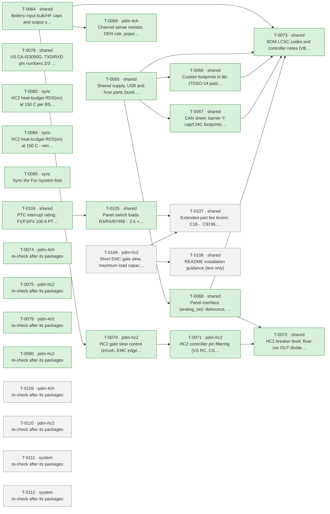

# Roadmap

Generated by `tools/orchestrate.py` from `docs/queue.json` – do not edit. Updated 2026-11-03 11:46. Policy: `docs/AUTONOMY.md`.

**Now:** nothing running · **Up next:** 3 packages · **Done:** 16 packages (49 items) · **Failed:** 0 · **Waiting for you:** 7 (`docs/OWNER-INBOX.md`) · **Deferred:** 14

## Board size

| Board | Parts | DNP | Unique fitted parts | Since the agents started |
|---|---|---|---|---|
| pdm-4ch | 200 | 15 | 61 | +33 parts, +15 DNP, +3 unique |
| pdm-hc2 | 216 | 11 | 70 | +47 parts, +11 DNP, +4 unique |

Every unique extended part costs a loading fee per order; DNP parts cost nothing but board space.

## Plan

Green done · blue running · grey waiting · red failed. Arrows: must finish first.

## Up next – what will change

### T-0106 · pdm-hc2 · Short EMC gate slew, maximum load capacitance, HC2 load guidance

Waiting.

- MAJOR · MOSFET gate drive is not slew-limited (about 400-800 V/us estimated, PD direct), so switching clicks reach th… → your ruling: covered by Q-0049: short EMC-only gate slew within the MOSFET SOA
- MAJOR · MOSFETs switch fully on in under 1 us, so a load with more than about 50-100 uF input capacitance probably ex… → your ruling: (1) maximum load capacitance: rate HC2 for about 50-100 uF load input capacitance, confirmed by the prototype measurement (Q-0045); fit only a short gate slew …
- INFO · Which HC2 loads have more than about 50 uF input capacitance (LED work-light drivers, radios, inverter)? Sets… → your ruling: typical HC2 loads are bilge pumps and wipers (not capacitive) and possibly grouped 100 W LED work lights (a few hundred uF in total); DC-DC converters for 12 V…
- MAJOR · Hardware breaker at about 24-26 A (146 ms) and OT trip at 140-160 C at the sensor leave about 18-24 A unprote… → your ruling: no - drop the 21 A option; decision 19 is withdrawn by the owner (2026-11-03); the breaker stays as in decision 39

Planner's brief

Owner rulings (verbatim). Q-0049 (T-0054): "(1) maximum load capacitance: rate HC2 for about 50-100 uF load input capacitance, confirmed by the prototype measurement (Q-0045); fit only a short gate slew for EMC (within the MOSFET SOA at that capacitance); README: HC2 is for motor loads (bilge pumps, wipers) and grouped LED work lights, while DC-DC converters (e.g. 24->12 V for a car radio), radios and other electronics go on the 4-channel board; split grouped LED lights if the prototype shows short-circuit trips". Q-0050 (T-0006): "covered by Q-0049: short EMC-only gate slew within the MOSFET SOA". Q-0051 (T-0061): "typical HC2 loads are bilge pumps and wipers (not capacitive) and possibly grouped 100 W LED work lights (a few hundred uF in total); DC-DC converters for 12 V car radios, radios and other electronics go on the 4-channel board; see Q-0049". Q-0053 (T-0053): "no - drop the 21 A option; decision 19 is withdrawn by the owner (2026-11-03); the breaker stays as in decision 39". These amend the 1000 uF / 20 A sizing of decision 25; its topology stays (TPS4811-Q1 section 8.3.2.1 / Fig. 8-6: R1 in the PU path = R104/R204, C1 + about 10 ohm at the gate, PD direct, RGATE_PD as a 0 ohm footprint). Inputs: docs/part-facts/C17556513.md (Eq. 3 I_inrush = 0.63 x V(BST-SRC) x C_LOAD / (R1 x C1), Eq. 4 CBST > Qg + 10 x C1, tSC 4/5 us), docs/part-facts/C501507.md (BSC030N08NS5 SOA Diagram 3 at 30 V: 10 us ~185 A, 100 us ~15 A; Zth Diagram 4), and the method and script of docs/reviews/2026-11-02-fix-pdm-hc2-T-0070.md. Steps: 1) Size R1/C1 so that ALL of these hold at 30 V: (a) with C_LOAD = 100 uF (aim) plus a 15 A resistive load, inrush + load stays below the minimum ISCP threshold (about 71 A with RISCP 4.7 k) with margin, so the fast trip does not fire at turn-on; (b) the input-side MOSFET Q11/Q21 stays inside SOA Diagram 3 and Tj < 150 C from Zth for that ramp, starting from the hot case and from a retry after running at 15 A (heat budget); (c) turn-on into a hard short (slow gate rise, 30 V across Q11 until ISCP trips plus tSC) stays inside SOA - T-0070 showed 100 k / 3.9 nF fails this; (d) the output dV/dt is far below today's 400-800 V/us (EMC report 2026-10-30, E2; PROFET reference 0.8 V/us), ramp in the tens of microseconds; (e) Eq. 4 with the existing CBST; (f) turn-off unchanged (PD direct). If 100 uF cannot meet (a)-(c), take the largest C_LOAD between 50 and 100 uF that does, and state it as the rating. Prefer R/C values and parts already on the BOM (e.g. C1523 1 nF, C25744 10 k, C25076 100 ohm). 2) tools/ksch.py on hc_channel (both channels): R104/R204 value = R1, add C1 + 10 ohm at the gate and the 0 ohm RGATE_PD footprint per decision 25. ERC and netlist before/after; only these refs may change. fix_check.py --scope pdm-hc2. 3) Rerun tools/heat_budget.py --channels 2 --part HC-2xBSC030 at 40 C (rating stays about 15 A; no PWM). 4) README: in the boards/limitations text, HC2 is for motor loads (bilge pumps, wipers) and grouped LED work lights; DC-DC converters (e.g. 24->12 V for a car radio), radios and other electronics go on pdm-4ch; give the maximum load input capacitance; split grouped LED work lights if they trip. Keep the existing no-PWM and timing bullets. 5) design-notes section 4a: sizing, SOA/Zth calculation, the rating, and a failure-mode note for bilge forced-run outputs (slew does not delay the fast trip; a large capacitive load trips and waits 3.8 min; a competent person reviews the bilge outputs before installation). 6) hardware/pdm-hc2/STATUS.md: replace the T-0070 'blocked' paragraph and Next item 0 with the result. Prototype test list: measure the real load capacitance and inrush of each intended HC2 load, including grouped LED work lights (Q-0045), confirm the 50-100 uF rating, and split LED groups that trip. T-0053: R113/R213 stay 68 k C36871 (decision 39, T-0072), no change; note that decision 19 and the 21 A option are withdrawn. Stop and ask (one-way): if no R1/C1 meets (a)-(c) even at 50 uF; if meeting them would need a change to RISCP/the fast-trip level, the breaker (decision 39), CBST or the MOSFET (decision 19 is withdrawn); if the heat budget moves the 15 A rating.

### T-0107 · shared · Extended-part fee levers: C18 -> C9196, RIS -> 2 x C4410, 1 uF/100 V -> C170101

Waiting after T-0106.

- MINOR · Two avoidable extended-part types: 4.7 nF/1 kV USB-shield capacitor and the 680 ohm 1206 RIS, 3.07 USD per or… → agent decision: C18 -> 1 nF/2 kV C9196 (basic, already used); RIS -> two 1 kOhm 1206 C4410 in parallel (see L5, L7)
- INFO · 4.7 nF/1 kV C107198 (extended) to 1 nF/2 kV C9196 (basic): 0.31 USD per board at 10, RC corner 34 Hz to 160 Hz → agent decision: Change the value and LCSC code of C18 on both boards (shared sheet), then run the part-facts check on C9196
- INFO · RIS 680 ohm 1206 C17975 (extended) replaced by two 1 kohm 1206 C4410 (basic) in parallel: 0.26 USD per board … → agent decision: Replace each RIS by two C4410 in parallel; firmware scale constant becomes 500 ohm; check C4410 power rating with part-…
- INFO · Using C170101 for the 1 uF/100 V places removes the C13832 fee; pays only for runs of fewer than 9 (4-ch) or … → agent decision: Only if the first run stays at 5 boards: swap the five or three capacitors to 2.2 uF/100 V C170101

Planner's brief

Two-way agent items from docs/reviews/2026-11-03-cost-system.md (C1, L5, L7, L8). T-0090 is the combined finding behind T-0096 (C18) and T-0098 (RIS), so it is done by those two changes, not by a third. Value and part swaps only, no new footprints. 1) T-0096 (shared power-usb, identical on both boards): C18 4.7 nF/1 kV C107198 -> 1 nF/2 kV X7R 1206 C9196 (basic, already on the BOM as C50-C53/C70). part_facts.py C9196 (rated voltage, X7R, 1206 footprint unchanged). The R13 || C18 corner moves from 34 Hz to 160 Hz; note it in design-notes section 8.3 (the shield RC is a pre-compliance footprint, decision 31). 2) T-0098 (pdm-4ch only, per-channel sheet): each RIS R103/R203/R303/R403 680 ohm C17975 -> two 1 kOhm 1206 C4410 (basic) in parallel = 500 ohm. part_facts.py C4410 (power 0.25 W, 1206). Check that IS at full load stays below the ADC range and the 3.3 V clamp: BTT6050 at 4.5 A about 1.5 V, BTT6010 at 8 A about 2.7 V (use kILIS from the BTT6050/BTT6010 facts). Decision 36 asks for RIS as 1206 >= 0.25 W: two 0.25 W parts meet it. The 40 mA fault case (0.8 W total) stays covered by the firmware DEN rule (design-notes section 6.1). Record the new firmware scale constant (500 ohm, 0.33 V/A) in design-notes section 6.1 and in the pdm-4ch STATUS for /system firmware. 3) T-0099: the item's condition holds (decision 33: first order 5 + 5 boards). Swap 1 uF/100 V C13832 -> 2.2 uF/100 V X7R 1206 C170101 (already on the BOM as C1, same 1206 footprint) at: C30 (shared root controller part, both boards; decision 26 allows 1-2.2 uF at J10) and HC2 C102/C202 (CVS on VS_CTRL, auto decision 58 - check the TPS4811-Q1 CVS recommendation in docs/part-facts/C17556513.md, and the RVS 100 ohm x 2.2 uF time constant against the VS_CTRL behaviour). Do NOT change pdm-4ch C104-C404: confirmed decision 26 names 1 uF/100 V at each BTT6050 VS tab, so changing it is a one-way door. Report it as a question for the owner (default: keep 1 uF C13832; the C13832 fee then stays on pdm-4ch only). Add to both STATUS pre-order checklists: for runs of 9+ (pdm-4ch) / 15+ (pdm-hc2) boards, C13832 for these places is cheaper again. 4) ERC and netlist on both boards before/after: only C18, C30, C102/C202 (values/LCSC), and R103/R203/R303/R403 plus the four new parallel resistors may change. fix_check.py --scope shared. Update STATUS on both boards and the unique-part counts (cost report: extended types 19 -> 17 on pdm-4ch, 20 -> 18 or 19 on pdm-hc2). Stop and ask (one-way): if C9196 or C4410 fail their facts check (voltage/power); if IS at the rated current would exceed the ADC range with 500 ohm; if TPS4811-Q1 gives an upper limit for CVS below 2.2 uF (then leave C102/C202 and C30 as they are, because a partial swap saves nothing on HC2).

### T-0108 · shared · README installation guidance (text only)

Waiting after T-0106.

- MINOR · The cable practice that the immunity design assumes (screened panel cable with drain at the PDM end, bundled … → agent decision: Add the Installation guidance section of this report to the README; text only.

Planner's brief

Two-way agent item from docs/reviews/2026-11-03-emc-system.md, section 'Installation guidance (for the README)'. Text only: no schematic, library or ARCHITECTURE change, and both netlists unchanged. Add an 'Installation' section to README.md with the report's bullets: battery feed (fuse at the battery, twisted/bundled pair, >= 0.5 m from the VHF feed, crossing at 90 deg, check polarity), loads (return with the feed to the battery negative bus, never through the PDM ground, fuse each output wire), inductive loads (diode/TVS at the load), PWM (none above 200 Hz on pdm-4ch; none on pdm-hc2 until measured, decision 25), panel cable (one screened multicore <= 10 m, drain only at J5.10, dry contacts, not shared with other loads), NMEA 2000 (drop <= 6 m, backbone grounded once, no drain at the node, away from the VHF coax), position (enclosed, vented, away from the VHF antenna and coax). Do not repeat what 'Important limitations' already says (load dump, USB service rule, HC2 external breaker, reverse battery, dry contacts). Point to those bullets instead, and keep the wording consistent with them and with the HC2 load text written by P3. Generic wording only: no vessel names, no personal data. Run fix_check.py --scope shared (README only). Stop and ask (one-way): if a bullet would contradict a confirmed decision or the current README (e.g. a different PWM rule than decision 25 as amended).

## Done

| Package | Scope | What | Items | Board growth | Model | Cost | Merged |
|---|---|---|---|---|---|---|---|
| T-0064 | shared | Battery input bulk/HF caps and output surge protection (inv… | 4 | – | opus | 4.12 USD | `dbc672cd` |
| T-0065 | shared | Shared supply, USB and fuse parts (buck caps, USB shield/ES… | 6 | – | opus | 12.15 USD | `e5fedd96` |
| T-0066 | shared | Custom footprints in lib/ (TDSO-14 paste, LMR51610 -> SOT-2… | 2 | – | opus | 1.58 USD | `14b42e65` |
| T-0067 | shared | CAN sheet: barrier Y-cap/CMC footprints, TXD pull-up, CA-IS… | 5 | – | opus | 6.74 USD | `5ffcfb6f` |
| T-0068 | shared | Panel interface (analog_sw): debounce, switch-load resistor… | 6 | pdm-4ch +1 parts (+0 DNP), +1 unique, pdm-hc2 +1 parts (+0 DNP), +1 unique | opus | 2.66 USD | `86fbfe03` |
| T-0069 | pdm-4ch | Channel sense resistor, DEN rule, population rule | 4 | pdm-4ch +4 parts (+4 DNP), +0 unique | sonnet | 0.62 USD | `b9fcef31` |
| T-0070 | pdm-hc2 | HC2 gate slew control (inrush, EMC edges) | 4 | no part changes | opus | 1.65 USD | `` |
| T-0071 | pdm-hc2 | HC2 controller pin filtering (VS RC, CS/EN/OV/IWRN filters,… | 3 | pdm-hc2 +16 parts (+4 DNP), +0 unique | opus | 5.14 USD | `80bb3bd1` |
| T-0072 | shared | HC2 breaker level, float-run OUT divider, reverse-battery d… | 4 | – | opus | 3.99 USD | `901c6f45` |
| T-0073 | shared | BOM LCSC codes and controller notes (VBAT full scale, IO3 s… | 6 | pdm-4ch +0 parts (+0 DNP), -4 unique, pdm-hc2 +0 parts (+0 DNP), -5 unique | opus | 1.13 USD | `1939dfbc` |
| T-0078 | shared | U5 CA-IS3050G: TXD/RXD pin numbers 2/3 swapped (both boards) | 1 | no part changes | opus | 0.51 USD | `d42065e2` |
| T-0082 | sync | HC2 heat-budget RDS(on) at 150 C per BSC030N08NS5 Diagram 9 | 1 | no part changes | opus | 0.24 USD | `24bf9f3b` |
| T-0084 | sync | HC2 heat-budget RDS(on) at 150 C - verify T-0082 sync and c… | 1 | no part changes | opus | 0.15 USD | `24bf9f3b` |
| T-0085 | sync | Sync the "For /system" lists | 0 | no part changes | opus | 0.71 USD |  |
| T-0104 | shared | PTC interrupt rating: F1/F3/F4 100 A PTC + series resistor,… | 1 | no part changes | opus | 3.21 USD | `` |
| T-0105 | shared | Panel switch loads R3/R4/R7/R8 -> 2 k + 2 k basic | 1 | pdm-4ch +4 parts (+0 DNP), +0 unique, pdm-hc2 +4 parts (+0 DNP), +0 unique | opus | 1.49 USD | `849fc1d6` |

Undo a package: `python3 tools/orchestrate.py undo <item>` (any of its items).

## Waiting for you

- Q-0060 · INFO · Is the interrupt rating (Imax at 60 V) of the 1812L050/60GR PTC enough for the prospective current of a direct battery …
- Q-0054 · MAJOR · The VS bulk capacitors are polarised aluminium electrolytics with no reverse rating in their datasheet and nothing in f…
- Q-0055 · INFO · 30 instead of 10 boards per order saves 6.38 USD (4-ch) / 7.12 USD (HC2) per board; 10 instead of 5 saves 9.46 / 9.93 U…
- Q-0056 · INFO · One panel for both designs saves 62.9 USD per order (3.15 USD per board at 10 + 10)
- Q-0057 · INFO · Hand-soldering the four through-hole connectors removes 4 extended fees and the THT labour: 16.2 USD per order and desi…
- Q-0058 · INFO · USB-C as service pads on later runs saves 3 extended fees and parts: 1.20 USD per board at 10
- Q-0059 · INFO · A monthly JLCPCB assembly coupon may waive the 8.18 USD setup per order (conditions for 2 oz and Economic PCBA unverifi…

## Deferred

**Until order** (5)

- Order 30 instead of 10 per run: -6.05 $/board (4-ch), -7.00 $/board (HC2); 10 instead of 5 saves -9.0/-9.8 $
- USB-C as DNP or pogo pads removes 3 extended fees and ~0.27 $ parts: -1.30 $/board at 10 (overlaps L3)
- How many pdm-4ch and pdm-hc2 boards per order (5, 10, 30)? This is the largest cost lever
- Is a fitted USB-C service connector required, or are pads/DNP plus OTA enough (L4)?
- TPS48110A stock is 989 and L1 1231, both single-source or thin; nothing is below 500

**Until owner** (2)

- 52/59 unique parts cost 1.53 $ each only under Standard PCBA; merging package variants would save ~9 $ per or…
- Does JLCPCB accept 2 oz copper with Economic PCBA? If not, Standard PCBA adds +5.1 $ (4-ch) / +5.6 $ (HC2) pe…

**Until pcb** (2)

- One panel holding pdm-4ch + pdm-hc2 saves one setup, stencil, THT fee and 15 shared extended fees: -59.79 $/o…
- Is a combined 1:1 panel of pdm-4ch + pdm-hc2 acceptable (L2)?

**Until prototype** (2)

- LMR51610YF (FPWM, same 1.1 MHz) would avoid PFM noise below 350 kHz; E7 asks for a scan first.
- LMR51610XDBVR (400 kHz, C20539658, 0.52 $) instead of the Y variant (1.35 $): -0.83 $/board; needs a re-desig…

**Until system-mechanical** (3)

- Board ground reaches the battery negative through one terminal pole that carries TVS surge current and, on HC…
- Fixed screw terminals instead of pluggable header + plug: about -1.0 $/board (the plug halves alone cost 1.20…
- Pluggable or fixed screw terminals (L5)?

