# Roadmap

Generated by `tools/orchestrate.py` from `docs/queue.json` – do not edit. Updated 2026-11-12 23:26. Policy: `docs/AUTONOMY.md`.

**Now:** nothing running · **Up next:** 3 packages · **Done:** 56 packages (87 items) · **Failed:** 1 · **Waiting for you:** 0 (`docs/OWNER-INBOX.md`) · **Deferred:** 22

## Board size

| Board | Parts | DNP | Unique fitted parts | Since the agents started |
|---|---|---|---|---|
| pdm-4ch | 227 | 20 | 59 | +60 parts, +20 DNP, +1 unique |
| pdm-hc2 | 241 | 16 | 63 | +72 parts, +16 DNP, -3 unique |

Every unique extended part costs a loading fee per order; DNP parts cost nothing but board space.

## Plan

```mermaid
flowchart LR
  T0064["T-0064 · shared<br/>Battery input bulk/HF caps and output s…"]:::done
  T0065["T-0065 · shared<br/>Shared supply, USB and fuse parts (buck…"]:::done
  T0066["T-0066 · shared<br/>Custom footprints in lib/ (TDSO-14 past…"]:::done
  T0067["T-0067 · shared<br/>CAN sheet: barrier Y-cap/CMC footprints…"]:::done
  T0068["T-0068 · shared<br/>Panel interface (analog_sw): debounce, …"]:::done
  T0069["T-0069 · pdm-4ch<br/>Channel sense resistor, DEN rule, popul…"]:::done
  T0070["T-0070 · pdm-hc2<br/>HC2 gate slew control (inrush, EMC edge…"]:::done
  T0071["T-0071 · pdm-hc2<br/>HC2 controller pin filtering (VS RC, CS…"]:::done
  T0072["T-0072 · shared<br/>HC2 breaker level, float-run OUT divide…"]:::done
  T0073["T-0073 · shared<br/>BOM LCSC codes and controller notes (VB…"]:::done
  T0078["T-0078 · shared<br/>U5 CA-IS3050G: TXD/RXD pin numbers 2/3 …"]:::done
  T0082["T-0082 · sync<br/>HC2 heat-budget RDS(on) at 150 C per BS…"]:::done
  T0084["T-0084 · sync<br/>HC2 heat-budget RDS(on) at 150 C - veri…"]:::done
  T0085["T-0085 · sync<br/>Sync the  For /system  lists"]:::done
  T0104["T-0104 · shared<br/>PTC interrupt rating: F1/F3/F4 100 A PT…"]:::done
  T0105["T-0105 · shared<br/>Panel switch loads R3/R4/R7/R8 -  2 k +…"]:::done
  T0106["T-0106 · pdm-hc2<br/>Short EMC gate slew, maximum load capac…"]:::done
  T0107["T-0107 · shared<br/>Extended-part fee levers: C18 -  C9196,…"]:::done
  T0108["T-0108 · shared<br/>README installation guidance (text only)"]:::done
  T0118["T-0118 · shared<br/>PTC interrupt rating: C70113 on F1-F4 p…"]:::done
  T0119["T-0119 · shared<br/>USB shield capacitor C18 to 1 nF/2 kV C…"]:::done
  T0120["T-0120 · pdm-4ch<br/>pdm-4ch VS-tab capacitors C104-C404 to …"]:::done
  T0121["T-0121 · pdm-4ch<br/>pdm-4ch reverse-battery blocking on VS …"]:::done
  T0132["T-0132 · pdm-4ch<br/>Q30 AGM601LL swap check (swap only if i…"]:::done
  T0137["T-0137 · pdm-4ch<br/>TVS across Q30 for negative transients …"]:::done
  T0141["T-0141 · sync<br/>Sync the  For /system  lists"]:::done
  T0143["T-0143 · pdm-4ch<br/>Fit SMDJ40CA across Q30, record the res…"]:::done
  T0147["T-0147 · sync<br/>Sync the  For /system  lists"]:::done
  T0156["T-0156 · sync<br/>Sync the  For /system  lists"]:::done
  T0158["T-0158 · pdm-4ch<br/>pdm-4ch 16 A input: J10 set and Q30 re-…"]:::done
  T0159["T-0159 · shared<br/>Merge near-duplicate BOM lines"]:::done
  T0160["T-0160 · shared<br/>Sign-of-life LEDs, spare GPIO and seria…"]:::done
  T0161["T-0161 · shared<br/>Buck input filter position"]:::done
  T0171["T-0171 · pdm-4ch<br/>pdm-4ch J10 socket C577772: stock fallb…"]:::done
  T0179["T-0179 · shared<br/>C577772 + C577752 set: buying rule and …"]:::done
  T0180["T-0180 · pdm-hc2<br/>HC2 turn-off edge: R116/R216 trial on t…"]:::done
  T0185["T-0185 · sync<br/>Sync the  For /system  lists"]:::done
  T0186["T-0186 · sync<br/>Sync the  For /system  lists"]:::done
  T0190["T-0190 · shared<br/>Shared power-usb: C3 to C170101 (cost l…"]:::done
  T0191["T-0191 · pdm-hc2<br/>HC2 EN/UVLO top resistors R105/R205 to …"]:::done
  T0196["T-0196 · sync<br/>Sync the  For /system  lists"]:::done
  T0197["T-0197 · pdm-4ch<br/>Place connectors and mounting holes"]:::done
  T0198["T-0198 · pdm-4ch<br/>Place the power path and output channels"]:::done
  T0199["T-0199 · pdm-4ch<br/>Place the logic half and all remaining …"]:::done
  T0200["T-0200 · pdm-4ch<br/>Power copper: pours and wide paths"]:::done
  T0201["T-0201 · pdm-4ch<br/>Route all remaining connections"]:::done
  T0202["T-0202 · pdm-4ch<br/>Silkscreen, markings and a clean DRC"]:::ready
  T0205["T-0205 · pdm-4ch<br/>4-layer planes and stitching vias"]:::done
  T0206["T-0206 · pdm-4ch<br/>Route all remaining connections on 4 la…"]:::done
  T0207["T-0207 · pdm-4ch<br/>Route the short local links and ground …"]:::done
  T0208["T-0208 · pdm-4ch<br/>Make room in the U1 strip and fan out U1"]:::done
  T0209["T-0209 · pdm-4ch<br/>Routing build script and the U1 strip"]:::done
  T0210["T-0210 · pdm-4ch<br/>CAN and USB pairs as fixed routes, rebu…"]:::done
  T0211["T-0211 · pdm-4ch<br/>Close the last connections by build"]:::ready
  T0214["T-0214 · pdm-4ch<br/>pdm-4ch: CAN/USB/CC1 fixed routes and L…"]:::done
  T0221["T-0221 · pdm-4ch<br/>pdm-4ch: confirm the routing scripts ga…"]:::done
  T0226["T-0226 · pdm-4ch<br/>pdm-4ch routing: signal vias through VS…"]:::failed
  T0231["T-0231 · pdm-4ch<br/>pdm-4ch routing: signal vias through VS…"]:::done
  T0236["T-0236 · pdm-4ch<br/>pdm-4ch routing: build with signal vias…"]:::done
  T0241["T-0241 · pdm-4ch<br/>pdm-4ch routing: clean router export, I…"]:::ready
  T0074["T-0074 · pdm-4ch<br/>re-check after its packages"]:::done
  T0075["T-0075 · pdm-hc2<br/>re-check after its packages"]:::done
  T0079["T-0079 · pdm-4ch<br/>re-check after its packages"]:::done
  T0080["T-0080 · pdm-hc2<br/>re-check after its packages"]:::done
  T0109["T-0109 · pdm-4ch<br/>re-check after its packages"]:::done
  T0110["T-0110 · pdm-hc2<br/>re-check after its packages"]:::done
  T0111["T-0111 · system<br/>re-check after its packages"]:::done
  T0112["T-0112 · system<br/>re-check after its packages"]:::done
  T0122["T-0122 · pdm-4ch<br/>re-check after its packages"]:::done
  T0123["T-0123 · pdm-hc2<br/>re-check after its packages"]:::done
  T0124["T-0124 · system<br/>re-check after its packages"]:::done
  T0125["T-0125 · system<br/>re-check after its packages"]:::done
  T0133["T-0133 · pdm-4ch<br/>re-check after its packages"]:::done
  T0134["T-0134 · system<br/>re-check after its packages"]:::done
  T0135["T-0135 · system<br/>re-check after its packages"]:::done
  T0138["T-0138 · pdm-4ch<br/>re-check after its packages"]:::done
  T0139["T-0139 · system<br/>re-check after its packages"]:::done
  T0140["T-0140 · system<br/>re-check after its packages"]:::done
  T0144["T-0144 · pdm-4ch<br/>re-check after its packages"]:::done
  T0145["T-0145 · system<br/>re-check after its packages"]:::done
  T0146["T-0146 · system<br/>re-check after its packages"]:::done
  T0162["T-0162 · pdm-4ch<br/>re-check after its packages"]:::done
  T0163["T-0163 · pdm-hc2<br/>re-check after its packages"]:::done
  T0164["T-0164 · system<br/>re-check after its packages"]:::done
  T0165["T-0165 · system<br/>re-check after its packages"]:::done
  T0172["T-0172 · pdm-4ch<br/>re-check after its packages"]:::done
  T0173["T-0173 · system<br/>re-check after its packages"]:::done
  T0174["T-0174 · system<br/>re-check after its packages"]:::done
  T0181["T-0181 · pdm-4ch<br/>re-check after its packages"]:::done
  T0182["T-0182 · pdm-hc2<br/>re-check after its packages"]:::done
  T0183["T-0183 · system<br/>re-check after its packages"]:::done
  T0184["T-0184 · system<br/>re-check after its packages"]:::done
  T0192["T-0192 · pdm-4ch<br/>re-check after its packages"]:::done
  T0193["T-0193 · pdm-hc2<br/>re-check after its packages"]:::done
  T0194["T-0194 · system<br/>re-check after its packages"]:::done
  T0195["T-0195 · system<br/>re-check after its packages"]:::done
  T0215["T-0215 · pdm-4ch<br/>re-check after its packages"]:::done
  T0216["T-0216 · system<br/>re-check after its packages"]:::done
  T0217["T-0217 · system<br/>re-check after its packages"]:::done
  T0222["T-0222 · pdm-4ch<br/>re-check after its packages"]:::done
  T0223["T-0223 · system<br/>re-check after its packages"]:::done
  T0224["T-0224 · system<br/>re-check after its packages"]:::done
  T0227["T-0227 · pdm-4ch<br/>re-check after its packages"]:::done
  T0228["T-0228 · system<br/>re-check after its packages"]:::done
  T0229["T-0229 · system<br/>re-check after its packages"]:::done
  T0232["T-0232 · pdm-4ch<br/>re-check after its packages"]:::done
  T0233["T-0233 · system<br/>re-check after its packages"]:::done
  T0234["T-0234 · system<br/>re-check after its packages"]:::done
  T0237["T-0237 · pdm-4ch<br/>re-check after its packages"]:::done
  T0238["T-0238 · system<br/>re-check after its packages"]:::done
  T0239["T-0239 · system<br/>re-check after its packages"]:::done
  T0242["T-0242 · pdm-4ch<br/>re-check after its packages"]:::ready
  T0243["T-0243 · system<br/>re-check after its packages"]:::ready
  T0244["T-0244 · system<br/>re-check after its packages"]:::ready
  T0065 --> T0066
  T0065 --> T0067
  T0065 --> T0068
  T0064 --> T0069
  T0064 --> T0070
  T0070 --> T0071
  T0068 --> T0072
  T0071 --> T0072
  T0064 --> T0073
  T0065 --> T0073
  T0066 --> T0073
  T0067 --> T0073
  T0068 --> T0073
  T0104 --> T0105
  T0105 --> T0107
  T0106 --> T0107
  T0106 --> T0108
  T0118 --> T0119
  T0159 --> T0160
  T0159 --> T0161
  T0190 --> T0191
  T0197 --> T0198
  T0198 --> T0199
  T0199 --> T0200
  T0200 --> T0201
  T0211 --> T0202
  T0200 --> T0205
  T0205 --> T0206
  T0205 --> T0207
  T0207 --> T0208
  T0208 --> T0209
  T0209 --> T0210
  T0210 --> T0211
  classDef done fill:#d8f0dc,stroke:#2e7d32
  classDef running fill:#d6e6ff,stroke:#1f5fbf
  classDef ready fill:#f2f2f2,stroke:#888
  classDef failed fill:#f9d9d9,stroke:#b3261e
```

Green done · blue running · grey waiting · red failed. Arrows: must finish first.

## Up next – what will change

### T-0202 · pdm-4ch · Silkscreen, markings and a clean DRC

Waiting after T-0211.

Planner's brief

Layout rules: the board's STATUS.md ("Next" PCB items, PCB rule 9, the pre-order checklist), decisions 122 (all SMT on top), 123 (holes, Ø 8 mm keep-outs), 127 (connector margins, J10 clear zone, labels), 128 (floorplan), the "Layout rules" sections of the EMC reports in docs/reviews/, and ARCHITECTURE invariants 4 and 6. Silkscreen: BATTERY and polarity at J10, function labels and pin 1 at every connector, PANEL and CAN at J5/J4, the board name, version and date. References readable, nothing on pads. Refill zones; 0 DRC errors, 0 unconnected, then record in STATUS.md what the layout does and what the bring-up should check.

### T-0211 · pdm-4ch · Close the last connections by build

Waiting after T-0218.

Planner's brief

Layout rules: the board's STATUS.md ("Next" PCB items, PCB rule 9, the pre-order checklist), decisions 122 (all SMT on top), 123 (holes, Ø 8 mm keep-outs), 127 (connector margins, J10 clear zone, labels), 128 (floorplan), the "Layout rules" sections of the EMC reports in docs/reviews/, and ARCHITECTURE invariants 4 and 6. Method (decision 163, owner): routing is a reproducible build, not hand edits. One command, `hardware/pdm-4ch/scripts/build_routing.sh [runs]`, run with KiCad closed under KiCad's own Python (pcbnew; it exports Specctra DSN and imports SES, kicad-cli cannot), works on a temp copy of the project and copies a board in only when it is better and clean. Steps: (1) fixed copper = every LOCKED track, via and zone: the stage 4–5 power copper and the scripted links of T-0207/T-0208 (lock them once, in the first build) plus the fixed tracks listed in `scripts/fixed_routes.py` (pairs, tight escapes; coordinates in mm, the place where hand-made routing lives); all UNLOCKED tracks and vias are removed before each build; (2) clear every zone fill, keep the power zone outlines (VS, VBAT_IN, VBAT_FL, OUT1–4, VS-In2) as keep-outs for foreign nets, In1 barred for signals, the antenna, CAN-barrier, JP30/JP1 and hole keep-outs on all layers; (3) Freerouting 2.5.0 headless (`~/.local/opt/jdk-25.0.4.1+1/Contents/Home/bin/java -Djava.awt.headless=true -jar ~/.local/opt/freerouting-2.5.0/freerouting-2.5.0.jar --gui.enabled=false -de in.dsn -do out.ses -mt 1`) routes the signals only; (4) import the SES, then pour: refill every zone, add GND stitching vias, remove dangling vias and stubs; (5) check: no power pour split, no starved thermal, `kpcb drc` with parity; (6) Freerouting differs per run: do several runs (up to 3 in parallel, in the background, each in its own folder) and keep the one with 0 DRC errors and the fewest unconnected. A problem the router leaves is fixed by adding fixed routes or a part move to the scripts and rebuilding, never by editing only the board. Each Freerouting run takes 15–20 min: start runs early and hand in within the 90-min limit. Record the method and the script usage in the board's STATUS.md and design-notes. Rules: no signal on In1.Cu; buck SW/CB/input loop on F.Cu with no via in the C1/C19/U3 loop; nothing across the CAN barrier; power pours stay whole. Earlier failures: docs/reviews/2026-11-10-fix-pdm-4ch-T-0206-rejected.md. Add fixed routes or the smallest two-way part move for every connection still open, rebuild until a run has 0 unconnected and 0 DRC errors, and commit the scripts with the board. A one-way door goes to the owner. Finish with 0 unconnected and 0 DRC errors.

### T-0241 · pdm-4ch · pdm-4ch routing: clean router export, In2 signal corridor through VS-In2, scripted channel buses (Q-0071)

Waiting.

- MAJOR · 0 unconnected is not reachable under the stage rules: the west channel signals (27 items) are walled in by th… → your ruling: In2 corridor. Allow signal tracks through the VS copper on In2.Cu only; F.Cu/B.Cu VS, the 16 A paths and the surge path stay unchanged. VS-In2 stays one piece …

Planner's brief

Fourth attempt at T-0218. The board on main is the T-0236 build 2: 74 unconnected, 0 DRC errors, parity 0, VS-In2 1 island, 1185.4 of 1190.7 mm2. Start from main, and first confirm that state with kpcb drc.

Owner's ruling (Q-0071, new decision row amending 172), verbatim: "In2 corridor. Allow signal tracks through the VS copper on In2.Cu only; F.Cu/B.Cu VS, the 16 A paths and the surge path stay unchanged. VS-In2 stays one piece and keeps every PROFET's thermal vias inside it, loses at most 15 % of its baseline area, and the heat budget at 40 °C must pass (tools/heat_budget.py). First fix the router export so the DSN has no built-in violations (T-0236 reports 722), and run several Freerouting runs per build so the run-to-run spread does not hide gains. Route mostly by script: the four output channels are identical, so design one channel's signal bus (sense, input, LED lines) through the In2 corridor once and generate the other three as the same pattern in scripts/fixed_routes.py; the J6 bundle, CAN, USB and the U1 fan-out stay fixed routes too. Freerouting only fills the remaining short links; if it still cannot close them after the export fix, drop it and script those links as well."

Sources:
- docs/reviews/2026-11-12-fix-pdm-4ch-T-0236.md: open items by group, the builds table, the next steps;
- design-notes 8.16 (build method; the 500-700 'unfixable' violations), 8.17 and 8.18 (the west pocket geometry, J6 bundle v2 and the J3 VBUS route, both pre-checked at 0 DRC errors on fixed copper);
- hardware/pdm-4ch/STATUS.md;
- decisions 163-175.

Method (decision 163): fixes go into hardware/pdm-4ch/scripts/ (routing_build.py, fixed_routes.py, build_routing.sh), and the board is the build output. Placement moves, if any, use tools/kpcb.py.

REPORT DISCIPLINE:
- Write the report within the first 10 minutes. Its fix block lists T-0218 under 'blocked' (door two-way, reason 'in progress: <stage>').
- Update the report after each stage.
- Move T-0218 to 'done' only at 0 unconnected.
- Never leave done and blocked both empty.
- Do not commit; the orchestrator does. Leave the best clean state in the worktree, with the scripts reproducing that board. Use LAND_BEST=1 once after fixed_routes.py changes, if needed.

TIME BOX:
- Start each build in the background with a 25-min limit.
- At most 5 builds.
- Stop work at about 75 minutes, keep the best clean state, and finish the report.

STAGE 1 - clean router export (no board change):
1. In routing_build.py prep, find what makes the 722 DSN violations. Suspects from 8.16: power copper inside its own pour keep-out, and pads near the 0.35 mm edge strip.
2. Change the export so the DSN has 0 built-in violations (Freerouting log). Do not loosen any KiCad DRC rule or keep-out to get there.
3. From then on, build with 3 runs (build_routing.sh 3 25). The script already gives each run its own strategy (FR_STRATS).
4. Record the violations before and after, and the 3-run spread.

STAGE 2 - corridor rule (scripts only):
1. Let signal tracks on In2.Cu pass inside the VS-In2 outline: VS-In2 is no longer a track keep-out for foreign nets on In2.
2. Change nothing on F.Cu/B.Cu VS, the VBAT/OUT pours, the 16 A paths or the surge path. Their keep-outs stay exactly as they are.
3. Make the pour check per pour: VS-In2 may lose up to 15 % of its 1190.7 mm2 baseline (so >= 1012 mm2) and must stay 1 island. Every other pour keeps its island count and >= 95 % of its area (decision 172).
4. Add a check that every PROFET thermal via (U11-U14 exposed pad vias, VS) lies inside the filled VS-In2 and is connected to it.
5. Leave the VS-In2 outline unchanged; the fill clears around the tracks.
6. Run one 3-run build and keep it if it is better.

STAGE 3 - scripted channel bus:
1. Before you script anything, check that the four channels' signal-side parts (the IS sense resistors/filters, the IN/DEN input parts, the LED drivers and their resistors) have the same relative placement and rotation. Report any differences.
2. Design one channel's bus (IS sense, IN/DEN input, LED lines) from its signal-column parts through the In2 corridor to D12-D15/U1, as a function in fixed_routes.py.
3. Generate the other three channels with that function, using per-channel offsets or a mirror. Where placement differs, use per-channel parameters rather than moving power parts.
4. Keep J6 (v1 as on main, or v2 from 8.18 if it then builds better), CAN, USB and the U1 fan-out as fixed routes.
5. Add the J3 VBUS route and a D3-A route (FB1.2 -> D3) from 8.18 together. They compete for In2 west of x 26.5.
6. Pre-check the fixed copper at 0 DRC errors, then build.

STAGE 4 - short links:
1. Let Freerouting fill what is left.
2. If after the export fix it still leaves links open across builds, script those links in fixed_routes.py and build again.

ACCEPTANCE (every build):
- 0 DRC errors and parity 0;
- the pour rules from stage 2;
- no signal on In1.Cu (EMC rule 3), buck SW/CB on F.Cu only, nothing across the CAN barrier or the antenna strip, no via in OUT1-B (decision 170);
- fewer unconnected items than the board.

AFTER THE LAST KEPT BUILD:
1. Run python3 tools/heat_budget.py --ambient 40 --currents 4,4,4,4 (decision 9) and report Tj.
2. heat_budget.py does not model the In2 area. State the VS-In2 area, the island count and that all thermal vias are inside it.
3. Run python3 tools/fix_check.py --role pcb-fixer --scope pdm-4ch. It checks: schematic unchanged, parity 0, 0 DRC errors, outline and holes unchanged, no bottom SMT.
4. Update STATUS.md and design-notes (new 8.19).
5. Record your own layout choices (export fix, channel bus geometry) as auto decisions in the fix block.

If items stay open, list them under 'blocked' (two-way) with the exact nets and the next scripted route.

ONE-WAY DOORS (stop, do not do, ask in the report):
- any change to F.Cu/B.Cu VS copper, the 16 A paths, the surge path or any other power-zone outline;
- a signal track through any power pour other than VS-In2, or on a layer other than In2 inside VS copper;
- VS-In2 split, losing more than 15 %, or a PROFET thermal via ending up outside it;
- the heat budget failing at 40 C;
- loosening a DRC rule or clearance to clear DSN violations;
- moving a PROFET, Q30/U30/D31, a connector, a hole or the outline;
- a bottom-side part;
- any schematic change.

## Done

| Package | Scope | What | Items | Board growth | Model | Cost | Merged |
|---|---|---|---|---|---|---|---|
| T-0064 | shared | Battery input bulk/HF caps and output surge protection (inv… | 4 | – | opus | 4.12 USD | `dbc672cd` |
| T-0065 | shared | Shared supply, USB and fuse parts (buck caps, USB shield/ES… | 6 | – | opus | 12.15 USD | `e5fedd96` |
| T-0066 | shared | Custom footprints in lib/ (TDSO-14 paste, LMR51610 -> SOT-2… | 2 | – | opus | 1.58 USD | `14b42e65` |
| T-0067 | shared | CAN sheet: barrier Y-cap/CMC footprints, TXD pull-up, CA-IS… | 5 | – | opus | 6.74 USD | `5ffcfb6f` |
| T-0068 | shared | Panel interface (analog_sw): debounce, switch-load resistor… | 6 | pdm-4ch +1 parts (+0 DNP), +1 unique, pdm-hc2 +1 parts (+0 DNP), +1 unique | opus | 2.66 USD | `86fbfe03` |
| T-0069 | pdm-4ch | Channel sense resistor, DEN rule, population rule | 4 | pdm-4ch +4 parts (+4 DNP), +0 unique | sonnet | 0.62 USD | `b9fcef31` |
| T-0070 | pdm-hc2 | HC2 gate slew control (inrush, EMC edges) | 4 | no part changes | opus | 1.65 USD | `c036d2a6` |
| T-0071 | pdm-hc2 | HC2 controller pin filtering (VS RC, CS/EN/OV/IWRN filters,… | 3 | pdm-hc2 +16 parts (+4 DNP), +0 unique | opus | 5.14 USD | `80bb3bd1` |
| T-0072 | shared | HC2 breaker level, float-run OUT divider, reverse-battery d… | 4 | – | opus | 3.99 USD | `c036d2a6` |
| T-0073 | shared | BOM LCSC codes and controller notes (VBAT full scale, IO3 s… | 6 | pdm-4ch +0 parts (+0 DNP), -4 unique, pdm-hc2 +0 parts (+0 DNP), -5 unique | opus | 1.13 USD | `1939dfbc` |
| T-0078 | shared | U5 CA-IS3050G: TXD/RXD pin numbers 2/3 swapped (both boards) | 1 | no part changes | opus | 0.51 USD | `d42065e2` |
| T-0082 | sync | HC2 heat-budget RDS(on) at 150 C per BSC030N08NS5 Diagram 9 | 1 | no part changes | opus | 0.24 USD | `24bf9f3b` |
| T-0084 | sync | HC2 heat-budget RDS(on) at 150 C - verify T-0082 sync and c… | 1 | no part changes | opus | 0.15 USD | `24bf9f3b` |
| T-0085 | sync | Sync the "For /system" lists | 0 | no part changes | opus | 0.71 USD |  |
| T-0104 | shared | PTC interrupt rating: F1/F3/F4 100 A PTC + series resistor,… | 1 | no part changes | opus | 3.21 USD | `3b24acd6` |
| T-0105 | shared | Panel switch loads R3/R4/R7/R8 -> 2 k + 2 k basic | 1 | pdm-4ch +4 parts (+0 DNP), +0 unique, pdm-hc2 +4 parts (+0 DNP), +0 unique | opus | 1.49 USD | `849fc1d6` |
| T-0106 | pdm-hc2 | Short EMC gate slew, maximum load capacitance, HC2 load gui… | 4 | pdm-hc2 +6 parts (+0 DNP), +0 unique | opus | 3.28 USD | `c036d2a6` |
| T-0107 | shared | Extended-part fee levers: C18 -> C9196, RIS -> 2 x C4410, 1… | 4 | pdm-4ch +4 parts (+0 DNP), +0 unique, pdm-hc2 +0 parts (+0 DNP), -1 unique | opus | 3.21 USD | `196bdd9c` |
| T-0108 | shared | README installation guidance (text only) | 1 | no part changes | opus | 0.25 USD | `c9bce1a7` |
| T-0118 | shared | PTC interrupt rating: C70113 on F1-F4 plus 0.2 ohm series r… | 1 | pdm-4ch +3 parts (+0 DNP), +0 unique, pdm-hc2 +3 parts (+0 DNP), +0 unique | opus | 1.81 USD | `3b24acd6` |
| T-0119 | shared | USB shield capacitor C18 to 1 nF/2 kV C9196 | 2 | pdm-4ch +0 parts (+0 DNP), -1 unique, pdm-hc2 +0 parts (+0 DNP), -1 unique | opus | 0.47 USD | `196bdd9c` |
| T-0120 | pdm-4ch | pdm-4ch VS-tab capacitors C104-C404 to 2.2 uF/100 V C170101 | 2 | pdm-4ch +0 parts (+0 DNP), -1 unique | opus | 0.41 USD | `70cdd9cf` |
| T-0121 | pdm-4ch | pdm-4ch reverse-battery blocking on VS in front of the bulk… | 1 | pdm-4ch +3 parts (+0 DNP), +2 unique | opus | 4.44 USD | `f1f3f88b` |
| T-0132 | pdm-4ch | Q30 AGM601LL swap check (swap only if it passes) and design… | 2 | no part changes | opus | 7.06 USD | `605f3305` |
| T-0137 | pdm-4ch | TVS across Q30 for negative transients with VS charged | 1 | no part changes | opus | 4.12 USD | `9cda47c8` |
| T-0141 | sync | Sync the "For /system" lists | 0 | no part changes | opus | 0.80 USD |  |
| T-0143 | pdm-4ch | Fit SMDJ40CA across Q30, record the residual risk and the p… | 1 | pdm-4ch +1 parts (+0 DNP), +1 unique | opus | 1.94 USD | `9cda47c8` |
| T-0147 | sync | Sync the "For /system" lists | 0 | no part changes | opus | 0.76 USD |  |
| T-0156 | sync | Sync the "For /system" lists | 0 | no part changes | opus | 0.61 USD |  |
| T-0158 | pdm-4ch | pdm-4ch 16 A input: J10 set and Q30 re-selection | 1 | no part changes | opus | 2.93 USD | `232c3185` |
| T-0159 | shared | Merge near-duplicate BOM lines | 1 | pdm-4ch +0 parts (+0 DNP), -3 unique, pdm-hc2 +0 parts (+0 DNP), -4 unique | opus | 3.01 USD | `698cbf87` |
| T-0160 | shared | Sign-of-life LEDs, spare GPIO and serial console access | 3 | pdm-4ch +5 parts (+1 DNP), +1 unique, pdm-hc2 +5 parts (+1 DNP), +1 unique | opus | 4.13 USD | `c01c3a6d` |
| T-0161 | shared | Buck input filter position | 1 | pdm-4ch +4 parts (+4 DNP), +0 unique, pdm-hc2 +4 parts (+4 DNP), +0 unique | opus | 5.08 USD | `9024407b` |
| T-0171 | pdm-4ch | pdm-4ch J10 socket C577772: stock fallback for the order | 3 | no part changes | opus | 0.97 USD | `ac1c0481` |
| T-0179 | shared | C577772 + C577752 set: buying rule and interchangeable-plug… | 3 | no part changes | opus | 0.44 USD | `ac1c0481` |
| T-0180 | pdm-hc2 | HC2 turn-off edge: R116/R216 trial on the pre-compliance sc… | 1 | no part changes | opus | 0.28 USD | `147034f0` |
| T-0185 | sync | Sync the "For /system" lists | 0 | no part changes | opus | 0.65 USD |  |
| T-0186 | sync | Sync the "For /system" lists | 0 | no part changes | opus | 0.53 USD |  |
| T-0190 | shared | Shared power-usb: C3 to C170101 (cost lever L5) | 1 | pdm-4ch +0 parts (+0 DNP), -1 unique, pdm-hc2 +0 parts (+0 DNP), -1 unique | opus | 0.97 USD | `ca774491` |
| T-0191 | pdm-hc2 | HC2 EN/UVLO top resistors R105/R205 to C17927 (cost lever L… | 1 | pdm-hc2 +0 parts (+0 DNP), -1 unique | opus | 0.46 USD | `93a72d3b` |
| T-0196 | sync | Sync the "For /system" lists | 0 | no part changes | opus | 0.33 USD |  |
| T-0197 | pdm-4ch | Place connectors and mounting holes | 0 | no part changes | opus | 2.17 USD |  |
| T-0198 | pdm-4ch | Place the power path and output channels | 0 | no part changes | opus | 3.48 USD |  |
| T-0199 | pdm-4ch | Place the logic half and all remaining parts | 0 | no part changes | opus | 24.23 USD |  |
| T-0200 | pdm-4ch | Power copper: pours and wide paths | 0 | no part changes | opus | 4.34 USD |  |
| T-0201 | pdm-4ch | Route all remaining connections | 0 | – | opus | 6.33 USD |  |
| T-0205 | pdm-4ch | 4-layer planes and stitching vias | 0 | no part changes | opus | 2.44 USD |  |
| T-0206 | pdm-4ch | Route all remaining connections on 4 layers | 0 | – | opus | 4.46 USD |  |
| T-0207 | pdm-4ch | Route the short local links and ground vias | 0 | no part changes | opus | 7.04 USD |  |
| T-0208 | pdm-4ch | Make room in the U1 strip and fan out U1 | 0 | no part changes | opus | 5.29 USD |  |
| T-0209 | pdm-4ch | Routing build script and the U1 strip | 0 | no part changes | opus | 3.54 USD |  |
| T-0210 | pdm-4ch | CAN and USB pairs as fixed routes, rebuild | 0 | no part changes | opus | 5.93 USD |  |
| T-0214 | pdm-4ch | pdm-4ch: CAN/USB/CC1 fixed routes and LAND_BEST into the ro… | 1 | no part changes | opus | 0.57 USD | `746f3880` |
| T-0221 | pdm-4ch | pdm-4ch: confirm the routing scripts gate is open and the T… | 1 | no part changes | opus | 0.21 USD | `1c5d7eb3` |
| T-0231 | pdm-4ch | pdm-4ch routing: signal vias through VS-In2 and placement r… | 1 | no part changes | opus | 0.94 USD | `` |
| T-0236 | pdm-4ch | pdm-4ch routing: build with signal vias through VS-In2, pla… | 1 | no part changes | opus | 4.82 USD | `` |
| T-0226 | pdm-4ch | pdm-4ch routing: signal vias through VS-In2, placement room… | 1 | failed: no report written (unknown): timeout after 5400 s | opus | 0.00 USD |  |

Undo a package: `python3 tools/orchestrate.py undo <item>` (any of its items).

## Deferred

**Until order** (12)

- Order 30 instead of 10 per run: -6.05 $/board (4-ch), -7.00 $/board (HC2); 10 instead of 5 saves -9.0/-9.8 $
- USB-C as DNP or pogo pads removes 3 extended fees and ~0.27 $ parts: -1.30 $/board at 10 (overlaps L3)
- How many pdm-4ch and pdm-hc2 boards per order (5, 10, 30)? This is the largest cost lever
- Is a fitted USB-C service connector required, or are pads/DNP plus OTA enough (L4)?
- TPS48110A stock is 989 and L1 1231, both single-source or thin; nothing is below 500
- 30 instead of 10 boards per order saves 6.38 USD (4-ch) / 7.12 USD (HC2) per board; 10 instead of 5 saves 9.4…
- Hand-soldering the four through-hole connectors removes 4 extended fees and the THT labour: 16.2 USD per orde…
- USB-C as service pads on later runs saves 3 extended fees and parts: 1.20 USD per board at 10
- A monthly JLCPCB assembly coupon may waive the 8.18 USD setup per order (conditions for 2 oz and Economic PCB…
- Should the first order use the free-assembly coupon (L6) or hand-soldered connectors (L3)?
- C13832 removal costs 0.162 USD per board against a 3.07 USD fee per order, so it pays only up to about 19 boa…
- C170101 instead of C13832 saves the loading fee only below about 14 boards per order; above that C13832 is ch…

**Until owner** (3)

- 52/59 unique parts cost 1.53 $ each only under Standard PCBA; merging package variants would save ~9 $ per or…
- Does JLCPCB accept 2 oz copper with Economic PCBA? If not, Standard PCBA adds +5.1 $ (4-ch) / +5.6 $ (HC2) pe…
- C30 swap to 2.2 uF C170101 adds about 0.054 USD per board on pdm-4ch with no fee saved, because C13832 stays …

**Until prototype** (3)

- LMR51610YF (FPWM, same 1.1 MHz) would avoid PFM noise below 350 kHz; E7 asks for a scan first.
- LMR51610XDBVR (400 kHz, C20539658, 0.52 $) instead of the Y variant (1.35 $): -0.83 $/board; needs a re-desig…
- SH-ESP32 uses the same 60 V PTC without a series resistor; removing R54-R56 would save one line, about 2-3 US…

**Until system-mechanical** (4)

- Board ground reaches the battery negative through one terminal pole that carries TVS surge current and, on HC…
- Fixed screw terminals instead of pluggable header + plug: about -1.0 $/board (the plug halves alone cost 1.20…
- Pluggable or fixed screw terminals (L5)?
- SH-ESP32 fits standard 100 x 68 x 50 mm waterproof enclosures; pdm-4ch at about 100 x 65 mm is close, which c…

