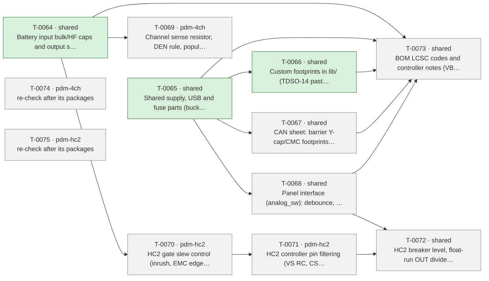

# Roadmap

Generated by `tools/orchestrate.py` from `docs/queue.json` – do not edit. Updated 2026-11-02 21:02. Policy: `docs/AUTONOMY.md`.

**Now:** nothing running · **Up next:** 7 packages · **Done:** 3 packages (12 items) · **Failed:** 0 · **Waiting for you:** 0 (`docs/OWNER-INBOX.md`) · **Deferred:** 14

## Board size

| Board | Parts | DNP | Unique fitted parts | Since the agents started |
|---|---|---|---|---|
| pdm-4ch | 186 | 9 | 64 | +19 parts, +9 DNP, +6 unique |
| pdm-hc2 | 184 | 5 | 74 | +15 parts, +5 DNP, +8 unique |

Every unique extended part costs a loading fee per order; DNP parts cost nothing but board space.

## Plan

Green done · blue running · grey waiting · red failed. Arrows: must finish first.

## Up next – what will change

### T-0067 · shared · CAN sheet: barrier Y-cap/CMC footprints, TXD pull-up, CA-IS3050G check

Waiting.

- MAJOR · No high-frequency return across the isolation barrier (CIO about 1 pF) and no CMC option, so the N2K cable ca… → your ruling: yes - as footprints only: Y-capacitor GND_CAN-GND DNP, CMC footprint fitted with 0 ohm bridges; decide at pre-compliance scan
- INFO · Is IEC 60945 (marine) compliance a goal or only good practice, is a pre-compliance scan planned, and may the … → your ruling: IEC 60945 as a design target, no certification; one pre-compliance scan on the first prototypes decides the DNP footprints; the N2K shield stays unconnected at…
- INFO · CA-IS3050G (C528763, 5 kV RMS, 0.92 $ at 10+) instead of ISO1044 (1.62 $): -0.71 $/board, second source; diff… → your ruling: yes - part-facts check of CA-IS3050G (supplies, pinout, timing), swap only if it passes; Q-0004 footprints and Q-0039 pull-up then apply to it
- INFO · Must the isolated CAN side stay powered from NET-S? If not, an isolated CAN part with integrated isolated sup… → your ruling: keep the isolated CAN side powered from NET-S (NMEA 2000 practice, LEN)
- MINOR · No external pull-up on ISO1044 TXD; TI says not to rely on the internal one, and GPIO17 has a 60 us low glitc… → your ruling: yes - 10 k pull-up from ISO1044 TXD to +3V3 on the shared can sheet

Planner's brief

Shared can sheet, identical on both boards. Constraints first: ruling Q-0031 (T-0039) verbatim: 'keep the isolated CAN side powered from NET-S (NMEA 2000 practice, LEN)'. Ruling Q-0012 (T-0019) verbatim: 'IEC 60945 as a design target, no certification; one pre-compliance scan on the first prototypes decides the DNP footprints; the N2K shield stays unconnected at the node (4-pole J4)'. Record both in design-notes (EMC and CAN sections); J4 stays 4-pole. Order: (1) T-0030. Ruling Q-0023 verbatim: 'yes - part-facts check of CA-IS3050G (supplies, pinout, timing), swap only if it passes; Q-0004 footprints and Q-0039 pull-up then apply to it'. Read the Chipanalog CA-IS3050G datasheet: VCC1 at 3.3 V, VCC2 at 5 V from U6 (TPS7B91, or L78M05 if P2 swapped it), bus fault protection against the N2K bus, loop delay against ISO 11898 at 250 kbit/s, TXD dominant timeout, isolation rating, pinout and package (SOIC-8 vs SOIC-8-WB). Also check the JLCPCB part C528763 (stock, footprint). Swap only if every check passes; otherwise keep ISO1044 and record why. (2) T-0048. Ruling Q-0039 verbatim: 'yes - 10 k pull-up from ISO1044 TXD to +3V3 on the shared can sheet'. Apply it to the transceiver that step 1 leaves (basic 10 k 0402, C25744). (3) T-0010. Ruling Q-0004 verbatim: 'yes - as footprints only: Y-capacitor GND_CAN-GND DNP, CMC footprint fitted with 0 ohm bridges; decide at pre-compliance scan'. Add a 1206 Y-class (1-2.2 nF, >=1 kV) footprint from GND_CAN to GND, DNP. Add a CMC footprint in series with CANH/CANL: CMC DNP, with two fitted 0 ohm bridges (or a footprint that accepts both). Note layout rule 9 (barrier clearance, Y-cap the only crossing) in STATUS. Checks: ERC and netlist on both boards after each step, can.kicad_sch identical on both boards, LCSC on fitted parts, DNP on the Y-cap and CMC. Stop and ask if: the Y-capacitor path would create a DC path across the barrier (it must stay a capacitor only, invariant 6 spirit / NMEA isolation); the CA-IS3050G needs a supply arrangement other than NET-S (that would contradict Q-0031).

### T-0068 · shared · Panel interface (analog_sw): debounce, switch-load resistors, SW_SUPPLY diode, margins, reverse notes

Waiting.

- MINOR · Hardware switch path has tau 0.32 ms (no real debounce), turns the output off below about 8 V at the switch (… → your ruling: yes - C14-C17 to 470 nF; README note: dry (unlit) switch contacts, and the output-off behaviour below about 8 V during 12 V cranking
- MINOR · At SWIN 10.5 V with the 3.3 V rail down, IN minus device GND is about 1.8-2.0 V once ON, against VIN(H) min 2… → your ruling: correct the margin claim in design-notes and measure on the prototype; RIN 4.7 k goes on the prototype test list as the planned fix if the margin is short; no …
- MINOR · 0.19 W continuous at 30 V in a 0.25 W part (77 %), 0.49 W during a 48 V clamp. → your ruling: yes - two 1206 resistors in series (2.2 k + 2.4 k, basic parts) for R3/R4/R7/R8
- MINOR · p_other 0.6 W omits about 1.5 W of panel-interface dissipation at 30 V (switch loads, dividers, LED sinks); T… → agent decision: Raise the default or document about 2.1 W for the 4-ch board at 30 V with all panel lines on.
- MINOR · With reversed battery, the panel LEDs see about 24-30 V reverse (cathode held near 0 V by R19 and the Q colle… → your ruling: add a series diode in the SW_SUPPLY feed to protect the panel LEDs on reversal; recheck the switch thresholds and the Q-0034 IN margin with the extra diode drop
- MINOR · 'Switches survive with the ground network' holds only for VS(REV) 28 V, t < 2 min, RL >= 12 ohm (P_4.1.2); at… → agent decision: Qualify the claim in design-notes/README with the datasheet conditions.

Planner's brief

Shared analog_sw sheet, identical on both boards. Order: (1) T-0012. Ruling Q-0006 verbatim: 'yes - C14-C17 to 470 nF; README note: dry (unlit) switch contacts, and the output-off behaviour below about 8 V during 12 V cranking'. Basic 470 nF part, rated for the node voltage (<= ~3.3 V by the zener) and placed after R34-R37. (2) T-0046. Ruling Q-0038 verbatim: 'yes - two 1206 resistors in series (2.2 k + 2.4 k, basic parts) for R3/R4/R7/R8'. Each switch load becomes 2.2 k + 2.4 k 1206 in series; check basic LCSC codes and recompute dissipation at 30 V and at the 48 V clamp. (3) T-0049. Ruling Q-0040 verbatim: 'add a series diode in the SW_SUPPLY feed to protect the panel LEDs on reversal; recheck the switch thresholds and the Q-0034 IN margin with the extra diode drop'. Choose a basic diode: Schottky preferred for low drop, reverse rating >=60 V (the 48 V clamp plus a reversed 30 V battery), >= F4 trip current. Place it so that D54 still clamps the J5.5 line at the connector. (4) T-0042. Ruling Q-0034 verbatim: 'correct the margin claim in design-notes and measure on the prototype; RIN 4.7 k goes on the prototype test list as the planned fix if the margin is short; no circuit change now'. Rewrite design-notes section 3 with the margin at SWIN 10.5 V (3V3 down and up), including the new diode drop from step 3. Put the measurement and the RIN 4.7 k fallback on the prototype test list in pdm-4ch STATUS. (5) T-0047 (two-way, no ruling). Document in design-notes section 4 that p_other is about 2.1 W for the 4-ch board at 30 V with all panel lines on, using the values after steps 2-3, and the resulting Tj (scratch run: tools/heat_budget.py --p-other 2.1). The tool default itself stays (tools/ is outside the gates; see report). (6) T-0050 (two-way, no ruling). Qualify design-notes section 8 and the README for pdm-4ch: the reverse-battery survival holds for VS(REV) 28 V, t < 2 min, RL >= 12 ohm (BTT6050 P_4.1.2); heavier loads need the battery fuse to clear (body diode ~2.4 W > PTOT 1.6 W). Also add the panel-LED protection from step 3. Do not write the HC2 part of section 8 here (that is P9). Checks: ERC and netlist on both boards after each edit, analog_sw.kicad_sch identical on both boards, LCSC on every fitted part, heat budget scratch run. Failure-mode note (navigation lights and bilge forced-run are panel-switched): what changes with the 470 nF and the diode drop at low battery. Stop and ask (one-way, invariant 1) if, with the diode drop, the hardware switch path no longer turns an output on at SWIN >= 10.5 V by the datasheet worst case even with the planned RIN 4.7 k fallback, or would need a divider change on the shared sheet.

### T-0069 · pdm-4ch · Channel sense resistor, DEN rule, population rule

Waiting.

- INFO · Each BTT6010 channel adds 1.57 $ at 10 and a mixed build adds one 3.07 $ fee per order (2+2 mix: +3.71 $/boar… → agent decision: Document the population and ordering rule in pdm-4ch STATUS / README
- INFO · Standard population for Vega's pdm-4ch: all BTT6050 (24.87 $) or a 2+2 mix with BTT6010 (28.58 $ at 10)? → your ruling: all four BTT6050 as the standard pdm-4ch population; heavy loads go on HC2
- MAJOR · IS fault current (6/15/40 mA, P_7.5.7) into 680 ohm dissipates 0.15 W typ / ~1.1 W max in a 0.1 W 0603 whenev… → your ruling: yes, all three - RIS as 1206 >=0.25 W; record firmware rule: DEN pulsed only while sampling (and dropped on full-scale IS); OUT pull-down as a DNP footprint
- INFO · Should DEN be held high in Active mode, or pulsed only while sampling IS? V1 (RIS overload on fault or open o… → your ruling: DEN pulsed only while sampling IS (and dropped on full-scale IS), not held high in Active mode (see Q-0033)

Planner's brief

pdm-4ch channel sheet (x4) and docs. (1) T-0041. Ruling Q-0033 verbatim: 'yes, all three - RIS as 1206 >=0.25 W; record firmware rule: DEN pulsed only while sampling (and dropped on full-scale IS); OUT pull-down as a DNP footprint'. Change R103/R203/R303/R403 to 680 ohm 1206, >=0.25 W, basic LCSC; the value is unchanged so the sense scaling is unchanged. Add a DNP pull-down footprint from each OUT to GND; propose its value from BTT6050 section 7.3.3.2 (RPD for open-load detection) and record it as auto. Its dissipation at 30 V must stay within the package rating if it is ever fitted. (2) T-0052. Ruling Q-0041 verbatim: 'DEN pulsed only while sampling IS (and dropped on full-scale IS), not held high in Active mode (see Q-0033)'. Rewrite design-notes section 6 (power modes / DEN) and add it to the firmware requirements list for /system firmware. (3) T-0040. Ruling Q-0032 verbatim: 'all four BTT6050 as the standard pdm-4ch population; heavy loads go on HC2'. (4) T-0032 (two-way): document the population and ordering rule in pdm-4ch STATUS and README: BTT6010 only where > 4 A, and mixed builds are ordered together so the extended fee is paid once. Checks: ERC and netlist on pdm-4ch (the RIS footprint/LCSC change and the new DNP refs only); tools/heat_budget.py at 40 C with --p-other 2.1 (the population is unchanged, BTT6050 x4 at 4 A). Stop and ask if the RIS power check at the 40 mA maximum fault current (~1.1 W) is meant to be covered by hardware: the ruling relies on the firmware DEN rule for that case, so record it only, and do not fit a 2 W part on your own.

### T-0070 · pdm-hc2 · HC2 gate slew control (inrush, EMC edges)

Waiting.

- MAJOR · MOSFET gate drive is not slew-limited (about 400-800 V/us estimated, PD direct), so switching clicks reach th… → your ruling: yes - RG_PU 100 ohm, PD kept direct, RGATE_PD as a 0 ohm footprint; recheck switching loss, SOA, heat budget and short-circuit response; no PWM on HC2 outputs …
- MAJOR · MOSFETs switch fully on in under 1 us, so a load with more than about 50-100 uF input capacitance probably ex… → your ruling: yes - gate slew control per TPS4811-Q1 section 8.3.2.1 (R1 in PU path, C1 + 10 ohm at gate, PD direct; start about 100k/3.9 nF for ~20 A into 1000 uF); this su…
- INFO · First switch-on after power-up waits about 76-100 ms for the bootstrap (Eq. 1), also on the hardware switch p… → agent decision: Record both times in design-notes section 4a and user documentation.
- INFO · Which HC2 loads have more than about 50 uF input capacitance (LED searchlight/work-light drivers, radios, inv… → your ruling: loads not known yet - size the HC2 gate slew control for about 20 A into 1000 uF and measure the real loads on the prototype

Planner's brief

hc_channel sheet x2. Ruling Q-0043 (T-0054) verbatim: 'yes - gate slew control per TPS4811-Q1 section 8.3.2.1 (R1 in PU path, C1 + 10 ohm at gate, PD direct; start about 100k/3.9 nF for ~20 A into 1000 uF); this supersedes the plain RG_PU 100 ohm of Q-0001 (covers EMC E2 too); check MOSFET SOA, heat budget and fast short-circuit response'. Ruling Q-0001 (T-0006) verbatim, valid where Q-0043 does not replace it: 'yes - RG_PU 100 ohm, PD kept direct, RGATE_PD as a 0 ohm footprint; recheck switching loss, SOA, heat budget and short-circuit response; no PWM on HC2 outputs until measured on the bench'. Do not fit RG_PU 100 ohm; do keep a 0 ohm RGATE_PD footprint and the no-PWM rule. Ruling Q-0045 (T-0061) verbatim: 'loads not known yet - size the HC2 gate slew control for about 20 A into 1000 uF and measure the real loads on the prototype'. Order: (1) Read TPS4811-Q1 section 8.3.2.1, Eq. 3 and Eq. 4, and the BSC030N08NS5 datasheet (Qg, SOA Diagram 3). (2) Size R1/C1 for IINRUSH ~20 A into 1000 uF at 28-30 V (E24/E12 values, C1 >=25 V C0G/X7R, basic parts). Check: CBST C103/C203 > Qg(total) + 10*C1; MOSFET energy during the ramp against SOA (~0.4 J over 1-2 ms); the gate PD path stays direct (0 ohm RGATE_PD), so the 80 A short-circuit turn-off is not slowed; turn-on into a short (current ramps slowly, ISCP still trips within tSC). (3) Edit: R104/R204 role per TI topology (R1 in PU path), C1 + ~10 ohm at the gate, RGATE_PD 0 ohm footprint. (4) T-0059 (two-way): record in design-notes section 4a and the user notes the bootstrap delay at first switch-on (~76-100 ms, Eq. 1), the new turn-on ramp time, and the 3.8 min retry reset by toggling INP. (5) Add to HC2 STATUS: no PWM until bench-measured, and a prototype test of real load capacitance and inrush. Checks: ERC and netlist on pdm-hc2 (declare every changed ref), heat budget at 40 C on a scratch copy with RDS(on) 11.7 mOhm (T-0057 is deferred), and confirm 15 A still stands. Failure-mode note: bilge forced-run and searchlight outputs, slower turn-on, behaviour into a stalled pump. Stop and ask if no R1/C1 pair meets both the 1000 uF / ~20 A target and the MOSFET SOA (that would need a maximum load capacitance or a different MOSFET, i.e. decision 19), or if slew control would delay the short-circuit protection.

### T-0071 · pdm-hc2 · HC2 controller pin filtering (VS RC, CS/EN/OV/IWRN filters, DIODE 1 nF)

Waiting after T-0070.

- MAJOR · TPS48110A VS pin wired straight to VS; TI recommends RVS 100 ohm + CVS 0.1-10 uF and gives 60 V/us as abs-max… → agent decision: Add RVS 100 ohm and CVS 1 uF/100 V in the VS supply of each controller after checking IVS.
- MAJOR · Current-sense, UVLO/OV and DIODE pins have no EMI filtering; 35-100 V/m near a 25 W VHF set can offset the 25… → agent decision: Footprints per TI Table 9-3: about 1 nF X cap and 100 pF Y caps on CS+/CS-, 10 nF on EN/UVLO and OVSET, 1 nF on DIODE, …
- MINOR · No 1 nF bypass across the MMBT3904 remote sensor; TPS4811-Q1 section 9.6.1 says it must be placed (EMC E4 lis… → agent decision: Add 1 nF 0402 (C1523, already on the BOM) from DIODE to GND at each MMBT3904; Kelvin emitter return to controller GND.

Planner's brief

hc_channel sheet x2; all three items are two-way agent items (no owner ruling). Order: (1) T-0056: add 1 nF 0402 (C1523) from DIODE to GND at each MMBT3904 (Q13/Q23), fitted; TPS4811-Q1 section 9.6.1 makes it mandatory. Note the Kelvin emitter return in STATUS for the PCB. (2) T-0005: add RVS 100 ohm and CVS 1 uF/100 V in the VS feed of U11/U12 pin 20 (TPS4811-Q1 Table 9-3). First read IVS (operating and with the charge pump active) and check that the drop is < ~0.3 V and does not move the UVLO/OV thresholds or the CS+ reference (CS+ is fed from VS via RSET). Make C102/C202 the CVS or keep them, and record the choice as auto. (3) T-0008: footprints per TI Table 9-3: X cap ~1 nF across CS+/CS-, Y caps ~100 pF CS+/CS- to GND/SRC, 10 nF on EN/UVLO and on OVSET, 100 pF on IWRN; the DIODE capacitor is already done in step 1. For each one, check the time constant against the protection it filters: CS filter << tSC 4-5 us (80 A fast trip) and << tOC; EN/UVLO and OVSET filters should not hide a real OV/UV event longer than intended. Fit the values that pass with a clear margin (basic parts, auto decision) and mark the rest DNP. Final values are decided at the pre-compliance scan (Q-0012). Checks: ERC and netlist on pdm-hc2 after each step, LCSC or DNP on every new part, CS amplifier offset with the Y caps (matched values). Failure-mode note: the filters sit on the breaker and short-circuit sensing of safety-relevant outputs. Stop and ask if any filter would slow the 80 A short-circuit trip or the breaker beyond the datasheet response, or if RVS would put VS below V(VS_PORR) during the gate-drive load.

### T-0072 · shared · HC2 breaker level, float-run OUT divider, reverse-battery documentation

Waiting after T-0068, T-0071.

- MAJOR · Hardware breaker at about 24-26 A (146 ms) and OT trip at 140-160 C at the sensor leave about 18-24 A unprote… → your ruling: option (c) - RIWRN 68k (IOC about 17.5 A) plus README/label requirement for an external breaker <=15-18 A per output plus a firmware soft fuse; update the ARCH…
- MAJOR · Reversed battery puts about -12...-30 V on TPS48110 VS/CS+/CS-/ISCP (abs max -1 V to GND); D30 SMCJ30CA is bi… → your ruling: keyed/polarised J10 plus README and label warning, and correct design-notes section 8 (reversal survival does not apply to HC2); full reverse-polarity protecti…
- MINOR · Section 1 still names TPS48111-Q1 and 8-20 A; section 9 says an OUT voltage divider lets the PDM see float-dr… → agent decision: Correct both sections to the as-drawn design (TPS48110A-Q1, about 15 A; float runs only visible via SW3/SW4 if wired); …
- INFO · Should the HC2 hardware breaker sit near the continuous rating (about 17.5 A) or stay at 25 A with a document… → your ruling: breaker level as ruled in Q-0042 (RIWRN 68k, about 17.5 A, plus external breaker and firmware soft fuse); add an OUT voltage divider on spare IO4/IO5 for float…

Planner's brief

Shared scope only because docs/ARCHITECTURE.md (HC2 budget, pin map) changes; hardware edits are on pdm-hc2 (hc_channel, HC2 root). Do not touch the shared sheets. Order: (1) T-0053. Ruling Q-0042 verbatim: 'option (c) - RIWRN 68k (IOC about 17.5 A) plus README/label requirement for an external breaker <=15-18 A per output plus a firmware soft fuse; update the ARCHITECTURE HC2 budget; measure the bilge pump start current before ordering'. Set R113/R213 to 68 k (basic, E12). Recompute IOC with Eq. 6 and the spread, and keep the 146 ms timer. Update the ARCHITECTURE budget row ('breaker ~17.5 A / 146 ms; fast trip 80 A'). Write the README and label requirement and the firmware soft-fuse requirement (for /system firmware). Put 'measure bilge pump start current before ordering' on the HC2 pre-order checklist. Heat check on a scratch copy of heat_budget.py with 11.7 mOhm: Tj at 17.5-18 A. Ruling Q-0046 (T-0062) verbatim: 'breaker level as ruled in Q-0042 (RIWRN 68k, about 17.5 A, plus external breaker and firmware soft fuse); add an OUT voltage divider on spare IO4/IO5 for float-run detection - pin-map change via /system'. (2) T-0062: add a divider from OUT1 to IO4 and OUT2 to IO5 (ADC1, invariant 10). Suggested start: same as VBAT_SENSE, 220 k/22 k + 100 nF, 1 % basic parts, so the full scale is ~32 V. Place it in hc_channel or the HC2 root without changing the shared controller part, and remove the no-connect flags on IO4/IO5. Check: injection current into an unpowered ESP32 pin when a float switch drives OUT; the OUT line during freewheel (-0.5 V) and reverse. Update the ARCHITECTURE pin map row (HC2: IO4/IO5 OUT1/OUT2 sense). Failure-mode note: the divider must not make the float-switch circuit depend on the PDM (invariant 8); a shorted lower resistor still loads the pump feed by <0.2 mA only. (3) T-0058 (two-way): correct design-notes section 1 (TPS48110A-Q1, ~15 A) and section 9 (float runs now seen by the OUT divider on IO4/IO5, and by SW3/SW4 if wired). (4) T-0055. Ruling Q-0044 verbatim: 'keyed/polarised J10 plus README and label warning, and correct design-notes section 8 (reversal survival does not apply to HC2); full reverse-polarity protection deferred to a later HC2 revision (keep it on the list)'. Write the README and label warning that reverse connection destroys the HC2 controllers. Add the HC2 paragraph to design-notes section 8 (after the P5 edit). Put 'J10 keyed/polarised' into HC2 STATUS 'For /system' (mechanical; J10 not chosen yet), and 'full reverse-polarity protection' into the next-revision list. Do not change decision 19 ([proposed], ~21 A searchlight): a 17.5 A breaker excludes that load. Report it as an owner question (per-build RIWRN or drop the option) with door one-way. Checks: ERC and netlist on both boards (pdm-4ch must be unchanged), LCSC on fitted parts. Stop and ask if: the 68 k breaker would trip on a measured or datasheet bilge-pump start current (that is the owner's measurement, so leave the value as ruled and flag it); the OUT divider needs a pin other than IO4/IO5.

### T-0073 · shared · BOM LCSC codes and controller notes (VBAT full scale, IO3 strap)

Waiting after T-0067, T-0068.

- MINOR · 22 BOM lines have no LCSC field, so JLCPCB cannot place them as drawn → your ruling: yes - add the listed basic/preferred LCSC codes after checking each against value and footprint; J5/J10/J11 in /system mechanical
- INFO · No basic NTC exists; an MMBT3904 diode sensor (preferred) would remove one extended fee: -0.32 $/board at 10,… → your ruling: keep the NTC (accuracy without calibration is worth 3.07 USD per order)
- INFO · Removing R1/R2 on HC2 saves only ~0.01 $/board; recommendation is to keep the controller part identical → your ruling: no - keep R1/R2 so the controller part stays identical on both boards
- MINOR · ESP32-S3 ADC calibrated range is 0-2900 mV (datasheet v2.2 Table 5-6), so VBAT full scale is 31.9 V, not 33 V… → your ruling: yes - correct VBAT full scale to about 32 V in decision 18 and design-notes
- INFO · IO3 (JTAG source strap) is tied low through 10.7 k; harmless unless EFUSE_STRAP_JTAG_SEL is burnt. → agent decision: Note in the firmware/production docs: never burn EFUSE_STRAP_JTAG_SEL.
- INFO · IO3 strapping pin is held low by the IMON2 network; harmless while EFUSE_STRAP_JTAG_SEL is not burnt (same as… → agent decision: No hardware change; production must not burn that eFuse.

Planner's brief

Run after the swaps, so the codes are final. (1) T-0021. Ruling Q-0014 verbatim: 'yes - add the listed basic/preferred LCSC codes after checking each against value and footprint; J5/J10/J11 in /system mechanical'. Codes from cost report C1: C2/C13 C14663, C4/C6 C15849, C5 C19666, C7/C9 C28233, C8 C45783, C10/C11 C307331, C12 C52923, D12-D15 (HC2 D12/D13) C22466350, R1/R2/R5/R6 C25879, R11/R12 C25905, R15-R17/R21/R24/R27 C25744; FB1/FB2 as P2 left them (C1017 or C19330). For each one use jlc_get_part to check value, package against the footprint, and voltage rating against the net (e.g. C12 25 V only on the 5 V CAN side; C2 is the boot capacitor). If P2 renamed or replaced a ref, skip that line. J5/J10/J11 stay without code (mechanical). (2) T-0033. Ruling Q-0025 verbatim: 'no - keep R1/R2 so the controller part stays identical on both boards' (they get C25879 in step 1). (3) T-0031. Ruling Q-0024 verbatim: 'keep the NTC (accuracy without calibration is worth 3.07 USD per order)'; check that TH1 keeps its LCSC code and make no change. (4) T-0043. Ruling Q-0035 verbatim: 'yes - correct VBAT full scale to about 32 V in decision 18 and design-notes'. Correct design-notes; the decision 18 text is amended through the decision row of this plan (do not edit decisions.md). (5) T-0051 / T-0060 (two-way): add to design-notes (controller/firmware section) and the production notes: never burn EFUSE_STRAP_JTAG_SEL, because IO3 is held low by IS2 (4-ch) and IMON2 (HC2). Checks: ERC and netlist on both boards (only LCSC fields change, so no net changes); shared sheets identical; the gate wants every part with LCSC or DNP. Stop and ask if a listed code does not match the value, footprint or voltage rating and no basic or preferred part fits (record it; do not pick an extended part for a passive without saying so).

## Done

| Package | Scope | What | Items | Board growth | Model | Cost | Merged |
|---|---|---|---|---|---|---|---|
| T-0064 | shared | Battery input bulk/HF caps and output surge protection (inv… | 4 | – | opus | 4.12 USD | `dbc672cd` |
| T-0065 | shared | Shared supply, USB and fuse parts (buck caps, USB shield/ES… | 6 | – | opus | 12.15 USD | `e5fedd96` |
| T-0066 | shared | Custom footprints in lib/ (TDSO-14 paste, LMR51610 -> SOT-2… | 2 | – | opus | 1.58 USD | `14b42e65` |

Undo a package: `python3 tools/orchestrate.py undo <item>` (any of its items).

## Deferred

**Until order** (4)

- Order 30 instead of 10 per run: -6.05 $/board (4-ch), -7.00 $/board (HC2); 10 instead of 5 saves -9.0/-9.8 $
- USB-C as DNP or pogo pads removes 3 extended fees and ~0.27 $ parts: -1.30 $/board at 10 (overlaps L3)
- How many pdm-4ch and pdm-hc2 boards per order (5, 10, 30)? This is the largest cost lever
- Is a fitted USB-C service connector required, or are pads/DNP plus OTA enough (L4)?

**Until owner** (3)

- 52/59 unique parts cost 1.53 $ each only under Standard PCBA; merging package variants would save ~9 $ per or…
- Does JLCPCB accept 2 oz copper with Economic PCBA? If not, Standard PCBA adds +5.1 $ (4-ch) / +5.6 $ (HC2) pe…
- RDS(on) at 150 C is 11.2 mOhm in the tool; BSC030N08NS5 Diagram 9 max (5.35 mOhm) gives 2 x 5.35 + 1 = 11.7 m…

**Until pcb** (2)

- One panel holding pdm-4ch + pdm-hc2 saves one setup, stencil, THT fee and 15 shared extended fees: -59.79 $/o…
- Is a combined 1:1 panel of pdm-4ch + pdm-hc2 acceptable (L2)?

**Until prototype** (2)

- LMR51610YF (FPWM, same 1.1 MHz) would avoid PFM noise below 350 kHz; E7 asks for a scan first.
- LMR51610XDBVR (400 kHz, C20539658, 0.52 $) instead of the Y variant (1.35 $): -0.83 $/board; needs a re-desig…

**Until system-mechanical** (3)

- Board ground reaches the battery negative through one terminal pole that carries TVS surge current and, on HC…
- Fixed screw terminals instead of pluggable header + plug: about -1.0 $/board (the plug halves alone cost 1.20…
- Pluggable or fixed screw terminals (L5)?

