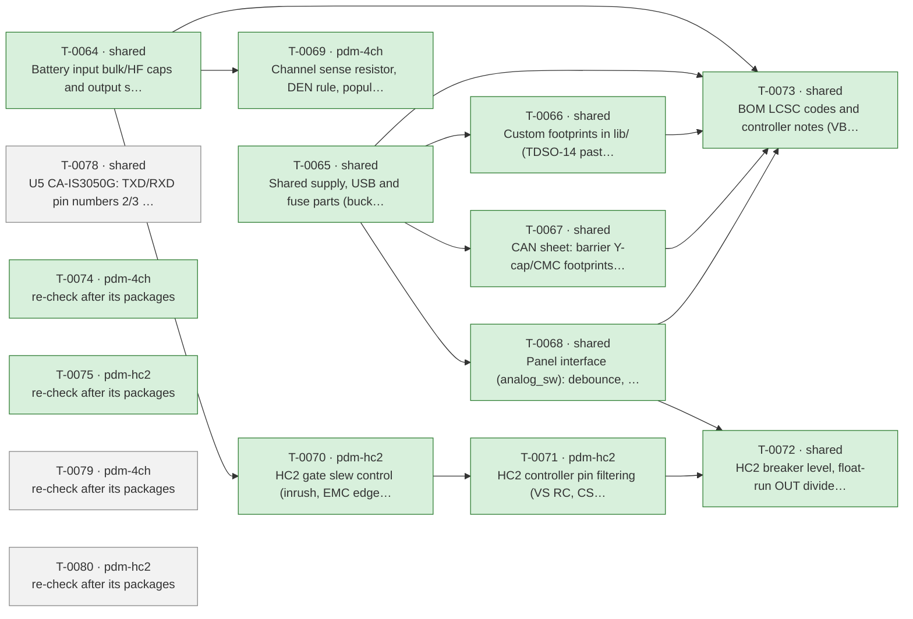

# Roadmap

Generated by `tools/orchestrate.py` from `docs/queue.json` – do not edit. Updated 2026-11-03 09:16. Policy: `docs/AUTONOMY.md`.

**Now:** nothing running · **Up next:** 1 packages · **Done:** 10 packages (44 items) · **Failed:** 0 · **Waiting for you:** 0 (`docs/OWNER-INBOX.md`) · **Deferred:** 14

## Board size

| Board | Parts | DNP | Unique fitted parts | Since the agents started |
|---|---|---|---|---|
| pdm-4ch | 196 | 15 | 61 | +29 parts, +15 DNP, +3 unique |
| pdm-hc2 | 206 | 11 | 70 | +37 parts, +11 DNP, +4 unique |

Every unique extended part costs a loading fee per order; DNP parts cost nothing but board space.

## Plan

Green done · blue running · grey waiting · red failed. Arrows: must finish first.

## Up next – what will change

### T-0078 · shared · U5 CA-IS3050G: TXD/RXD pin numbers 2/3 swapped (both boards)

Waiting.

- CRITICAL · U5 pins 2 and 3 are swapped: datasheet (CA-IS305x v1.10 p. 5 Fig. 6-1/Table 6-1) has pin 2 = RXD, pin 3 = TXD… → your ruling: yes

Planner's brief

Owner ruling (Q-0052), verbatim: "yes" – to the fix: "Swap the pin numbers of TXD and RXD in the ESP32-PDM:CA-IS3050G symbol (TXD = 3, RXD = 2), update symbols on both boards, re-run ERC and netlist, correct the Pinout row in design-notes §8.5." Source: docs/reviews/2026-11-03-validate-pdm-4ch.md C1.

Check first: run `python3 tools/part_facts.py C528763 "SOIC8-WB pinout pins 2 and 3"`. This returns the cached docs/part-facts/C528763.md, which should give 1 VCC1, 2 RXD, 3 TXD, 4 GND1, 5 GND2, 6 CANL, 7 CANH, 8 VCC2 (v1.10 p. 5 Fig. 6-1/Table 6-1; the CA-IS3052G is the part with 2 = TXD, p. 6 Table 6-2). Also confirm that LCSC C528763 is the CA-IS3050G and not the 3052G (part-facts header and the JLCPCB listing). STOP AND ASK (one-way door) if the facts say pin 2 = TXD for the CA-IS3050G, or if C528763 turns out to be a CA-IS3052G. In that case the current wiring is correct for the fitted part, and the owner decides.

Steps, in order:
1. Record the baseline: ERC and kicadxml netlist for pdm-4ch and pdm-hc2 (`tools/sch_query.py <board> ref U5` and `erc`).
2. lib/ESP32-PDM.kicad_sym, symbol CA-IS3050G: change pin number 2 -> 3 on the pin named TXD and 3 -> 2 on the pin named RXD. Keep names, electrical types and positions, so the TXD pin stays at the /IO17 wire end and the RXD pin at the /IO18 wire end.
3. Copy the updated symbol into the lib_symbols cache of hardware/pdm-4ch/can.kicad_sch and hardware/pdm-hc2/can.kicad_sch (tools/ksch.py), with the same text on both sheets.
4. Re-run ERC and the netlist on both boards. Expected: no new errors or warnings (a lib_symbol_mismatch on U5 must not appear). The only netlist change on each board is U5 pin numbers: /IO17 (U1.21, R70.2) -> U5.3 TXD and /IO18 (U1.22) -> U5.2 RXD. U5 pins 1, 4–8 and all other nets stay the same. Declared refs: U5.
5. docs/design-notes.md §8.5: correct the Pinout row to "1 VCC1, 2 RXD, 3 TXD, 4 GND1, 5 GND2, 6 CANL, 7 CANH, 8 VCC2 (Table 6-1; CA-IS3052G has 2/3 swapped, Table 6-2)". Add a dated line to the Symbol bullet saying that T-0076 corrected the pin 2/3 numbers and that R70 stays on TXD (/IO17, now U5.3).
6. Update both hardware/*/STATUS.md (CA-IS3050G entry: pins 2 RXD / 3 TXD). Run tools/fix_check.py --scope shared --refs U5.

Do not: change ARCHITECTURE.md (the pin map IO17 TX / IO18 RX is unchanged), move R70, re-route the IO17/IO18 nets instead of renumbering, or add parts. No heat-budget, cost or LEN effect. Any change beyond U5's pin numbers (new part, pin-map change, change to decision 29) is out of scope: stop and ask.

## Done

| Package | Scope | What | Items | Board growth | Model | Cost | Merged |
|---|---|---|---|---|---|---|---|
| T-0064 | shared | Battery input bulk/HF caps and output surge protection (inv… | 4 | – | opus | 4.12 USD | `dbc672cd` |
| T-0065 | shared | Shared supply, USB and fuse parts (buck caps, USB shield/ES… | 6 | – | opus | 12.15 USD | `e5fedd96` |
| T-0066 | shared | Custom footprints in lib/ (TDSO-14 paste, LMR51610 -> SOT-2… | 2 | – | opus | 1.58 USD | `14b42e65` |
| T-0067 | shared | CAN sheet: barrier Y-cap/CMC footprints, TXD pull-up, CA-IS… | 5 | – | opus | 6.74 USD | `5ffcfb6f` |
| T-0068 | shared | Panel interface (analog_sw): debounce, switch-load resistor… | 6 | pdm-4ch +1 parts (+0 DNP), +1 unique, pdm-hc2 +1 parts (+0 DNP), +1 unique | opus | 2.66 USD | `86fbfe03` |
| T-0069 | pdm-4ch | Channel sense resistor, DEN rule, population rule | 4 | pdm-4ch +4 parts (+4 DNP), +0 unique | sonnet | 0.62 USD | `b9fcef31` |
| T-0070 | pdm-hc2 | HC2 gate slew control (inrush, EMC edges) | 4 | no part changes | opus | 1.65 USD | `` |
| T-0071 | pdm-hc2 | HC2 controller pin filtering (VS RC, CS/EN/OV/IWRN filters,… | 3 | pdm-hc2 +16 parts (+4 DNP), +0 unique | opus | 5.14 USD | `80bb3bd1` |
| T-0072 | shared | HC2 breaker level, float-run OUT divider, reverse-battery d… | 4 | – | opus | 3.99 USD | `901c6f45` |
| T-0073 | shared | BOM LCSC codes and controller notes (VBAT full scale, IO3 s… | 6 | pdm-4ch +0 parts (+0 DNP), -4 unique, pdm-hc2 +0 parts (+0 DNP), -5 unique | opus | 1.13 USD | `1939dfbc` |

Undo a package: `python3 tools/orchestrate.py undo <item>` (any of its items).

## Deferred

**Until order** (4)

- Order 30 instead of 10 per run: -6.05 $/board (4-ch), -7.00 $/board (HC2); 10 instead of 5 saves -9.0/-9.8 $
- USB-C as DNP or pogo pads removes 3 extended fees and ~0.27 $ parts: -1.30 $/board at 10 (overlaps L3)
- How many pdm-4ch and pdm-hc2 boards per order (5, 10, 30)? This is the largest cost lever
- Is a fitted USB-C service connector required, or are pads/DNP plus OTA enough (L4)?

**Until owner** (3)

- 52/59 unique parts cost 1.53 $ each only under Standard PCBA; merging package variants would save ~9 $ per or…
- Does JLCPCB accept 2 oz copper with Economic PCBA? If not, Standard PCBA adds +5.1 $ (4-ch) / +5.6 $ (HC2) pe…
- RDS(on) at 150 C is 11.2 mOhm in the tool; BSC030N08NS5 Diagram 9 max (5.35 mOhm) gives 2 x 5.35 + 1 = 11.7 m…

**Until pcb** (2)

- One panel holding pdm-4ch + pdm-hc2 saves one setup, stencil, THT fee and 15 shared extended fees: -59.79 $/o…
- Is a combined 1:1 panel of pdm-4ch + pdm-hc2 acceptable (L2)?

**Until prototype** (2)

- LMR51610YF (FPWM, same 1.1 MHz) would avoid PFM noise below 350 kHz; E7 asks for a scan first.
- LMR51610XDBVR (400 kHz, C20539658, 0.52 $) instead of the Y variant (1.35 $): -0.83 $/board; needs a re-desig…

**Until system-mechanical** (3)

- Board ground reaches the battery negative through one terminal pole that carries TVS surge current and, on HC…
- Fixed screw terminals instead of pluggable header + plug: about -1.0 $/board (the plug halves alone cost 1.20…
- Pluggable or fixed screw terminals (L5)?

