# Roadmap

Generated by `tools/orchestrate.py` from `docs/queue.json` – do not edit. Updated 2026-11-07 10:38. Policy: `docs/AUTONOMY.md`.

**Now:** nothing running · **Up next:** 3 packages · **Done:** 30 packages (69 items) · **Failed:** 0 · **Waiting for you:** 0 (`docs/OWNER-INBOX.md`) · **Deferred:** 25

## Board size

| Board | Parts | DNP | Unique fitted parts | Since the agents started |
|---|---|---|---|---|
| pdm-4ch | 218 | 15 | 62 | +51 parts, +15 DNP, +4 unique |
| pdm-hc2 | 232 | 11 | 68 | +63 parts, +11 DNP, +2 unique |

Every unique extended part costs a loading fee per order; DNP parts cost nothing but board space.

## Plan

```mermaid
flowchart LR
  T0064["T-0064 · shared<br/>Battery input bulk/HF caps and output s…"]:::done
  T0065["T-0065 · shared<br/>Shared supply, USB and fuse parts (buck…"]:::done
  T0066["T-0066 · shared<br/>Custom footprints in lib/ (TDSO-14 past…"]:::done
  T0067["T-0067 · shared<br/>CAN sheet: barrier Y-cap/CMC footprints…"]:::done
  T0068["T-0068 · shared<br/>Panel interface (analog_sw): debounce, …"]:::done
  T0069["T-0069 · pdm-4ch<br/>Channel sense resistor, DEN rule, popul…"]:::done
  T0070["T-0070 · pdm-hc2<br/>HC2 gate slew control (inrush, EMC edge…"]:::done
  T0071["T-0071 · pdm-hc2<br/>HC2 controller pin filtering (VS RC, CS…"]:::done
  T0072["T-0072 · shared<br/>HC2 breaker level, float-run OUT divide…"]:::done
  T0073["T-0073 · shared<br/>BOM LCSC codes and controller notes (VB…"]:::done
  T0078["T-0078 · shared<br/>U5 CA-IS3050G: TXD/RXD pin numbers 2/3 …"]:::done
  T0082["T-0082 · sync<br/>HC2 heat-budget RDS(on) at 150 C per BS…"]:::done
  T0084["T-0084 · sync<br/>HC2 heat-budget RDS(on) at 150 C - veri…"]:::done
  T0085["T-0085 · sync<br/>Sync the  For /system  lists"]:::done
  T0104["T-0104 · shared<br/>PTC interrupt rating: F1/F3/F4 100 A PT…"]:::done
  T0105["T-0105 · shared<br/>Panel switch loads R3/R4/R7/R8 -  2 k +…"]:::done
  T0106["T-0106 · pdm-hc2<br/>Short EMC gate slew, maximum load capac…"]:::done
  T0107["T-0107 · shared<br/>Extended-part fee levers: C18 -  C9196,…"]:::done
  T0108["T-0108 · shared<br/>README installation guidance (text only)"]:::done
  T0118["T-0118 · shared<br/>PTC interrupt rating: C70113 on F1-F4 p…"]:::done
  T0119["T-0119 · shared<br/>USB shield capacitor C18 to 1 nF/2 kV C…"]:::done
  T0120["T-0120 · pdm-4ch<br/>pdm-4ch VS-tab capacitors C104-C404 to …"]:::done
  T0121["T-0121 · pdm-4ch<br/>pdm-4ch reverse-battery blocking on VS …"]:::done
  T0132["T-0132 · pdm-4ch<br/>Q30 AGM601LL swap check (swap only if i…"]:::done
  T0137["T-0137 · pdm-4ch<br/>TVS across Q30 for negative transients …"]:::done
  T0141["T-0141 · sync<br/>Sync the  For /system  lists"]:::done
  T0143["T-0143 · pdm-4ch<br/>Fit SMDJ40CA across Q30, record the res…"]:::done
  T0147["T-0147 · sync<br/>Sync the  For /system  lists"]:::done
  T0156["T-0156 · sync<br/>Sync the  For /system  lists"]:::done
  T0158["T-0158 · pdm-4ch<br/>pdm-4ch 16 A input: J10 set and Q30 re-…"]:::done
  T0159["T-0159 · shared<br/>Merge near-duplicate BOM lines"]:::ready
  T0160["T-0160 · shared<br/>Sign-of-life LEDs, spare GPIO and seria…"]:::ready
  T0161["T-0161 · shared<br/>Buck input filter position"]:::ready
  T0074["T-0074 · pdm-4ch<br/>re-check after its packages"]:::done
  T0075["T-0075 · pdm-hc2<br/>re-check after its packages"]:::done
  T0079["T-0079 · pdm-4ch<br/>re-check after its packages"]:::done
  T0080["T-0080 · pdm-hc2<br/>re-check after its packages"]:::done
  T0109["T-0109 · pdm-4ch<br/>re-check after its packages"]:::done
  T0110["T-0110 · pdm-hc2<br/>re-check after its packages"]:::done
  T0111["T-0111 · system<br/>re-check after its packages"]:::done
  T0112["T-0112 · system<br/>re-check after its packages"]:::done
  T0122["T-0122 · pdm-4ch<br/>re-check after its packages"]:::done
  T0123["T-0123 · pdm-hc2<br/>re-check after its packages"]:::done
  T0124["T-0124 · system<br/>re-check after its packages"]:::done
  T0125["T-0125 · system<br/>re-check after its packages"]:::done
  T0133["T-0133 · pdm-4ch<br/>re-check after its packages"]:::done
  T0134["T-0134 · system<br/>re-check after its packages"]:::done
  T0135["T-0135 · system<br/>re-check after its packages"]:::done
  T0138["T-0138 · pdm-4ch<br/>re-check after its packages"]:::done
  T0139["T-0139 · system<br/>re-check after its packages"]:::done
  T0140["T-0140 · system<br/>re-check after its packages"]:::done
  T0144["T-0144 · pdm-4ch<br/>re-check after its packages"]:::done
  T0145["T-0145 · system<br/>re-check after its packages"]:::done
  T0146["T-0146 · system<br/>re-check after its packages"]:::done
  T0162["T-0162 · pdm-4ch<br/>re-check after its packages"]:::ready
  T0163["T-0163 · pdm-hc2<br/>re-check after its packages"]:::ready
  T0164["T-0164 · system<br/>re-check after its packages"]:::ready
  T0165["T-0165 · system<br/>re-check after its packages"]:::ready
  T0065 --> T0066
  T0065 --> T0067
  T0065 --> T0068
  T0064 --> T0069
  T0064 --> T0070
  T0070 --> T0071
  T0068 --> T0072
  T0071 --> T0072
  T0064 --> T0073
  T0065 --> T0073
  T0066 --> T0073
  T0067 --> T0073
  T0068 --> T0073
  T0104 --> T0105
  T0105 --> T0107
  T0106 --> T0107
  T0106 --> T0108
  T0118 --> T0119
  T0159 --> T0160
  T0159 --> T0161
  classDef done fill:#d8f0dc,stroke:#2e7d32
  classDef running fill:#d6e6ff,stroke:#1f5fbf
  classDef ready fill:#f2f2f2,stroke:#888
  classDef failed fill:#f9d9d9,stroke:#b3261e
```

Green done · blue running · grey waiting · red failed. Arrows: must finish first.

## Up next – what will change

### T-0159 · shared · Merge near-duplicate BOM lines

Waiting.

- INFO · Standard PCBA charges 1.53 USD per unique line, so near-duplicate values cost about 6 USD (4-ch) and 7.65 USD… → your ruling: yes (owner, 2026-11-06)

Planner's brief

Owner ruling on T-0149, verbatim: yes (owner, 2026-11-06). The approved fix, verbatim: C2 to C307331 (0402), C12 and C13 to C15849, R10 to C25768, HC2 R9 to C36871. C13 is the L78M05 input cap: check the X5R DC-bias curve at 29 V first and keep C28323 if it does not pass. This carries out the merge opened by decisions 33 and 99. Values do not change; only code and package do. All these parts are already on the BOM.

In order, same edit on both boards:
1. Part checks first: C307331 voltage rating against the boot-capacitor requirement of LMR51610 (C2, between SW through R43 and CB); C25768 and C36871 tolerance against the present C31850 and C23231, because R9/R10 set the 3.3 V output; C15849 for C12 on U5 VCC2 (5 V).
2. C13 check: docs/part-facts/C15849.md has no DC-bias curve (UNVERIFIED there, Samsung's simulation tool is the primary source). Take the curve from a primary source, and take the required input capacitance from the L78M05 datasheet (C58069). Effective capacitance at 29 V must meet that requirement with tolerance and temperature included. If no primary curve can be found, or it does not pass, keep C13 on C28323 as the item says and report it; this is the item's own outcome and no stop.
3. Edit: C2 C14663 to C307331 on C_0402_1005Metric; C12 C52923 to C15849 on C_0603_1608Metric; C13 C28323 to C15849 on C_0603_1608Metric if step 2 passes; R10 C31850 to C25768 on R_0402_1005Metric; R9 C23231 to C36871 on R_0402_1005Metric.
4. R9 is on the shared power-usb sheet, so it changes on both boards, not only on HC2 as the item words it, or the shared-sheets gate fails. On pdm-4ch this is cost-neutral (one line swapped for one line). Record this as an auto decision with that reason.
5. Confirm that the old codes are gone from each BOM: C14663, C52923, C31850, C23231, and C28323 if C13 passed. Report lines removed per board and the saving at 1.53 USD per line.
6. Update design-notes (8.3 and 8.5 where they name these parts) and both STATUS files, including the smaller land patterns for layout.

Checks: ERC and netlist before and after on both boards (no connection may change, only the parts' fields); tools/fix_check.py with refs C2, C12, C13, R9, R10; tools/report_check.py.

Stop and ask if: the swap would change the 3.3 V setpoint tolerance in a way decision 30 or the budgets depend on, or C2's rating fails and no part already on the BOM fits (then leave C2 as it is and report it; it is not worth a new line).

### T-0160 · shared · Sign-of-life LEDs, spare GPIO and serial console access

Waiting after T-0159.

- MINOR · The boards have no on-board LED, so a new board gives no sign of life without firmware and a panel (SH-ESP32 … → your ruling: yes (owner, 2026-11-06)
- INFO · Spare GPIOs are unconnected, so later design changes have nowhere to attach without a new PCB → your ruling: yes (owner, 2026-11-06)
- INFO · The serial console is unconnected, so a firmware crash that takes native USB down leaves no diagnostics → your ruling: yes (owner, 2026-11-06)

Planner's brief

Owner rulings, verbatim: T-0150 yes (owner, 2026-11-06); T-0151 yes (owner, 2026-11-06); T-0152 yes (owner, 2026-11-06). Approved fixes, verbatim. T-0150: Add a 3.3 V power LED and a firmware status LED on spare IO13, both low current, using one LED line and a resistor value already on the BOM where it fits. Update the pin map (IO13). Optionally add CAN TX/RX LEDs only if a check against the CA-IS3050G and R70 shows they do not load the signals; otherwise leave them out and say so. T-0151: Bring IO35, IO36, IO37 and IO42, with 3V3 and GND, to an unfitted pad or header footprint with no BOM line (IO13 goes to the status LED, S1). Do not use the strapping pins IO45 and IO46. Check each pin in the datasheet and against the pin map, and record the footprint for layout. T-0152: Bring TXD0, RXD0 and GND to unfitted test pads with no BOM line, near the layout test points of the EMC report.

In order, identical on both boards except where stated:
1. Pin checks through tools/part_facts.py C2913206 (docs/part-facts/C2913206.md): IO13, IO35, IO36, IO37, IO42, TXD0, RXD0 on ESP32-S3-MINI-1-N8: boot state, strapping, in-package use.
2. LEDs: one new fitted LED line, a basic 0603 LED if one fits, datasheet-checked. Power LED from +3V3 to GND. Status LED from IO13 to GND, off while IO13 is not driven. Series resistor from the BOM: 2.2 k C25879 is about 0.5 mA and is the first choice; check brightness against the LED's rated current and IO13's drive. Place the status LED in the controller part of the root sheet on both boards, and the power LED on power-usb or root, the same on both boards. No LED may depend on or load the switch-to-output path (invariant 1). Note in design-notes that the power LED draws continuously, also in the low-power modes of decision 13, and add its current to the controller power figure.
3. Optional CAN LEDs: check U5 RXD drive and TXD input levels from the CA-IS3050G facts (C528763) and R70 10 k on IO17. Add them only if the check shows they do not load the signals, with no new line. Otherwise leave them out and say so. Do not spend a part-facts lookup beyond what this needs.
4. One DNP footprint for T-0151 and T-0152 together, with no LCSC code and no BOM line, next free J reference on both boards, e.g. Connector_PinHeader_2.54mm:PinHeader_1x08_P2.54mm_Vertical if it is in the installed KiCad library. Pins: GND, TXD0, RXD0, IO35, IO36, IO37, IO42, 3V3, with 3V3 at the far end from GND.
5. pdm-hc2 difference: IO35, IO36 and IO37 are FLT_T1, FLT_I2 and FLT_T2 there and are not spare. Under T-0151's own pin-map check, leave those three positions unconnected with no-connect flags on pdm-hc2, and do not touch the FLT nets. pdm-hc2 brings out only GND, TXD0, RXD0, IO42 and 3V3. Record this as an auto decision. Do not add IO33 (HC2) or IO34 (4-ch) to the footprint; mention them as a suggestion in the report only. Do not use IO45 or IO46.
6. Remove the no-connect state from the pins now used. Update ARCHITECTURE pin map: IO13 becomes the status LED on both boards; split IO34-IO37 so that the 4-ch column shows IO34 spare and IO35-IO37 on the unfitted footprint while HC2 stays FLT; add IO42 and TXD0/RXD0 on the unfitted footprint. Do not edit the Invariants section.
7. Layout list in both STATUS files: footprint position near the EMC report's test points (VS, 3V3, GND, buck SW, CANH/CANL; docs/reviews/2026-11-03-emc-system.md item 9), inside the board and not at an edge connector; on-board use only, with no cable leaving the board (invariant 9 for 3V3, invariant 4 because these lines are unprotected); LEDs placed visible with the board in its carrier. Update the T-0150/T-0151 line in 'For /system'. Add the firmware use of IO13 to the /system firmware list.

Checks: ERC with no new errors or warnings, netlist before and after on both boards; tools/fix_check.py with refs U1 and all new parts; tools/report_check.py.

Stop and ask if: a listed pin turns out to be strapping or used inside the module, on the board that was to bring it out, and the item has no alternative; a request would make these lines reach an external connector or take 3V3 off the board (invariants 4 and 9).

### T-0161 · shared · Buck input filter position

Waiting after T-0159.

- INFO · The buck input has capacitors but no LC filter position; SH-ESP32 uses an inductor with damping to limit cond… → your ruling: yes (owner, 2026-11-06)

Planner's brief

Owner ruling on T-0153, verbatim: yes (owner, 2026-11-06). The approved fix, verbatim: Add a filter position between D2 and C1/U3: an inductor footprint bridged by a fitted 0 Ohm part or equivalent, DNP inductor, plus a damping option, so the decision 28 pre-compliance scan can decide. Check the current rating, PTC and R54 interaction and stability against the LMR51610 input requirements.

In order, on power-usb, identical on both boards:
1. Today D2.K, D3.K (USB path), C1, C19 and U3 VIN/EN share one net, Net-(D2-K). Split it so the position is D2.K -> position -> C1/C19/U3. Keep D3.K on the C1/U3 side, so USB-only input keeps its present 3.74 V at 0.40 A (decision 87), which is already below 4 V. C1 and C19 stay at U3 (decisions 30 and 48).
2. Bridge: a fitted 0 Ohm part. First choice C17168 0402, already on the BOM as R43, R71, R72, so no new line. Check its current rating against the normal input current and against a short behind the position while F1 trips (F1 C70113, R54 0.2 Ohm, decision 81). If 0402 is not enough, use a larger 0 Ohm part (C21189 0603 is on the BOM but DNP there, so fitting it adds a line) or a copper bridge, and say why.
3. Inductor: DNP, in parallel with the bridge. Footprint and example value from L1 SWPA6045S8R2MT C96963 (Inductor_SMD:L_Sunlord_SWPA6045S, 8.2 uH, already on the BOM), unless the checks show it does not fit. Its current rating must cover F1's hold and trip behaviour. The final value is set at the scan.
4. Damping option: DNP only, using values and parts already on the BOM where they fit (for example an R in series with a C across C1, or an R across the inductor; R44's 10 Ohm C17903 and C170101 are on the BOM). No fitted part and no new line.
5. Checks, and write them in design-notes 8.3: bridge fitted: no change to the buck input beyond the added resistance. Inductor fitted: LC resonance with C1 + C19 against the switching frequency; filter output impedance against the buck's negative input impedance at the lowest input voltage, with R54 + PTC resistance included; the drop at peak input current; LMR51610 input requirements from docs/part-facts/C22427220.md, including the 2.2 uF minimum behind decision 48. Say which damping values the scan should start from.
6. Add to both STATUS files: the layout rule (the input loop C1/C19/U3 stays tight and is unchanged; the position sits before C1); the pre-compliance item for decision 28; and that decision 81's mandatory hard-short test behind F1 is made with the bridge fitted.

Checks: ERC and netlist before and after on both boards; tools/fix_check.py with refs D2, D3, C1, C19, U3 and the new parts; tools/report_check.py. The EMC re-check follows automatically. A competent person reviews F1 and R54 before installation (decision 81).

Stop and ask if: the position only works by changing F1, R54 or their ratings (decision 81), C1 below its minimum, or the USB-only margin; or the bridge cannot survive the F1 trip in any footprint, because that changes the protection (safety). Do not fit the inductor or damping parts: that is the scan's decision.

## Done

| Package | Scope | What | Items | Board growth | Model | Cost | Merged |
|---|---|---|---|---|---|---|---|
| T-0064 | shared | Battery input bulk/HF caps and output surge protection (inv… | 4 | – | opus | 4.12 USD | `dbc672cd` |
| T-0065 | shared | Shared supply, USB and fuse parts (buck caps, USB shield/ES… | 6 | – | opus | 12.15 USD | `e5fedd96` |
| T-0066 | shared | Custom footprints in lib/ (TDSO-14 paste, LMR51610 -> SOT-2… | 2 | – | opus | 1.58 USD | `14b42e65` |
| T-0067 | shared | CAN sheet: barrier Y-cap/CMC footprints, TXD pull-up, CA-IS… | 5 | – | opus | 6.74 USD | `5ffcfb6f` |
| T-0068 | shared | Panel interface (analog_sw): debounce, switch-load resistor… | 6 | pdm-4ch +1 parts (+0 DNP), +1 unique, pdm-hc2 +1 parts (+0 DNP), +1 unique | opus | 2.66 USD | `86fbfe03` |
| T-0069 | pdm-4ch | Channel sense resistor, DEN rule, population rule | 4 | pdm-4ch +4 parts (+4 DNP), +0 unique | sonnet | 0.62 USD | `b9fcef31` |
| T-0070 | pdm-hc2 | HC2 gate slew control (inrush, EMC edges) | 4 | no part changes | opus | 1.65 USD | `c036d2a6` |
| T-0071 | pdm-hc2 | HC2 controller pin filtering (VS RC, CS/EN/OV/IWRN filters,… | 3 | pdm-hc2 +16 parts (+4 DNP), +0 unique | opus | 5.14 USD | `80bb3bd1` |
| T-0072 | shared | HC2 breaker level, float-run OUT divider, reverse-battery d… | 4 | – | opus | 3.99 USD | `c036d2a6` |
| T-0073 | shared | BOM LCSC codes and controller notes (VBAT full scale, IO3 s… | 6 | pdm-4ch +0 parts (+0 DNP), -4 unique, pdm-hc2 +0 parts (+0 DNP), -5 unique | opus | 1.13 USD | `1939dfbc` |
| T-0078 | shared | U5 CA-IS3050G: TXD/RXD pin numbers 2/3 swapped (both boards) | 1 | no part changes | opus | 0.51 USD | `d42065e2` |
| T-0082 | sync | HC2 heat-budget RDS(on) at 150 C per BSC030N08NS5 Diagram 9 | 1 | no part changes | opus | 0.24 USD | `24bf9f3b` |
| T-0084 | sync | HC2 heat-budget RDS(on) at 150 C - verify T-0082 sync and c… | 1 | no part changes | opus | 0.15 USD | `24bf9f3b` |
| T-0085 | sync | Sync the "For /system" lists | 0 | no part changes | opus | 0.71 USD |  |
| T-0104 | shared | PTC interrupt rating: F1/F3/F4 100 A PTC + series resistor,… | 1 | no part changes | opus | 3.21 USD | `3b24acd6` |
| T-0105 | shared | Panel switch loads R3/R4/R7/R8 -> 2 k + 2 k basic | 1 | pdm-4ch +4 parts (+0 DNP), +0 unique, pdm-hc2 +4 parts (+0 DNP), +0 unique | opus | 1.49 USD | `849fc1d6` |
| T-0106 | pdm-hc2 | Short EMC gate slew, maximum load capacitance, HC2 load gui… | 4 | pdm-hc2 +6 parts (+0 DNP), +0 unique | opus | 3.28 USD | `c036d2a6` |
| T-0107 | shared | Extended-part fee levers: C18 -> C9196, RIS -> 2 x C4410, 1… | 4 | pdm-4ch +4 parts (+0 DNP), +0 unique, pdm-hc2 +0 parts (+0 DNP), -1 unique | opus | 3.21 USD | `196bdd9c` |
| T-0108 | shared | README installation guidance (text only) | 1 | no part changes | opus | 0.25 USD | `c9bce1a7` |
| T-0118 | shared | PTC interrupt rating: C70113 on F1-F4 plus 0.2 ohm series r… | 1 | pdm-4ch +3 parts (+0 DNP), +0 unique, pdm-hc2 +3 parts (+0 DNP), +0 unique | opus | 1.81 USD | `3b24acd6` |
| T-0119 | shared | USB shield capacitor C18 to 1 nF/2 kV C9196 | 2 | pdm-4ch +0 parts (+0 DNP), -1 unique, pdm-hc2 +0 parts (+0 DNP), -1 unique | opus | 0.47 USD | `196bdd9c` |
| T-0120 | pdm-4ch | pdm-4ch VS-tab capacitors C104-C404 to 2.2 uF/100 V C170101 | 2 | pdm-4ch +0 parts (+0 DNP), -1 unique | opus | 0.41 USD | `70cdd9cf` |
| T-0121 | pdm-4ch | pdm-4ch reverse-battery blocking on VS in front of the bulk… | 1 | pdm-4ch +3 parts (+0 DNP), +2 unique | opus | 4.44 USD | `f1f3f88b` |
| T-0132 | pdm-4ch | Q30 AGM601LL swap check (swap only if it passes) and design… | 2 | no part changes | opus | 7.06 USD | `605f3305` |
| T-0137 | pdm-4ch | TVS across Q30 for negative transients with VS charged | 1 | no part changes | opus | 4.12 USD | `9cda47c8` |
| T-0141 | sync | Sync the "For /system" lists | 0 | no part changes | opus | 0.80 USD |  |
| T-0143 | pdm-4ch | Fit SMDJ40CA across Q30, record the residual risk and the p… | 1 | pdm-4ch +1 parts (+0 DNP), +1 unique | opus | 1.94 USD | `9cda47c8` |
| T-0147 | sync | Sync the "For /system" lists | 0 | no part changes | opus | 0.76 USD |  |
| T-0156 | sync | Sync the "For /system" lists | 0 | no part changes | opus | 0.61 USD |  |
| T-0158 | pdm-4ch | pdm-4ch 16 A input: J10 set and Q30 re-selection | 1 | no part changes | opus | 2.93 USD | `232c3185` |

Undo a package: `python3 tools/orchestrate.py undo <item>` (any of its items).

## Deferred

**Until order** (12)

- Order 30 instead of 10 per run: -6.05 $/board (4-ch), -7.00 $/board (HC2); 10 instead of 5 saves -9.0/-9.8 $
- USB-C as DNP or pogo pads removes 3 extended fees and ~0.27 $ parts: -1.30 $/board at 10 (overlaps L3)
- How many pdm-4ch and pdm-hc2 boards per order (5, 10, 30)? This is the largest cost lever
- Is a fitted USB-C service connector required, or are pads/DNP plus OTA enough (L4)?
- TPS48110A stock is 989 and L1 1231, both single-source or thin; nothing is below 500
- 30 instead of 10 boards per order saves 6.38 USD (4-ch) / 7.12 USD (HC2) per board; 10 instead of 5 saves 9.4…
- Hand-soldering the four through-hole connectors removes 4 extended fees and the THT labour: 16.2 USD per orde…
- USB-C as service pads on later runs saves 3 extended fees and parts: 1.20 USD per board at 10
- A monthly JLCPCB assembly coupon may waive the 8.18 USD setup per order (conditions for 2 oz and Economic PCB…
- Should the first order use the free-assembly coupon (L6) or hand-soldered connectors (L3)?
- C13832 removal costs 0.162 USD per board against a 3.07 USD fee per order, so it pays only up to about 19 boa…
- C170101 instead of C13832 saves the loading fee only below about 14 boards per order; above that C13832 is ch…

**Until owner** (3)

- 52/59 unique parts cost 1.53 $ each only under Standard PCBA; merging package variants would save ~9 $ per or…
- Does JLCPCB accept 2 oz copper with Economic PCBA? If not, Standard PCBA adds +5.1 $ (4-ch) / +5.6 $ (HC2) pe…
- C30 swap to 2.2 uF C170101 adds about 0.054 USD per board on pdm-4ch with no fee saved, because C13832 stays …

**Until pcb** (3)

- One panel holding pdm-4ch + pdm-hc2 saves one setup, stencil, THT fee and 15 shared extended fees: -59.79 $/o…
- Is a combined 1:1 panel of pdm-4ch + pdm-hc2 acceptable (L2)?
- One panel for both designs saves 62.9 USD per order (3.15 USD per board at 10 + 10)

**Until prototype** (3)

- LMR51610YF (FPWM, same 1.1 MHz) would avoid PFM noise below 350 kHz; E7 asks for a scan first.
- LMR51610XDBVR (400 kHz, C20539658, 0.52 $) instead of the Y variant (1.35 $): -0.83 $/board; needs a re-desig…
- SH-ESP32 uses the same 60 V PTC without a series resistor; removing R54-R56 would save one line, about 2-3 US…

**Until system-mechanical** (4)

- Board ground reaches the battery negative through one terminal pole that carries TVS surge current and, on HC…
- Fixed screw terminals instead of pluggable header + plug: about -1.0 $/board (the plug halves alone cost 1.20…
- Pluggable or fixed screw terminals (L5)?
- SH-ESP32 fits standard 100 x 68 x 50 mm waterproof enclosures; pdm-4ch at about 100 x 65 mm is close, which c…

