# Roadmap

Generated by `tools/orchestrate.py` from `docs/queue.json` – do not edit. Updated 2026-11-04 21:03. Policy: `docs/AUTONOMY.md`.

**Now:** nothing running · **Up next:** 1 packages · **Done:** 24 packages (66 items) · **Failed:** 0 · **Waiting for you:** 0 (`docs/OWNER-INBOX.md`) · **Deferred:** 23

## Board size

| Board | Parts | DNP | Unique fitted parts | Since the agents started |
|---|---|---|---|---|
| pdm-4ch | 210 | 15 | 61 | +43 parts, +15 DNP, +3 unique |
| pdm-hc2 | 225 | 11 | 68 | +56 parts, +11 DNP, +2 unique |

Every unique extended part costs a loading fee per order; DNP parts cost nothing but board space.

## Plan

```mermaid
flowchart LR
  T0064["T-0064 · shared<br/>Battery input bulk/HF caps and output s…"]:::done
  T0065["T-0065 · shared<br/>Shared supply, USB and fuse parts (buck…"]:::done
  T0066["T-0066 · shared<br/>Custom footprints in lib/ (TDSO-14 past…"]:::done
  T0067["T-0067 · shared<br/>CAN sheet: barrier Y-cap/CMC footprints…"]:::done
  T0068["T-0068 · shared<br/>Panel interface (analog_sw): debounce, …"]:::done
  T0069["T-0069 · pdm-4ch<br/>Channel sense resistor, DEN rule, popul…"]:::done
  T0070["T-0070 · pdm-hc2<br/>HC2 gate slew control (inrush, EMC edge…"]:::done
  T0071["T-0071 · pdm-hc2<br/>HC2 controller pin filtering (VS RC, CS…"]:::done
  T0072["T-0072 · shared<br/>HC2 breaker level, float-run OUT divide…"]:::done
  T0073["T-0073 · shared<br/>BOM LCSC codes and controller notes (VB…"]:::done
  T0078["T-0078 · shared<br/>U5 CA-IS3050G: TXD/RXD pin numbers 2/3 …"]:::done
  T0082["T-0082 · sync<br/>HC2 heat-budget RDS(on) at 150 C per BS…"]:::done
  T0084["T-0084 · sync<br/>HC2 heat-budget RDS(on) at 150 C - veri…"]:::done
  T0085["T-0085 · sync<br/>Sync the  For /system  lists"]:::done
  T0104["T-0104 · shared<br/>PTC interrupt rating: F1/F3/F4 100 A PT…"]:::done
  T0105["T-0105 · shared<br/>Panel switch loads R3/R4/R7/R8 -  2 k +…"]:::done
  T0106["T-0106 · pdm-hc2<br/>Short EMC gate slew, maximum load capac…"]:::done
  T0107["T-0107 · shared<br/>Extended-part fee levers: C18 -  C9196,…"]:::done
  T0108["T-0108 · shared<br/>README installation guidance (text only)"]:::done
  T0118["T-0118 · shared<br/>PTC interrupt rating: C70113 on F1-F4 p…"]:::done
  T0119["T-0119 · shared<br/>USB shield capacitor C18 to 1 nF/2 kV C…"]:::done
  T0120["T-0120 · pdm-4ch<br/>pdm-4ch VS-tab capacitors C104-C404 to …"]:::done
  T0121["T-0121 · pdm-4ch<br/>pdm-4ch reverse-battery blocking on VS …"]:::done
  T0132["T-0132 · pdm-4ch<br/>Q30 AGM601LL swap check (swap only if i…"]:::done
  T0137["T-0137 · pdm-4ch<br/>TVS across Q30 for negative transients …"]:::ready
  T0074["T-0074 · pdm-4ch<br/>re-check after its packages"]:::done
  T0075["T-0075 · pdm-hc2<br/>re-check after its packages"]:::done
  T0079["T-0079 · pdm-4ch<br/>re-check after its packages"]:::done
  T0080["T-0080 · pdm-hc2<br/>re-check after its packages"]:::done
  T0109["T-0109 · pdm-4ch<br/>re-check after its packages"]:::done
  T0110["T-0110 · pdm-hc2<br/>re-check after its packages"]:::done
  T0111["T-0111 · system<br/>re-check after its packages"]:::done
  T0112["T-0112 · system<br/>re-check after its packages"]:::done
  T0122["T-0122 · pdm-4ch<br/>re-check after its packages"]:::done
  T0123["T-0123 · pdm-hc2<br/>re-check after its packages"]:::done
  T0124["T-0124 · system<br/>re-check after its packages"]:::done
  T0125["T-0125 · system<br/>re-check after its packages"]:::done
  T0133["T-0133 · pdm-4ch<br/>re-check after its packages"]:::done
  T0134["T-0134 · system<br/>re-check after its packages"]:::done
  T0135["T-0135 · system<br/>re-check after its packages"]:::done
  T0138["T-0138 · pdm-4ch<br/>re-check after its packages"]:::ready
  T0139["T-0139 · system<br/>re-check after its packages"]:::ready
  T0140["T-0140 · system<br/>re-check after its packages"]:::ready
  T0065 --> T0066
  T0065 --> T0067
  T0065 --> T0068
  T0064 --> T0069
  T0064 --> T0070
  T0070 --> T0071
  T0068 --> T0072
  T0071 --> T0072
  T0064 --> T0073
  T0065 --> T0073
  T0066 --> T0073
  T0067 --> T0073
  T0068 --> T0073
  T0104 --> T0105
  T0105 --> T0107
  T0106 --> T0107
  T0106 --> T0108
  T0118 --> T0119
  classDef done fill:#d8f0dc,stroke:#2e7d32
  classDef running fill:#d6e6ff,stroke:#1f5fbf
  classDef ready fill:#f2f2f2,stroke:#888
  classDef failed fill:#f9d9d9,stroke:#b3261e
```

Green done · blue running · grey waiting · red failed. Arrows: must finish first.

## Up next – what will change

### T-0137 · pdm-4ch · TVS across Q30 for negative transients with VS charged

Waiting.

- MINOR · A negative transient clamped by D30 at about -48.4 V while VS is charged puts about 77 V across Q30 (60 V rat… → your ruling: Fit a TVS across Q30 (drain VS to source VBAT_FL) on the first order. Choose it so that Q30 VDS stays below 60 V at the pulse current while the TVS takes the e…

Planner's brief

Owner's ruling Q-0066, verbatim: "Fit a TVS across Q30 (drain VS to source VBAT_FL) on the first order. Choose it so that Q30 VDS stays below 60 V at the pulse current while the TVS takes the energy of a negative transient with VS charged (80-115 mJ, check at the real maximum input of 32 A = 4 x BTT6010 at 8 A); it must not conduct for a steady reversed battery (<= 28 V) or in normal operation. Basic/preferred part if one fits. Correct design-notes 8.6 (b) and adjust the 8.6 (c) wording (the TVS is across Q30, not from VS to GND; the OUT->VS->Q30->D30 surge path stays). Back to the owner if no part keeps VDS below 60 V."

Background: docs/reviews/2026-11-03-emc-system-2.md E18, docs/reviews/2026-11-03-fix-pdm-4ch-T-0132.md, design-notes 8.6, docs/part-facts/C122552.md. The plan report docs/reviews/2026-11-04-plan-system-T-0136.md explains points 1-3 below with tables; its TVS figures are family values from memory, not checked, so verify them.

In order:

1. Part facts first, with tools/part_facts.py. Read SMCJ30CA C19077607 (already on the BOM as D30, no new unique part; the first candidate): VRWM, VBR min/max, VC at Ipp, IR at 28 V, peak pulse power against pulse duration, JLCPCB basic/preferred status. If point 2 or 3 needs a higher clamp, look up the same-family SMCJ36CA, SMCJ40CA and SMCJ43CA with the pcbparts tools or part_facts.py and read their facts. Prefer a basic/preferred part if one fits, as the ruling says. Use a bidirectional CA part: a unidirectional TVS would conduct forward next to Q30's body diode at power-up, and the ruling says no conduction in normal operation. Do not add a second TVS, a series element, or any other extra part or footprint.

2. Pulse current basis. It is not the 32 A load. The TVS current ends in VBAT_IN, so it cannot exceed what the transient source pulls from that node; if it tried to, VBAT_IN would rise and D30 would stop conducting. D30 only holds -48.4 V up to its Ipp, so that model implies a source of at most about 31 A (verify in the D30 facts). Check this reasoning, and if you accept it, use D30's Ipp as the bounding current and state it as an assumption in the design notes. Also give VDS at the textbook ISO 7637-2 pulse 1 source current if you can source that figure, marked as such, and give the T-0132 stiff-clamp figure (VBAT_IN fixed at -48.4 V, current limited only by C31 ESR, 30-300 mOhm) next to it for comparison. C31's ESR has no lower limit in its facts file.

3. Checks for each candidate: (a) VDS below 60 V at the bounding current, using VBR max plus the slope from VC at Ipp, with a margin stated. (b) VRWM at least 28 V, with IR at 28 V: confirm the leakage into VS during a steady reversed battery is harmless (R60 divider about 242 k), and keep the claim of no time limit in 8.6 'Reverse battery now' only if that holds; also update that paragraph for what happens above D30 VBR and with VS charged at the moment of reversal, where the TVS conducts once. (c) Normal operation: no conduction with Q30 on (VDS near 0) or at power-up. (d) Energy: recompute, because the 80-115 mJ was for Q30 avalanching at 60-66 V; a lower clamp takes more from the capacitors, E = C x (VS + 48.4 - Vc) x Vc with C = 109.2 uF and VS = 29 V gives about 150-164 mJ for Vc 39-50 V. Add the energy fed to the loads for the rest of the pulse at the 32 A case (load about 0.75 ohm in total, current falling with VS, bounded by source current x Vc x pulse length) and compare with the part's pulse rating at that duration. (e) VS at the end of the pulse = V(TVS) - V(D30), worst tolerances, at the bounding current and at lower currents. Choose the part that meets (a)-(d) with VS least negative, preferring the part already on the BOM when it also meets (e).

4. Schematic: add one TVS with tools/ksch.py on the pdm-4ch root sheet, next free ref (D31 is free; D30 is the highest D3x), between Q30 drain net VS and source net VBAT_FL, with an LCSC code. No net changes other than the new part's connections. Run ERC and compare the netlist before and after; declare refs: only the new TVS. Change no shared sheet, because this part of the root sheet exists only on pdm-4ch and the controller part stays identical.

5. Heat: the TVS dissipates nothing in steady state, so the heat budget is unchanged. Run tools/heat_budget.py at 40 C with the existing --r-path 0.00505 and --mix case to confirm, as CLAUDE.md requires. Do not change its inputs.

6. Docs, within the package's scope: design-notes 8.6 (b): replace 'VDS <= 48.4 V' with the true statement (steady reversal with VS discharged against a negative transient with VS charged, which the TVS now clamps), with the pulse-current assumption and the T-0130 note that such transients on a real bus are unverified. 8.6 (c): the TVS is across Q30, not from VS to GND; the OUT->VS->Q30->D30 surge path stays; invariant 4 wording unchanged. Add the part to the 8.6 parts table and Cost. Failure modes: TVS short (bypasses Q30: no reverse protection, not visible in use, same as 'Q30 fails short'); TVS open (back to Q30 avalanche, the T-0132 hot-start margin). Keep the competent-person review reminder (F4 feeds navigation lights and bilge forced run). PCB rule: TVS directly across Q30 drain tab and source pins, short and wide. README: change only if its reverse-battery text is no longer true. pdm-4ch STATUS.md: replace the 'T-0129 blocked for the owner' state with the result, add the PCB rule, and add a footprint/JLCPCB pre-order line only if the part is new. Add to the T-0121 sync note for the ARCHITECTURE root row that the blocker now includes this TVS; do not edit docs/ARCHITECTURE.md (not in this scope).

Record the part choice as an auto decision. Do not add the owner's ruling as a decision row: the planner has drafted it.

Stop and ask (one-way door), with your numbers: (i) no part keeps Q30 VDS below 60 V at the bounding current (the ruling says back to the owner). (ii) The bounding current in step 2 does not hold up and the stiff-clamp case has to be met, and no part meets it. (iii) Every part that meets (a)-(d) lets VS fall below 0 V at the bounding current, or at a transient source you take as realistic: negative VS on C31 and the VS parts goes against the purpose of decision 82 (C31 has no reverse rating), and the ruling did not cover it, so give the owner the VS figure and pulse length per candidate and let the owner choose. (iv) No candidate has an adequate pulse rating for the recomputed energy. (v) The fix would need a change to an invariant or to the OUT->VS->Q30->D30 surge path. Do not add parts, change Q30 or D30, or limit the input rating to get around a stop.

## Done

| Package | Scope | What | Items | Board growth | Model | Cost | Merged |
|---|---|---|---|---|---|---|---|
| T-0064 | shared | Battery input bulk/HF caps and output surge protection (inv… | 4 | – | opus | 4.12 USD | `dbc672cd` |
| T-0065 | shared | Shared supply, USB and fuse parts (buck caps, USB shield/ES… | 6 | – | opus | 12.15 USD | `e5fedd96` |
| T-0066 | shared | Custom footprints in lib/ (TDSO-14 paste, LMR51610 -> SOT-2… | 2 | – | opus | 1.58 USD | `14b42e65` |
| T-0067 | shared | CAN sheet: barrier Y-cap/CMC footprints, TXD pull-up, CA-IS… | 5 | – | opus | 6.74 USD | `5ffcfb6f` |
| T-0068 | shared | Panel interface (analog_sw): debounce, switch-load resistor… | 6 | pdm-4ch +1 parts (+0 DNP), +1 unique, pdm-hc2 +1 parts (+0 DNP), +1 unique | opus | 2.66 USD | `86fbfe03` |
| T-0069 | pdm-4ch | Channel sense resistor, DEN rule, population rule | 4 | pdm-4ch +4 parts (+4 DNP), +0 unique | sonnet | 0.62 USD | `b9fcef31` |
| T-0070 | pdm-hc2 | HC2 gate slew control (inrush, EMC edges) | 4 | no part changes | opus | 1.65 USD | `c036d2a6` |
| T-0071 | pdm-hc2 | HC2 controller pin filtering (VS RC, CS/EN/OV/IWRN filters,… | 3 | pdm-hc2 +16 parts (+4 DNP), +0 unique | opus | 5.14 USD | `80bb3bd1` |
| T-0072 | shared | HC2 breaker level, float-run OUT divider, reverse-battery d… | 4 | – | opus | 3.99 USD | `c036d2a6` |
| T-0073 | shared | BOM LCSC codes and controller notes (VBAT full scale, IO3 s… | 6 | pdm-4ch +0 parts (+0 DNP), -4 unique, pdm-hc2 +0 parts (+0 DNP), -5 unique | opus | 1.13 USD | `1939dfbc` |
| T-0078 | shared | U5 CA-IS3050G: TXD/RXD pin numbers 2/3 swapped (both boards) | 1 | no part changes | opus | 0.51 USD | `d42065e2` |
| T-0082 | sync | HC2 heat-budget RDS(on) at 150 C per BSC030N08NS5 Diagram 9 | 1 | no part changes | opus | 0.24 USD | `24bf9f3b` |
| T-0084 | sync | HC2 heat-budget RDS(on) at 150 C - verify T-0082 sync and c… | 1 | no part changes | opus | 0.15 USD | `24bf9f3b` |
| T-0085 | sync | Sync the "For /system" lists | 0 | no part changes | opus | 0.71 USD |  |
| T-0104 | shared | PTC interrupt rating: F1/F3/F4 100 A PTC + series resistor,… | 1 | no part changes | opus | 3.21 USD | `3b24acd6` |
| T-0105 | shared | Panel switch loads R3/R4/R7/R8 -> 2 k + 2 k basic | 1 | pdm-4ch +4 parts (+0 DNP), +0 unique, pdm-hc2 +4 parts (+0 DNP), +0 unique | opus | 1.49 USD | `849fc1d6` |
| T-0106 | pdm-hc2 | Short EMC gate slew, maximum load capacitance, HC2 load gui… | 4 | pdm-hc2 +6 parts (+0 DNP), +0 unique | opus | 3.28 USD | `c036d2a6` |
| T-0107 | shared | Extended-part fee levers: C18 -> C9196, RIS -> 2 x C4410, 1… | 4 | pdm-4ch +4 parts (+0 DNP), +0 unique, pdm-hc2 +0 parts (+0 DNP), -1 unique | opus | 3.21 USD | `196bdd9c` |
| T-0108 | shared | README installation guidance (text only) | 1 | no part changes | opus | 0.25 USD | `c9bce1a7` |
| T-0118 | shared | PTC interrupt rating: C70113 on F1-F4 plus 0.2 ohm series r… | 1 | pdm-4ch +3 parts (+0 DNP), +0 unique, pdm-hc2 +3 parts (+0 DNP), +0 unique | opus | 1.81 USD | `3b24acd6` |
| T-0119 | shared | USB shield capacitor C18 to 1 nF/2 kV C9196 | 2 | pdm-4ch +0 parts (+0 DNP), -1 unique, pdm-hc2 +0 parts (+0 DNP), -1 unique | opus | 0.47 USD | `196bdd9c` |
| T-0120 | pdm-4ch | pdm-4ch VS-tab capacitors C104-C404 to 2.2 uF/100 V C170101 | 2 | pdm-4ch +0 parts (+0 DNP), -1 unique | opus | 0.41 USD | `70cdd9cf` |
| T-0121 | pdm-4ch | pdm-4ch reverse-battery blocking on VS in front of the bulk… | 1 | pdm-4ch +3 parts (+0 DNP), +2 unique | opus | 4.44 USD | `f1f3f88b` |
| T-0132 | pdm-4ch | Q30 AGM601LL swap check (swap only if it passes) and design… | 2 | no part changes | opus | 7.06 USD | `605f3305` |

Undo a package: `python3 tools/orchestrate.py undo <item>` (any of its items).

## Deferred

**Until order** (12)

- Order 30 instead of 10 per run: -6.05 $/board (4-ch), -7.00 $/board (HC2); 10 instead of 5 saves -9.0/-9.8 $
- USB-C as DNP or pogo pads removes 3 extended fees and ~0.27 $ parts: -1.30 $/board at 10 (overlaps L3)
- How many pdm-4ch and pdm-hc2 boards per order (5, 10, 30)? This is the largest cost lever
- Is a fitted USB-C service connector required, or are pads/DNP plus OTA enough (L4)?
- TPS48110A stock is 989 and L1 1231, both single-source or thin; nothing is below 500
- 30 instead of 10 boards per order saves 6.38 USD (4-ch) / 7.12 USD (HC2) per board; 10 instead of 5 saves 9.4…
- Hand-soldering the four through-hole connectors removes 4 extended fees and the THT labour: 16.2 USD per orde…
- USB-C as service pads on later runs saves 3 extended fees and parts: 1.20 USD per board at 10
- A monthly JLCPCB assembly coupon may waive the 8.18 USD setup per order (conditions for 2 oz and Economic PCB…
- Should the first order use the free-assembly coupon (L6) or hand-soldered connectors (L3)?
- C13832 removal costs 0.162 USD per board against a 3.07 USD fee per order, so it pays only up to about 19 boa…
- C170101 instead of C13832 saves the loading fee only below about 14 boards per order; above that C13832 is ch…

**Until owner** (3)

- 52/59 unique parts cost 1.53 $ each only under Standard PCBA; merging package variants would save ~9 $ per or…
- Does JLCPCB accept 2 oz copper with Economic PCBA? If not, Standard PCBA adds +5.1 $ (4-ch) / +5.6 $ (HC2) pe…
- C30 swap to 2.2 uF C170101 adds about 0.054 USD per board on pdm-4ch with no fee saved, because C13832 stays …

**Until pcb** (3)

- One panel holding pdm-4ch + pdm-hc2 saves one setup, stencil, THT fee and 15 shared extended fees: -59.79 $/o…
- Is a combined 1:1 panel of pdm-4ch + pdm-hc2 acceptable (L2)?
- One panel for both designs saves 62.9 USD per order (3.15 USD per board at 10 + 10)

**Until prototype** (2)

- LMR51610YF (FPWM, same 1.1 MHz) would avoid PFM noise below 350 kHz; E7 asks for a scan first.
- LMR51610XDBVR (400 kHz, C20539658, 0.52 $) instead of the Y variant (1.35 $): -0.83 $/board; needs a re-desig…

**Until system-mechanical** (3)

- Board ground reaches the battery negative through one terminal pole that carries TVS surge current and, on HC…
- Fixed screw terminals instead of pluggable header + plug: about -1.0 $/board (the plug halves alone cost 1.20…
- Pluggable or fixed screw terminals (L5)?

