# Roadmap

Generated by `tools/orchestrate.py` from `docs/queue.json` – do not edit. Updated 2026-11-03 23:06. Policy: `docs/AUTONOMY.md`.

**Now:** nothing running · **Up next:** 1 packages · **Done:** 23 packages (64 items) · **Failed:** 0 · **Waiting for you:** 0 (`docs/OWNER-INBOX.md`) · **Deferred:** 23

## Board size

| Board | Parts | DNP | Unique fitted parts | Since the agents started |
|---|---|---|---|---|
| pdm-4ch | 210 | 15 | 61 | +43 parts, +15 DNP, +3 unique |
| pdm-hc2 | 225 | 11 | 68 | +56 parts, +11 DNP, +2 unique |

Every unique extended part costs a loading fee per order; DNP parts cost nothing but board space.

## Plan

```mermaid
flowchart LR
  T0064["T-0064 · shared<br/>Battery input bulk/HF caps and output s…"]:::done
  T0065["T-0065 · shared<br/>Shared supply, USB and fuse parts (buck…"]:::done
  T0066["T-0066 · shared<br/>Custom footprints in lib/ (TDSO-14 past…"]:::done
  T0067["T-0067 · shared<br/>CAN sheet: barrier Y-cap/CMC footprints…"]:::done
  T0068["T-0068 · shared<br/>Panel interface (analog_sw): debounce, …"]:::done
  T0069["T-0069 · pdm-4ch<br/>Channel sense resistor, DEN rule, popul…"]:::done
  T0070["T-0070 · pdm-hc2<br/>HC2 gate slew control (inrush, EMC edge…"]:::done
  T0071["T-0071 · pdm-hc2<br/>HC2 controller pin filtering (VS RC, CS…"]:::done
  T0072["T-0072 · shared<br/>HC2 breaker level, float-run OUT divide…"]:::done
  T0073["T-0073 · shared<br/>BOM LCSC codes and controller notes (VB…"]:::done
  T0078["T-0078 · shared<br/>U5 CA-IS3050G: TXD/RXD pin numbers 2/3 …"]:::done
  T0082["T-0082 · sync<br/>HC2 heat-budget RDS(on) at 150 C per BS…"]:::done
  T0084["T-0084 · sync<br/>HC2 heat-budget RDS(on) at 150 C - veri…"]:::done
  T0085["T-0085 · sync<br/>Sync the  For /system  lists"]:::done
  T0104["T-0104 · shared<br/>PTC interrupt rating: F1/F3/F4 100 A PT…"]:::done
  T0105["T-0105 · shared<br/>Panel switch loads R3/R4/R7/R8 -  2 k +…"]:::done
  T0106["T-0106 · pdm-hc2<br/>Short EMC gate slew, maximum load capac…"]:::done
  T0107["T-0107 · shared<br/>Extended-part fee levers: C18 -  C9196,…"]:::done
  T0108["T-0108 · shared<br/>README installation guidance (text only)"]:::done
  T0118["T-0118 · shared<br/>PTC interrupt rating: C70113 on F1-F4 p…"]:::done
  T0119["T-0119 · shared<br/>USB shield capacitor C18 to 1 nF/2 kV C…"]:::done
  T0120["T-0120 · pdm-4ch<br/>pdm-4ch VS-tab capacitors C104-C404 to …"]:::done
  T0121["T-0121 · pdm-4ch<br/>pdm-4ch reverse-battery blocking on VS …"]:::done
  T0132["T-0132 · pdm-4ch<br/>Q30 AGM601LL swap check (swap only if i…"]:::ready
  T0074["T-0074 · pdm-4ch<br/>re-check after its packages"]:::done
  T0075["T-0075 · pdm-hc2<br/>re-check after its packages"]:::done
  T0079["T-0079 · pdm-4ch<br/>re-check after its packages"]:::done
  T0080["T-0080 · pdm-hc2<br/>re-check after its packages"]:::done
  T0109["T-0109 · pdm-4ch<br/>re-check after its packages"]:::done
  T0110["T-0110 · pdm-hc2<br/>re-check after its packages"]:::done
  T0111["T-0111 · system<br/>re-check after its packages"]:::done
  T0112["T-0112 · system<br/>re-check after its packages"]:::done
  T0122["T-0122 · pdm-4ch<br/>re-check after its packages"]:::done
  T0123["T-0123 · pdm-hc2<br/>re-check after its packages"]:::done
  T0124["T-0124 · system<br/>re-check after its packages"]:::done
  T0125["T-0125 · system<br/>re-check after its packages"]:::done
  T0133["T-0133 · pdm-4ch<br/>re-check after its packages"]:::ready
  T0134["T-0134 · system<br/>re-check after its packages"]:::ready
  T0135["T-0135 · system<br/>re-check after its packages"]:::ready
  T0065 --> T0066
  T0065 --> T0067
  T0065 --> T0068
  T0064 --> T0069
  T0064 --> T0070
  T0070 --> T0071
  T0068 --> T0072
  T0071 --> T0072
  T0064 --> T0073
  T0065 --> T0073
  T0066 --> T0073
  T0067 --> T0073
  T0068 --> T0073
  T0104 --> T0105
  T0105 --> T0107
  T0106 --> T0107
  T0106 --> T0108
  T0118 --> T0119
  classDef done fill:#d8f0dc,stroke:#2e7d32
  classDef running fill:#d6e6ff,stroke:#1f5fbf
  classDef ready fill:#f2f2f2,stroke:#888
  classDef failed fill:#f9d9d9,stroke:#b3261e
```

Green done · blue running · grey waiting · red failed. Arrows: must finish first.

## Up next – what will change

### T-0132 · pdm-4ch · Q30 AGM601LL swap check (swap only if it passes) and design-notes 8.6 (b) avalanche correction

Waiting.

- INFO · Q30 is the most expensive new part (3.06 USD at 10 boards); AGM601LL C5464765 (TOLL-8L, 60 V, 1.25 mΩ, 0.85 U… → agent decision: check TOLL-8L pinout against Infineon_PG-HSOF-8-1, rerun tools/heat_budget.py with Q30 at 1.25 mΩ, swap if it passes
- MINOR · A negative transient clamped by D30 at about -48.4 V while VS is charged puts about 77 V across Q30 (60 V rat… → agent decision: Correct the 8.6 (b) statement: Q30 avalanches, EAS 1100 mJ covers the roughly 45 mJ stored in the VS capacitors; no par…

Planner's brief

No owner ruling on these items; both are two-way agent decisions. Related closed defaults: T-0128 'assumed: yes, if Tj stays within the existing margin' and T-0130 'assumed: No; treat E18 as documentation only and take no hardware action'. Reports: docs/reviews/2026-11-03-cost-system-3.md (L1), docs/reviews/2026-11-03-emc-system-2.md (E18). pdm-4ch root sheet only; pdm-hc2 has no Q30.

STEP 1, T-0126 facts: python3 tools/part_facts.py C5464765 "AGM601LL: pinout, package drawing, V(BR)DSS, VGS max, RDS(on) max at VGS 10 V and curve vs Tj, Tj max, RthJA with copper area and RthJC, EAS, body diode IS/ISM/VSD, Ciss max, Qg, stock". Use MAX values; check whether the 1.25 mOhm from the cost report is max or typ.

STEP 2, heat check. Do this before any schematic edit. tools/heat_budget.py has no Q30 junction: --r-path only adds path loss to the enclosure air, so it cannot show this check failing. Run both parts. (a) Q30's own junction by the design-notes 8.6 method: solve Tj = T_air + I^2 * RDS(on)(Tj) * RthJA with the part's max curve, at 16, 24 and 40 A, with enclosure air from the tool (40 A: air from --part BTT6010-1ERA --currents 10 --p-other 2.3 with the new hot path resistance), and RthJA from the new part's datasheet for 6 cm2 copper (decision 90's rule). (b) Decision 9 heat budget at 40 C: rerun the three 8.6 cases (4 x BTT6050 at 4 A; 2 x BTT6010 at 8 A + 2 x BTT6050 at 4 A; 4 x BTT6010 at 8 A) with --r-path = 4 mOhm + the new part's hot RDS(on) and --p-other 2.3.
PASS means all of: Q30 Tj at 40 A <= 125 C (the tool's default --tj-max; today's part is 122 C) and at or below the new part's Tj max; channel ratings 4 A and about 8 A unchanged. Planner's estimate with the IPT007N06N curve shape scaled to 1.25 mOhm at 25 C: about 221 C at 40 A, so expect FAIL unless AGM601LL's own curve or RthJA is much better.

STEP 3, other swap conditions, all must hold: V(BR)DSS >= 60 V; VGS rating >= 15 V so no zener is needed (U30 gate abs max 15 V, 8.6 (b)); RDS(on) specified at about 10 V (U30 drives 10.3 V min); avalanche rating stated and EAS well above the energy in step 5; body diode ratings cover 8.6 (d); C32 1 uF still >= 10 x Ciss max; pin 1 G, pins 2-8 S, tab D, and the package drawing fits the existing Infineon_PG-HSOF-8-1 land with no new footprint.

STEP 4, the outcome. If any condition fails or cannot be verified from the datasheet (no invented values, no assumed curve): DROP the lever, as cost report L1 says. Leave Q30 C122552 and the schematic untouched, and declare no refs. Record the facts and the Tj result in design-notes 8.6 Cost and in hardware/pdm-4ch/STATUS.md. If everything passes: change only Q30's value and LCSC code (declare Q30 in refs) with tools/ksch.py; run ERC and compare the netlist before and after (connections unchanged); update 8.6 (part row, requirements a-d with new numbers, C32 sizing, heat tables, Cost), STATUS.md including the pre-order footprint check and PCB rules, and the Q30 path figures already in design-notes; record an auto decision superseding the part in decision 88 and the Tj figure in decision 90. The failure-mode notes in 8.6 stay and remain true; keep the competent-person reminder.

STEP 5, T-0129: correct design-notes 8.6 (b) after step 4, using the rating of the part that stays. No part change. Keep the ≤ 48.4 V statement only for the steady reversed battery with VS discharged. Add: for a negative transient on VBAT_IN with VS still charged, D30 clamps VBAT_IN to about -48.4 V, U30 turns Q30 off, and VDS would reach about 77 V at VS 29 V (about 63 V in a 12 V system), above the 60 V rating, so Q30 avalanches and VS sags. Energy: use the charge through Q30 at the avalanche voltage, not only the stored energy. The finding's roughly 45 mJ is 1/2 C V^2. With C about 109 uF, E = C * (VS + 48.4 V - Vav) * Vav is about 115 mJ at Vav 60 V and about 82 mJ at 66 V, against EAS 1100 mJ (single pulse, C122552 facts file; recheck the arithmetic). State that the rating is single-pulse, and that whether such transients occur is an assumption (T-0130 default), not a measurement. Keep 'no TVS on VS' in (c); add no part. The 'Reverse battery now' paragraph describes the steady case with VS near 0 V and stays as it is. Do not edit docs/ARCHITECTURE.md.

CHECKS: python3 tools/fix_check.py with scope pdm-4ch and the declared refs; ERC no worse than before on both boards. Add nothing else while here.

STOP AND ASK (one-way door) instead of swapping if making the part pass would need any of: a lower 40 A input rating or lower channel ratings, weaker reverse-battery protection, a change to invariant 3 or 4 or their wording, or a TVS on VS. More copper, a second FET or a new footprint for this lever are not in the item: drop the lever instead. Also stop and ask if the energy check in step 5 no longer leaves the rating clearly above the absorbed energy, because that would turn a documentation fix into a safety question for the panel supply on VS.

## Done

| Package | Scope | What | Items | Board growth | Model | Cost | Merged |
|---|---|---|---|---|---|---|---|
| T-0064 | shared | Battery input bulk/HF caps and output surge protection (inv… | 4 | – | opus | 4.12 USD | `dbc672cd` |
| T-0065 | shared | Shared supply, USB and fuse parts (buck caps, USB shield/ES… | 6 | – | opus | 12.15 USD | `e5fedd96` |
| T-0066 | shared | Custom footprints in lib/ (TDSO-14 paste, LMR51610 -> SOT-2… | 2 | – | opus | 1.58 USD | `14b42e65` |
| T-0067 | shared | CAN sheet: barrier Y-cap/CMC footprints, TXD pull-up, CA-IS… | 5 | – | opus | 6.74 USD | `5ffcfb6f` |
| T-0068 | shared | Panel interface (analog_sw): debounce, switch-load resistor… | 6 | pdm-4ch +1 parts (+0 DNP), +1 unique, pdm-hc2 +1 parts (+0 DNP), +1 unique | opus | 2.66 USD | `86fbfe03` |
| T-0069 | pdm-4ch | Channel sense resistor, DEN rule, population rule | 4 | pdm-4ch +4 parts (+4 DNP), +0 unique | sonnet | 0.62 USD | `b9fcef31` |
| T-0070 | pdm-hc2 | HC2 gate slew control (inrush, EMC edges) | 4 | no part changes | opus | 1.65 USD | `c036d2a6` |
| T-0071 | pdm-hc2 | HC2 controller pin filtering (VS RC, CS/EN/OV/IWRN filters,… | 3 | pdm-hc2 +16 parts (+4 DNP), +0 unique | opus | 5.14 USD | `80bb3bd1` |
| T-0072 | shared | HC2 breaker level, float-run OUT divider, reverse-battery d… | 4 | – | opus | 3.99 USD | `c036d2a6` |
| T-0073 | shared | BOM LCSC codes and controller notes (VBAT full scale, IO3 s… | 6 | pdm-4ch +0 parts (+0 DNP), -4 unique, pdm-hc2 +0 parts (+0 DNP), -5 unique | opus | 1.13 USD | `1939dfbc` |
| T-0078 | shared | U5 CA-IS3050G: TXD/RXD pin numbers 2/3 swapped (both boards) | 1 | no part changes | opus | 0.51 USD | `d42065e2` |
| T-0082 | sync | HC2 heat-budget RDS(on) at 150 C per BSC030N08NS5 Diagram 9 | 1 | no part changes | opus | 0.24 USD | `24bf9f3b` |
| T-0084 | sync | HC2 heat-budget RDS(on) at 150 C - verify T-0082 sync and c… | 1 | no part changes | opus | 0.15 USD | `24bf9f3b` |
| T-0085 | sync | Sync the "For /system" lists | 0 | no part changes | opus | 0.71 USD |  |
| T-0104 | shared | PTC interrupt rating: F1/F3/F4 100 A PTC + series resistor,… | 1 | no part changes | opus | 3.21 USD | `3b24acd6` |
| T-0105 | shared | Panel switch loads R3/R4/R7/R8 -> 2 k + 2 k basic | 1 | pdm-4ch +4 parts (+0 DNP), +0 unique, pdm-hc2 +4 parts (+0 DNP), +0 unique | opus | 1.49 USD | `849fc1d6` |
| T-0106 | pdm-hc2 | Short EMC gate slew, maximum load capacitance, HC2 load gui… | 4 | pdm-hc2 +6 parts (+0 DNP), +0 unique | opus | 3.28 USD | `c036d2a6` |
| T-0107 | shared | Extended-part fee levers: C18 -> C9196, RIS -> 2 x C4410, 1… | 4 | pdm-4ch +4 parts (+0 DNP), +0 unique, pdm-hc2 +0 parts (+0 DNP), -1 unique | opus | 3.21 USD | `196bdd9c` |
| T-0108 | shared | README installation guidance (text only) | 1 | no part changes | opus | 0.25 USD | `c9bce1a7` |
| T-0118 | shared | PTC interrupt rating: C70113 on F1-F4 plus 0.2 ohm series r… | 1 | pdm-4ch +3 parts (+0 DNP), +0 unique, pdm-hc2 +3 parts (+0 DNP), +0 unique | opus | 1.81 USD | `3b24acd6` |
| T-0119 | shared | USB shield capacitor C18 to 1 nF/2 kV C9196 | 2 | pdm-4ch +0 parts (+0 DNP), -1 unique, pdm-hc2 +0 parts (+0 DNP), -1 unique | opus | 0.47 USD | `196bdd9c` |
| T-0120 | pdm-4ch | pdm-4ch VS-tab capacitors C104-C404 to 2.2 uF/100 V C170101 | 2 | pdm-4ch +0 parts (+0 DNP), -1 unique | opus | 0.41 USD | `70cdd9cf` |
| T-0121 | pdm-4ch | pdm-4ch reverse-battery blocking on VS in front of the bulk… | 1 | pdm-4ch +3 parts (+0 DNP), +2 unique | opus | 4.44 USD | `f1f3f88b` |

Undo a package: `python3 tools/orchestrate.py undo <item>` (any of its items).

## Deferred

**Until order** (12)

- Order 30 instead of 10 per run: -6.05 $/board (4-ch), -7.00 $/board (HC2); 10 instead of 5 saves -9.0/-9.8 $
- USB-C as DNP or pogo pads removes 3 extended fees and ~0.27 $ parts: -1.30 $/board at 10 (overlaps L3)
- How many pdm-4ch and pdm-hc2 boards per order (5, 10, 30)? This is the largest cost lever
- Is a fitted USB-C service connector required, or are pads/DNP plus OTA enough (L4)?
- TPS48110A stock is 989 and L1 1231, both single-source or thin; nothing is below 500
- 30 instead of 10 boards per order saves 6.38 USD (4-ch) / 7.12 USD (HC2) per board; 10 instead of 5 saves 9.4…
- Hand-soldering the four through-hole connectors removes 4 extended fees and the THT labour: 16.2 USD per orde…
- USB-C as service pads on later runs saves 3 extended fees and parts: 1.20 USD per board at 10
- A monthly JLCPCB assembly coupon may waive the 8.18 USD setup per order (conditions for 2 oz and Economic PCB…
- Should the first order use the free-assembly coupon (L6) or hand-soldered connectors (L3)?
- C13832 removal costs 0.162 USD per board against a 3.07 USD fee per order, so it pays only up to about 19 boa…
- C170101 instead of C13832 saves the loading fee only below about 14 boards per order; above that C13832 is ch…

**Until owner** (3)

- 52/59 unique parts cost 1.53 $ each only under Standard PCBA; merging package variants would save ~9 $ per or…
- Does JLCPCB accept 2 oz copper with Economic PCBA? If not, Standard PCBA adds +5.1 $ (4-ch) / +5.6 $ (HC2) pe…
- C30 swap to 2.2 uF C170101 adds about 0.054 USD per board on pdm-4ch with no fee saved, because C13832 stays …

**Until pcb** (3)

- One panel holding pdm-4ch + pdm-hc2 saves one setup, stencil, THT fee and 15 shared extended fees: -59.79 $/o…
- Is a combined 1:1 panel of pdm-4ch + pdm-hc2 acceptable (L2)?
- One panel for both designs saves 62.9 USD per order (3.15 USD per board at 10 + 10)

**Until prototype** (2)

- LMR51610YF (FPWM, same 1.1 MHz) would avoid PFM noise below 350 kHz; E7 asks for a scan first.
- LMR51610XDBVR (400 kHz, C20539658, 0.52 $) instead of the Y variant (1.35 $): -0.83 $/board; needs a re-desig…

**Until system-mechanical** (3)

- Board ground reaches the battery negative through one terminal pole that carries TVS surge current and, on HC…
- Fixed screw terminals instead of pluggable header + plug: about -1.0 $/board (the plug halves alone cost 1.20…
- Pluggable or fixed screw terminals (L5)?

